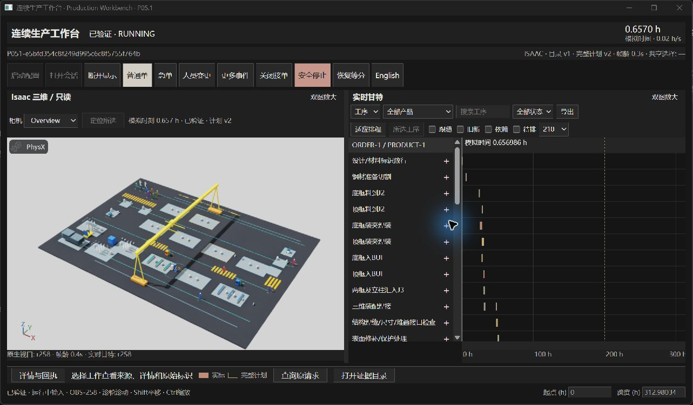
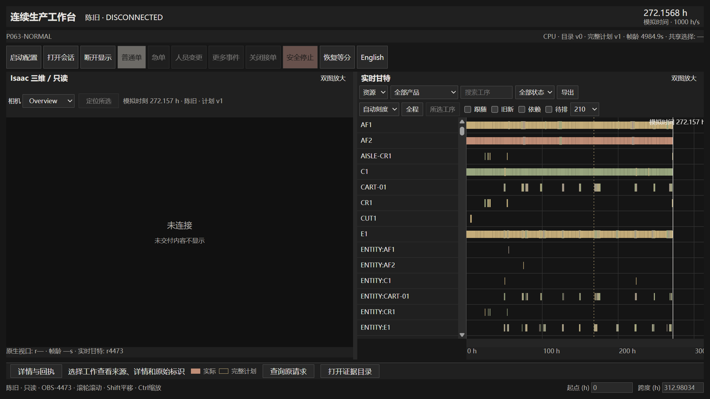
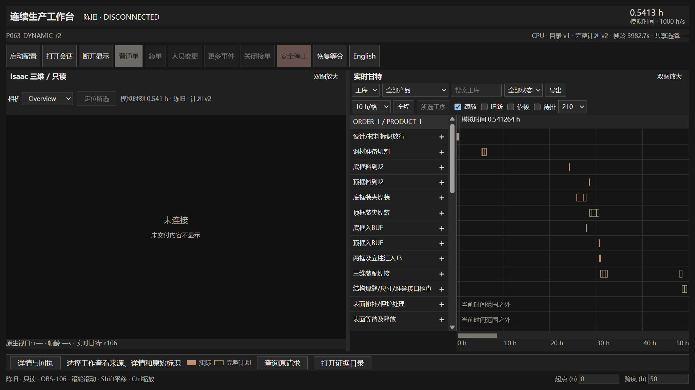
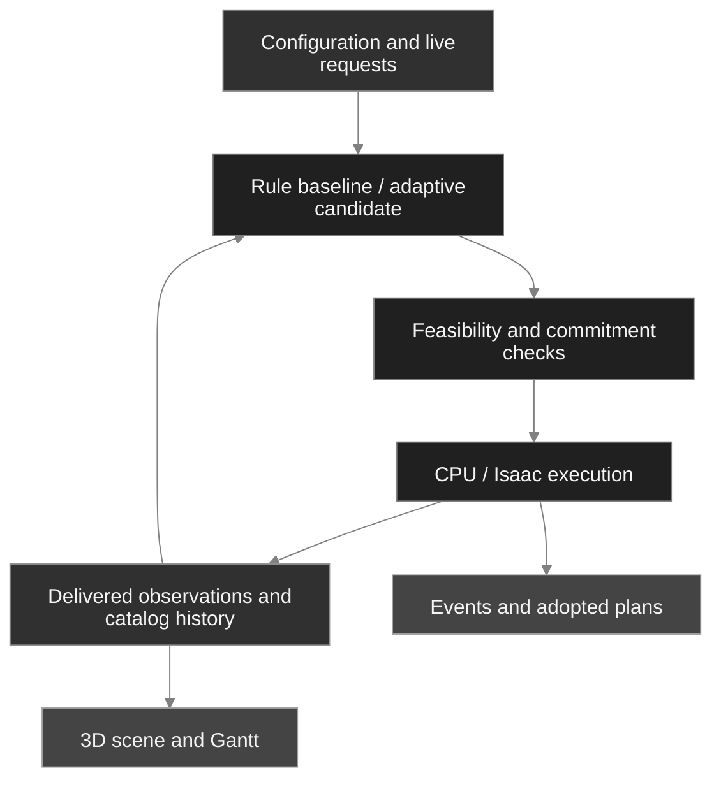
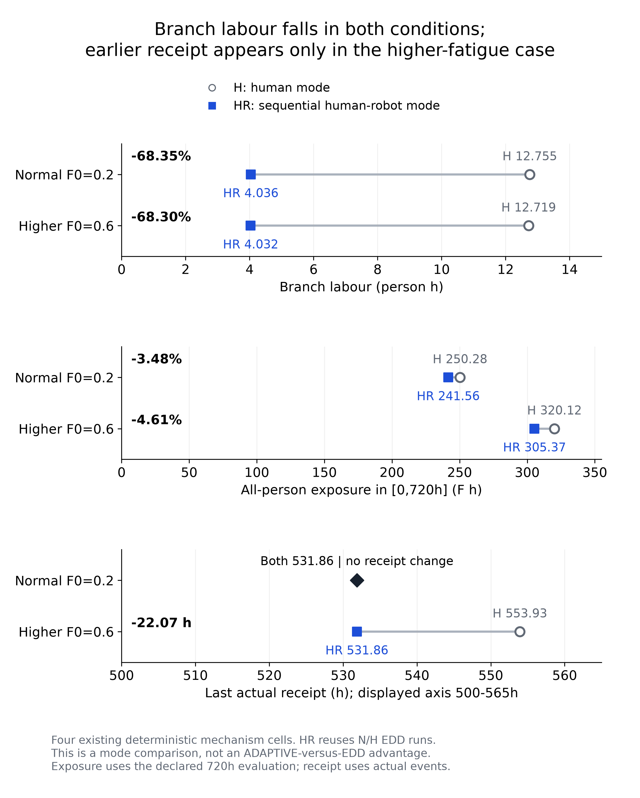
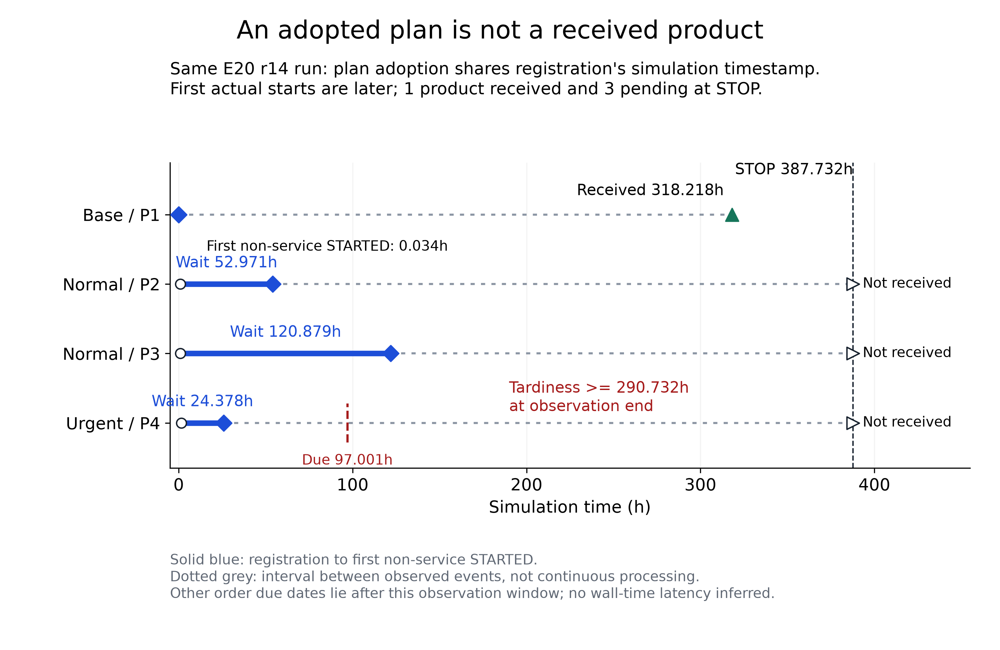
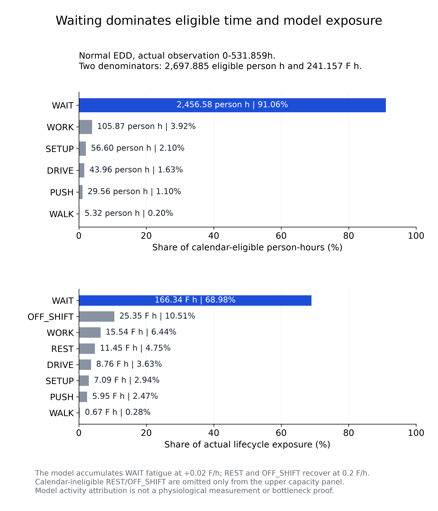
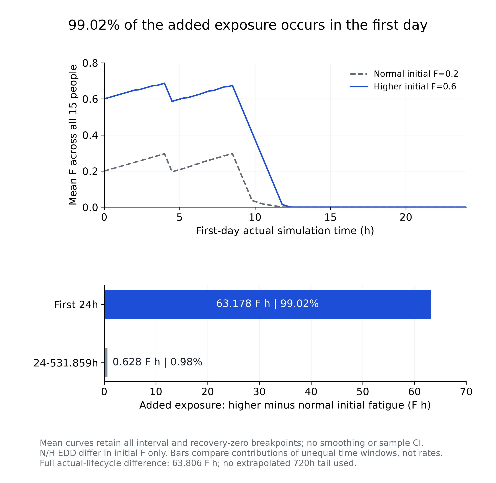
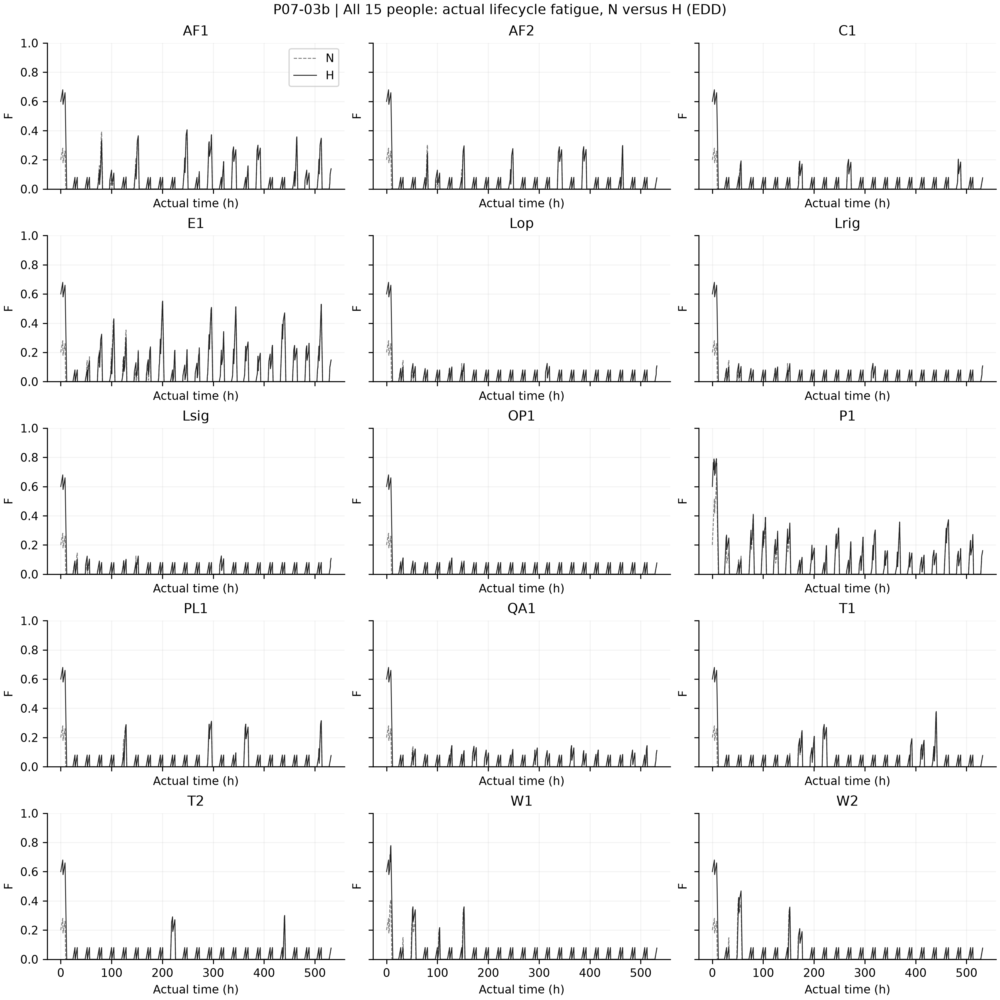
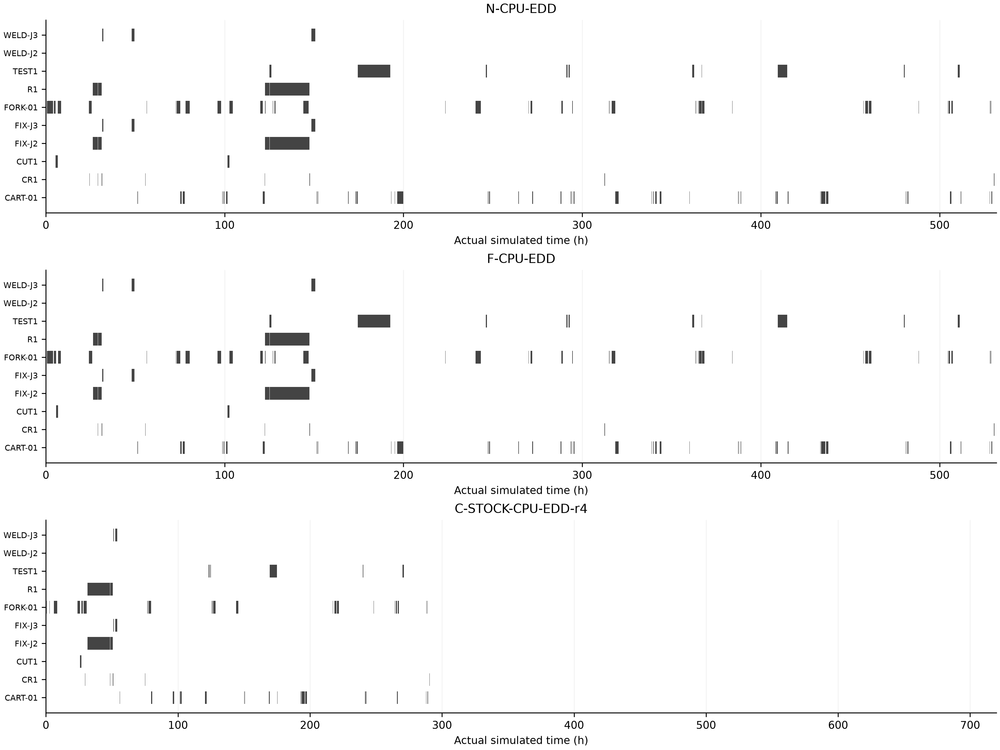

<h1 align="center">Adaptive HRC Scheduling</h1>

<p align="center">
  <a href="README.md">English</a> · <a href="README.zh-CN.md">简体中文</a>
</p>

<p align="center">A human-robot scheduling and simulation workbench for steel Modular Integrated Construction (MiC).</p>

<p align="center">
  <a href="pyproject.toml"></a>
  <a href="LICENSE"></a>
  <a href="https://github.com/delongwangshu49-hub/adaptive-hrc-scheduling/actions/workflows/ci.yml"></a>
</p>

<p align="center"><a href="#quick-start">Quick start</a> · <a href="#architecture">Architecture</a> · <a href="#research-results">Results</a> · <a href="#known-limitations-and-unfinished-work">Known limitations</a> · <a href="#documentation">Documentation</a></p>

Adaptive HRC Scheduling supports **factory production of steel Modular Integrated Construction (MiC)**. It connects module production tasks, worker fatigue, robot collaboration and resource constraints to scheduling, execution simulation and Gantt views. Run reference cases, apply order and workforce changes, and reproduce research results from saved records.

**The first official release, v1.0.1, includes a Windows portable workbench and English/Chinese reports.** The main workflows verified on the build machine are usable; bugs and unknown issues may remain.



An actual archived workbench window. The original image, run identity and capture scope are recorded in [visual provenance](docs/public_validation/visual_provenance.json).

## v1.1.0 prerelease

The W5 update adds verified-plan waiting feedback and call-owned replay preparation. The previous stable v1.0.1 remains below. E12 remains owner-pending and P08 remains incomplete.

[Release and downloads](https://github.com/delongwangshu49-hub/adaptive-hrc-scheduling/releases/tag/v1.1.0) · [Windows x64](https://github.com/delongwangshu49-hub/adaptive-hrc-scheduling/releases/download/v1.1.0/HRC-Workbench-Windows-x64-v1.1.0.zip) · [English report](reports/w5/report-mic-en_w5-candidate-r2.pdf) · [中文报告](reports/w5/report-mic-zh_w5-candidate-r2.pdf) · [Guide](docs/releases/v1.1.0-candidate.md)

## First official release

| Download | Entry point |
| --- | --- |
| Windows x64 portable workbench · 340 MB | [Download ZIP](https://github.com/delongwangshu49-hub/adaptive-hrc-scheduling/releases/download/v1.0.1/HRC-Workbench-Windows-x64.zip) · [User guide](docs/releases/v1.0.1.md) |
| English report · 24 pages | [Read PDF](reports/final/report-mic-en_reviewed.pdf) · [Direct download](https://github.com/delongwangshu49-hub/adaptive-hrc-scheduling/releases/download/v1.0.1/report-mic-en_reviewed.pdf) |
| 中文报告 · 22 页 | [Read PDF](reports/final/report-mic-zh_reviewed.pdf) · [Direct download](https://github.com/delongwangshu49-hub/adaptive-hrc-scheduling/releases/download/v1.0.1/report-mic-zh_reviewed.pdf) |
| Release and integrity | [Release notes](https://github.com/delongwangshu49-hub/adaptive-hrc-scheduling/releases/tag/v1.0.1) · [SHA-256](docs/releases/v1.0.1-SHA256SUMS.txt) |

The portable package includes Python, Qt, the scheduler, the Gantt frontend and a read-only example. CPU mode runs directly; the native 3D viewport connects to a separately installed Isaac Sim. Existing reference cases, research figures and reproducible inputs remain available.

## What you can do

| Workflow | Capabilities |
| --- | --- |
| Model production | Products, operations, qualifications, calendars, fatigue and recovery, equipment, material stock, transport and occupancy |
| Compare schedules | Rule baselines and adaptive candidates under shared feasibility and commitment checks |
| Apply changes | Orders, urgency, cancellation, equipment faults and repair, worker departure and return, with request receipts and catalog history |
| Inspect execution | CPU backend or the optional Isaac workbench, with actual operations and adopted future plans shown separately |
| Reproduce results | Product, worker, resource and cost ledgers with source hashes, independent checks and saved domain exports |

## Quick start

### Windows portable app

1. [Download the ZIP](https://github.com/delongwangshu49-hub/adaptive-hrc-scheduling/releases/download/v1.0.1/HRC-Workbench-Windows-x64.zip), extract it completely and double-click `HRC-Workbench.exe`. Keep the adjacent `app` folder.
2. Use **启动配置 (Launch configuration)** to run the default CPU case, or open the read-only example through **便携设置与示例 (Portable settings and examples)**.
3. Initial scheduling and Gantt verification take time. Finish with **安全停止 (Safe stop)** and wait for the worker to exit. Results default to `%LOCALAPPDATA%\HRCWorkbench\runs`.

Native 3D additionally requires **Isaac Sim 6.1 and PowerShell 7**. Select the Isaac installation root in settings and use a writable ASCII-only results path, such as `C:\HRC\runs`. CPU mode and archives support Chinese paths. See the [portable guide](docs/releases/v1.0.1.md) for complete steps and log locations.

### Reproduce the research examples from source

Start by rebuilding the saved results. This path needs **Python 3.12.13** and **uv 0.12.3**; it does not require a GPU, Isaac Sim or a new production run. Commands below use PowerShell 7.

```powershell
git clone https://github.com/delongwangshu49-hub/adaptive-hrc-scheduling.git
cd adaptive-hrc-scheduling
uv python install 3.12.13
uv venv --python 3.12.13 .local/results-env
uv pip install --python .local/results-env/Scripts/python.exe -r analysis/p07/requirements.txt
& .local/results-env/Scripts/python.exe analysis/p07/presentation.py replay --output .local/results-demo
```

Choose a new output directory. `.local/results-demo` contains the original recomputed statistics and domain exports, nine question-led tables in `presentation/`, and four figures in `figures/`. Input hashes, exposure integrals, worker denominators and presentation data are checked; the replay rejects access to the original private run archives. On Linux/macOS, use `.local/results-env/bin/python` as the environment interpreter.

For a new normal CPU reference run:

```powershell
uv sync --locked --link-mode copy
uv run --locked python scripts/verify_production_chain.py --output .local/new-normal-cpu --backend light --simulation --products 1 --variant SR-W1 --scenario NORMAL --until-h 720
```

This command executes a complete case. Inspect the saved end state, actual product receipts and independent audit together. The [production and reconstruction guide](docs/public_validation/reproduction.md) explains installation, saved-run checks and distribution scope. The core wheel contains the runtime; analysis inputs and figures are supplied in the full source bundle.

### Run the Windows workbench from source

The desktop application uses PySide6 / Qt WebEngine. Rebuild the frontend to match the current sources using the commands below. Configure Isaac Sim separately using the [workbench guide](docs/public_workbench/usage.md).

```powershell
uv sync --locked --project desktop/p051
npm.cmd --prefix desktop/p051/web ci
npm.cmd --prefix desktop/p051/web run build
& ./desktop/p051/.venv/Scripts/python.exe ./scripts/run_p051_workbench.py --help
& ./desktop/p051/.venv/Scripts/python.exe ./scripts/run_p051_workbench.py
```

<details>
<summary>Archived normal production and dynamic order update</summary>



The normal single-product CPU reference completed 436 static operations and received its product.



The dynamic checkpoint preserves the updated catalog and full plan, then stops and saves. A saved checkpoint is distinct from full order completion. Both images retain their original bytes; see [provenance](docs/public_validation/visual_provenance.json).

</details>

## Architecture

The scheduler consumes delivered observations. Catalog history preserves the initial configuration and subsequent versions; execution commands are checked against the version accepted for that command.



The workbench distinguishes actual execution, adopted future plans, unscheduled tasks and unknown states. A display failure does not automatically replay a business request.


Exposure curves retain recovery-to-zero breakpoints. Actual lifecycles and the common evaluation window are reported separately, as are total display rows and full-plan rows.

## Research results

The study uses five fixed scenarios, four existing mechanism cells, dynamic workforce checkpoints and an archived continuous Kit run. These are deterministic cases with distinct run identities and observation windows, not random replicates.

### Strategy outcomes and computational cost

ADAPTIVE and EDD have the same last actual receipt time in all five scenarios. Across scenarios, each method has nine noncancelled received run-products; all nine are late by **123.86 to 363.86 h**.

| Scenario | ΔΣE (F·h) | Recorded wall change | Cached-plan STARTED |
| --- | ---: | ---: | ---: |
| N | 0 | +5.98% | 24 / 2031 (1.18%) |
| H | 0 | +7.82% | 24 / 2036 (1.18%) |
| F | 0 | +7.43% | 21 / 2032 (1.03%) |
| U | −0.001013 | +57.29% | 29 / 2043 (1.42%) |
| C | 0 | +2.19% | 24 / 1066 (2.25%) |

N/H denote normal/higher initial fatigue, F a fault-and-repair case, U an urgent order, and C cancellation. Δ is ADAPTIVE minus EDD over the common 720 h window; U's relative exposure difference is −0.000419%. Wall times are single recorded runs, so they do not establish a causal overhead or a general performance benchmark. Cached-plan shares use all classified STARTED commands as the denominator, not candidate adoption attempts. C retains its original censored end state, and its cancelled product is excluded from delivery comparisons. [Exact values and product lateness](docs/public_results/README.md#策略与交付) (Chinese).

### Collaboration saves branch labour; the delivery effect depends on the case



Sequential human-robot mode (HR) reduces branch labour by about **68%**. Last receipt moves **22.07 h** earlier only with higher initial fatigue; it does not change in the normal-initial-fatigue case. Branch savings therefore do not translate proportionally into whole-order acceleration.

All-person exposure here uses the common 720 h evaluation window, including the derived recovery tail after the actual lifecycle. Receipt times are actual events. The two HR cells reuse the N/H EDD runs; these are mode contrasts, not evidence of an ADAPTIVE advantage or additional independent samples.

### An adopted plan still has to reach execution and receipt



In the same E20 r14 run, the two normal additions wait **52.97 / 120.88 h** from registration to their first non-service STARTED command; the urgent product waits **24.38 h**. At STOP, only P1 has been received. Urgent P4 remains unreceived, with a tardiness lower bound of **290.73 h**.

Plan adoption shares registration's simulation timestamp; that does not measure wall-clock response latency. First non-service STARTED may include transport. Dotted lines connect observed events rather than continuous processing. [Product events and censoring](docs/public_results/README.md#订单响应) (Chinese).

### Waiting and initial fatigue explain different parts of exposure



Within the normal EDD actual lifecycle, WAIT accounts for **91.06%** of calendar-eligible person-hours and **68.98%** of model exposure. The model accumulates WAIT fatigue at +0.02 F/h and recovers at 0.2 F/h in REST/OFF_SHIFT. These shares motivate inspecting waiting arrangements and model assumptions; they do not by themselves establish a production bottleneck or measured physiological burden. The exposure denominator includes actual recovery phases.



The N/H EDD configurations differ only in initial F, from 0.2 to 0.6. Added exposure over the actual lifecycle is **63.81 F·h**, with **99.02%** occurring in the first 24 h. All interval and recovery-zero breakpoints are retained, and mean-curve area multiplied by 15 matches the worker-level integral. The two contribution windows have unequal lengths; the bars show exposure amounts, not rates. [Activity and window ledgers](docs/public_results/README.md#人员时间与暴露) (Chinese).

### Workforce changes and cancellation need explicit denominators

| Question | Recorded quantities | Interpretation |
| --- | --- | --- |
| How much worker time is available? | In the CPU checkpoint, W1 has 0.2597 h presence and availability; ordinary workers have 6.1990 / 5.6990 h | Availability intersects presence, calendar, qualification validity and worker state. It is distinct from unoccupied time. The 13 equal-denominator workers are grouped together. |
| What was already spent before cancellation? | Per run: 28 returned lots, STEEL 3.318 t, 0.7473 person-hours and 96.10 m transport | Empty return of 61.30 m is included in transport. Monetary cost remains unknown where policy parameters are missing. |

The original C run remains censored at 720 h. The time to the last recorded cancelled command does not establish exact cleanup duration. [Grouped workforce and cancellation accounts](docs/public_results/README.md#图表与数据) (Chinese).

<details>
<summary>Full worker trajectories and resource ownership records</summary>



The complete worker view supports checks beyond the aggregate first-day curve. Recovery-to-zero breakpoints and the original actual lifecycle are preserved.



Ownership intervals show when resources were held, including resources with no holding interval in a case. They do not measure continuous processing or establish bottleneck causality. [Metric definitions](docs/metrics/p07_metrics_definition_r3.md) (Chinese).

</details>

## Known limitations and unfinished work

Initial planning, replanning and Gantt verification remain slow, and waiting feedback needs improvement. Live performance targets, some dynamic completion paths and WIP cancellation remain incomplete. Manual REST is unavailable; testing on other machines, long runs and owner-operated acceptance remain pending. This version supports simulation research.

Established solutions are being evaluated and follow-up improvements are being planned. See the [release notes](docs/releases/v1.0.1.md#known-issues-and-validation-scope) for details and operating conditions. Please report bugs with reproduction steps through [Issues](https://github.com/delongwangshu49-hub/adaptive-hrc-scheduling/issues).

## Development and validation

Run the same CPU entry point used by CI:

```powershell
uv run --locked --no-cache --no-editable --reinstall-package adaptive-hrc-scheduling python scripts/check.py
```

Run the P07 checks separately:

```powershell
uv run --locked python -m unittest discover -s tests -p 'test_p07*.py' -v
```

The existing G07 release, `step-P07-r3`, passed 1276 checks in each of four Ubuntu/Windows source and isolated-wheel CI rounds. Portable packaging separately passed 23 frontend and 41 targeted Python checks, plus local CPU, archive and external Kit verification. See the badge and [Actions](https://github.com/delongwangshu49-hub/adaptive-hrc-scheduling/actions/workflows/ci.yml) for CI associated with the current release commit, and the [release notes](docs/releases/v1.0.1.md) for packaging validation scope.

```text
src/adaptive_hrc_scheduling/   Production model, contracts, scheduling and execution
scripts/                     Production, audit and desktop entry points
desktop/p051/                Qt / React workbench
sim/                         Isaac scene and readback adapters
analysis/p07/                Offline analysis, validation and figures
examples/reproduction/        Configurations and derived replay measurements
docs/                        Guides, model definitions and evidence
```

Report issues with the version, reproduction steps, actual end state and relevant logs. Contributions should preserve existing assertions, failure records and evidence scope. Use [GitHub Issues](https://github.com/delongwangshu49-hub/adaptive-hrc-scheduling/issues) to discuss changes.

## Documentation

Reports and release guides are available in English and Simplified Chinese. Detailed research evidence retains its original Chinese records.

| Topic | Guide |
| --- | --- |
| Official release and reports | [Portable guide](docs/releases/v1.0.1.md) · [English PDF](reports/final/report-mic-en_reviewed.pdf) · [中文 PDF](reports/final/report-mic-zh_reviewed.pdf) |
| Setup and CPU execution | [Environment setup](docs/setup.md) · [Production and saved-run reconstruction](docs/public_validation/reproduction.md) |
| Desktop interaction | [Workbench usage](docs/public_workbench/usage.md) · [Interaction cases](docs/public_workbench/interaction_cases.tsv) |
| Model and contracts | [Production specification](docs/model/specification.md) · [Dynamic backend](docs/public_backend/README.md) · [Shared interaction contract](docs/public_delivery_r2/interaction_contract_r3.md) |
| Research evidence | [Results and replay guide](docs/public_results/README.md) · [Metric definitions](docs/metrics/p07_metrics_definition_r3.md) · [Public input manifest](examples/reproduction/p07/r3/manifest.json) |
| Scope and provenance | [Current status](docs/public_results/status.md) · [Evidence summary](docs/public_validation/evidence_summary.json) · [Visual sources](docs/public_validation/visual_provenance.json) |

## License

Project code is available under the [MIT License](LICENSE). Bundled third-party runtimes retain their respective [component licenses](desktop/p051/portable/THIRD-PARTY.md). Model assumptions, image sources and data scope are documented with their respective evidence.


## W5 local integration candidate

**v1.1.0 prerelease.** The v1.1.0 prerelease integrates verified-plan waiting feedback and call-owned replay preparation. It preserves the previous verified Gantt during replanning, binds promotion to the current task, and keeps safe STOP and independent verification. Set `P051_PREVIEW_REUSE=0` for the full Python preparation path; `P051_WAIT_FEEDBACK=0` hides the added feedback. The published v1.0.1 remains available above.

The historical W3 four-pair CPU result (17.33% shorter submit-to-verified projection and 26.50% less net replay) belongs to the earlier isolated candidate. W5 has functional and packaging checks, with no new four-pair or industrial performance qualification. See the [candidate guide](docs/releases/v1.1.0-candidate.md) and [validation summary](docs/validation/W5_integration_r1.md). E12 remains owner-pending and P08 remains incomplete.
