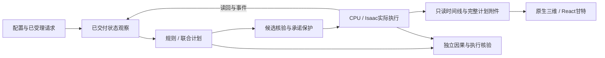

<div align="center">

# Adaptive HRC Scheduling

**面向模块化建筑工厂的人机协作自适应调度研究**

联合选择协作模式、任务顺序与资源安排，
在 CPU 与 Isaac Sim 中执行，并独立核对决策、状态和实际读回。

[](https://github.com/delongwangshu49-hub/adaptive-hrc-scheduling/actions/workflows/ci.yml)
[](pyproject.toml)
[](LICENSE)
[](docs/model/S18_simulation_scope_proposal_r1.md)

[概览](#overview) · [当前阶段](#status) · [快速开始](#quickstart) · [工作原理](#architecture) · [验证与边界](#validation) · [文档导航](#docs)

</div>

<a id="overview"></a>

## 项目概览

本项目研究建筑模块制造中的自适应人机协同调度，覆盖结构、MEP、内装、质量放行与外部接收。任务前序、人员资格与疲劳、设备、物料、空间和在制占用进入同一合法域；调度器依据已交付观察调整未执行安排，保留在制段、承诺、载荷和人员历史。

Windows 工作台采用原生 Isaac 视口与 React/WebEngine 甘特及表单相邻承载，运行中可提交新订单和人员变更。模型、执行、界面、研究结果及负责人操作分别验收。成果属于 **S18-SIM-A1 仿真研究域**，工业 G2 仍为 OPEN。

<a id="status"></a>

## 当前阶段

**本阶段包覆盖 P05.0–P05.3：工作台、完整计划与实时甘特、限定连续生产证据、19 格研究覆盖及审阅后的有限修复。** P05 已完成本地限定范围验收，G05 的提交、标签与 CPU CI 分别核对。P06、正式统计图表及 P08/P09 最终联合验收不由阶段发布替代。

| 范围 | 已有交付 | 保持的边界 |
| --- | --- | --- |
| P00–P04 | 模型、契约、动态订单/人员、持续会话与投影后端；历史阶段已发布 | 历史结果保留原版本与用途 |
| P05.0 | B 混合路线与克制黑灰风格获得实际预审批准 | 设计批准不等于每项操作已实现 |
| P05.1 | 同权双图、完整计划、实际/当前/旧计划区分、双语表单、资源甘特与安全停止 | 已审尺寸采用左右等外面板；手动 REST 未实现 |
| P05.2 | 真新普通单/急单、W2 离岗和 W3 到岗派工的实际 Kit 前缀；另有派生完成性及容量证据 | 原同 Kit 全部接收仍 **NOT_MET**，不同运行不拼接 |
| P05.3 | 五情景 CPU 覆盖、历史/局部 Kit 见证与四机制，共 19 格；16 份独立检查 | C 正向范围为 STOCK；WIP 剩余完成未建立 |
| P06–P09 | 后续独立复现、统计报告及负责人操作/最终验收 | 本阶段包不预记通过 |

[P05 摘要](docs/public_workbench/README.md)、[19 格覆盖](docs/public_workbench/coverage.tsv)、[交互案例](docs/public_workbench/interaction_cases.tsv)和[结构化证据](docs/public_workbench/evidence_summary.json)是当前公开入口。完整原始轨迹、受限资料和大日志在受控本地保留。

## 能力与成熟度

| 能力 | 当前受测范围 |
| --- | --- |
| 规则与联合调度 | 共用合法域、执行/因果检查、预算和回退；保留相同、较差与失败结果 |
| CPU / Isaac 闭环 | 命令、事件、读回、观察和决定有身份绑定；完整历史链与新局部前缀分列 |
| 完整计划与甘特 | 完整计划先覆盖已知订单；实际填充、当前轮廓、旧版和阻塞状态分开 |
| 运行中业务 | 新普通单/急单和具名人员变更使用共享契约；受理、生效、执行与接收分开 |
| 只读显示与失效处理 | 稳定工作颜色、筛选/导出、陈旧禁写、断连和安全关闭 |
| 性能与人工验收 | 有界负载、尺寸/DPR及原生取证；持续 4Hz 和 P08 负责人操作未建立 |

当前获准布局在已审尺寸下默认横排、左右外面板等宽、名称栏独立，支持分隔拖动、对称放大与恢复等分。这已替代早期“所有尺寸绘图区严格1:1、窄屏上下”的设计规则；未测系统 DPI 不作保证。首页保持文字和架构图，没有自动恢复旧截图或加入新效果图。

<a id="quickstart"></a>

## 快速开始

CPU 路径不需要 Isaac Sim 或 GPU。项目固定 Python **3.12.13**、uv **0.12.3**；Windows 开发命令使用 **PowerShell 7**。

```powershell
git clone https://github.com/delongwangshu49-hub/adaptive-hrc-scheduling.git
cd adaptive-hrc-scheduling
uv python install 3.12.13
uv sync --locked --link-mode copy
uv run --locked python -I -m adaptive_hrc_scheduling
```

安装入口输出包元数据；生产工具和桌面入口需要完整源码仓库。[环境隔离](docs/setup.md)说明 CPU、桌面与 Kit 的独立依赖。

### CPU 正常生产

```powershell
uv run --locked python scripts/verify_production_chain.py --output .local/new-normal-cpu --backend light --simulation --products 1 --variant SR-W1 --scenario NORMAL --until-h 720
```

这是已有正常单件入口，需新输出目录。查看 report、事件/决定、双审计和真实退出；局部检查点不等于订单完成，该命令也不代表全部 P05 成对研究。

### P05 Windows 工作台

```powershell
uv sync --locked --project desktop/p051
& ./desktop/p051/.venv/Scripts/python.exe ./scripts/run_p051_workbench.py --help
& ./desktop/p051/.venv/Scripts/python.exe ./scripts/run_p051_workbench.py
```

发布树含受测 Web 构建资产。当前原生 Kit 启动适配沿用受测 Windows 环境，默认安装位置为 D:/Dev/tools/isaac-sim-6.1；其他安装布局需适配。CPU CI 不证明其他环境的原生桌面可用。[工作台指南](docs/public_workbench/usage.md)提供操作与重建说明。

### CPU 检查

```powershell
uv run --locked --no-cache --no-editable --reinstall-package adaptive-hrc-scheduling python scripts/check.py
```

共享检查包含锁、Ruff/格式、源码测试、构建，以及全新隔离 wheel 环境中的测试和依赖核对。GitHub Ubuntu/Windows 作业上限为 **120 分钟**，完整检查命令不缩减。上次约42–52分钟的双轮耗时仅作历史参考；本次结果须绑定具体提交和 Actions 运行。

<a id="architecture"></a>

## 工作原理



固定研究与交互来源分开。动态目录保留 C0 和版本历史，旧命令按接纳版本核验。显示消费已交付事实，未来计划、实际与陈旧/未知状态分开；显示故障不自动重启业务或重放请求。

```text
src/adaptive_hrc_scheduling/   领域、契约、计划、执行及投影
scripts/                       运行、审计与桌面入口
desktop/p051/                 P05 Qt / React工作台及受测Web资产
desktop/s19b/                 原生宿主和历史工作台
sim/                           Isaac场景与读回适配
docs/public_workbench/        P05公开摘要、覆盖与使用说明
tools/p053_auxiliary/         辅助取证修复源与隔离检查
```

<a id="validation"></a>

## 验证与边界

| 证据 | 结论及用途 |
| --- | --- |
| P05.1 实现及有限修复 | 计划/实际绑定、双语、窗口、投影和局部 Kit 见证；不替代负责人验收 |
| P05.2 限定收口 | r14 真实前缀、r9 派生完成性与 E21 独立容量分项接受；原 E20 全链 NOT_MET 保持 |
| P05.3 覆盖 | 19 格按声明用途满足；16 份独立检查为8份 Session、8份执行/因果，检查集合不同 |
| 四个新 Kit 见证 | F/U/H/C 四个新鲜局部前缀共一个真实 exit0；外层约510秒，非整单或新 GUI 验收 |
| 取消 | STOCK 剩余 PRODUCT-2 接收；两次 WIP/J3 HOLD 及首 N/U 失败保留 |
| 有限修复 | 异常取证校验当前行和实际配置，8项隔离 CPU 检查通过；失败索引修正，r5 未启动新 Kit |

[证据摘要](docs/public_workbench/evidence_summary.json)和[失败与修复](docs/public_workbench/failures_and_repairs.md)说明数值、身份及可获得性。新源码双平台/隔离 wheel CI 以当前提交的 [Actions](https://github.com/delongwangshu49-hub/adaptive-hrc-scheduling/actions/workflows/ci.yml) 为准，不把历史测试数写成新提交结果。

手动 REST_REQUEST 未实现；持续4Hz、任意规模/系统DPI、同Kit全单完成及P08负责人操作不在已成立结论内。USD运动学读回不等于工业动力学或安全认证，正式方法优势和最终联合验收尚未建立。公开摘要不表示完整原始轨迹已公开。

<a id="docs"></a>

## 文档导航

| 内容 | 入口 |
| --- | --- |
| 当前范围与设计批准 | [P05摘要](docs/public_workbench/README.md) · [设计与批准](docs/public_workbench/design_and_approval.md) |
| 使用与构建 | [工作台指南](docs/public_workbench/usage.md) · [环境隔离](docs/setup.md) |
| 覆盖与交互 | [19格](docs/public_workbench/coverage.tsv) · [24案例](docs/public_workbench/interaction_cases.tsv) · [UI能力](docs/public_workbench/ui_capabilities.tsv) |
| 证据与失败 | [结构化摘要](docs/public_workbench/evidence_summary.json) · [失败/修复](docs/public_workbench/failures_and_repairs.md) |
| 已发布后端与契约 | [P04后端](docs/public_backend/README.md) · [P03契约](docs/public_delivery_r2/interaction_contract_r3.md) |
| 模型与研究边界 | [生产规范](docs/model/specification.md) · [仿真范围](docs/model/S18_simulation_scope_proposal_r1.md) · [工业G2](docs/research/S18_industrial_g2_evidence_r1.md) |

## 贡献与许可

通过 [Issues](https://github.com/delongwangshu49-hub/adaptive-hrc-scheduling/issues)提供版本、复现步骤、预期/实际结果与脱敏错误摘要。AI辅助开发和自动化验证不替代负责人操作或最终验收。

自有代码采用 [MIT License](LICENSE)。第三方软件和资产按各自许可，来源见[资产登记](docs/sim/asset_register.tsv)。阶段包绑定具体提交与标签，保留历史版本及失败，不代表项目最终冻结。
