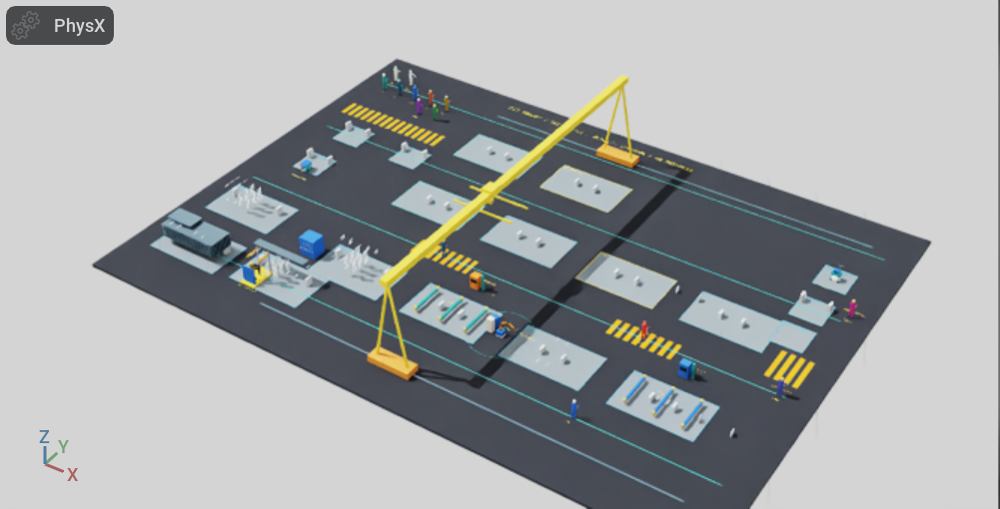
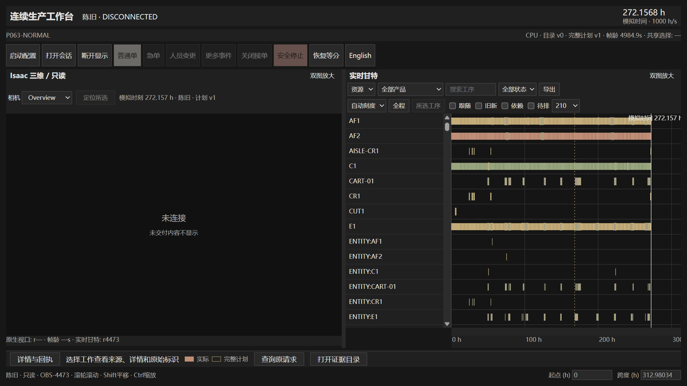
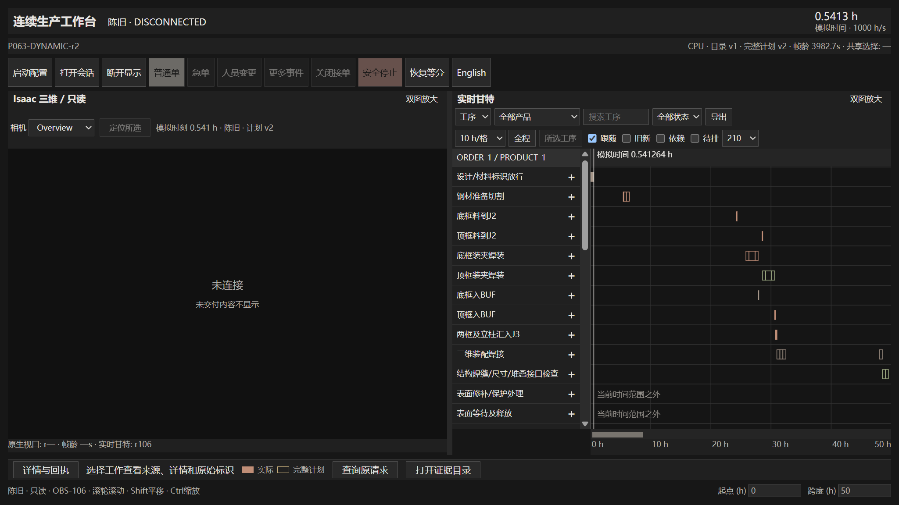
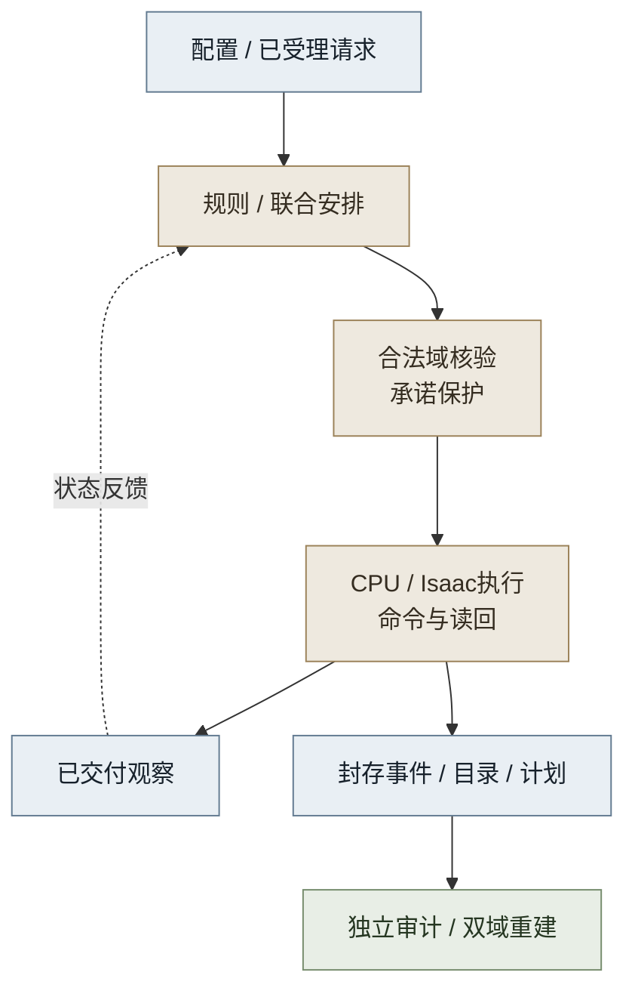
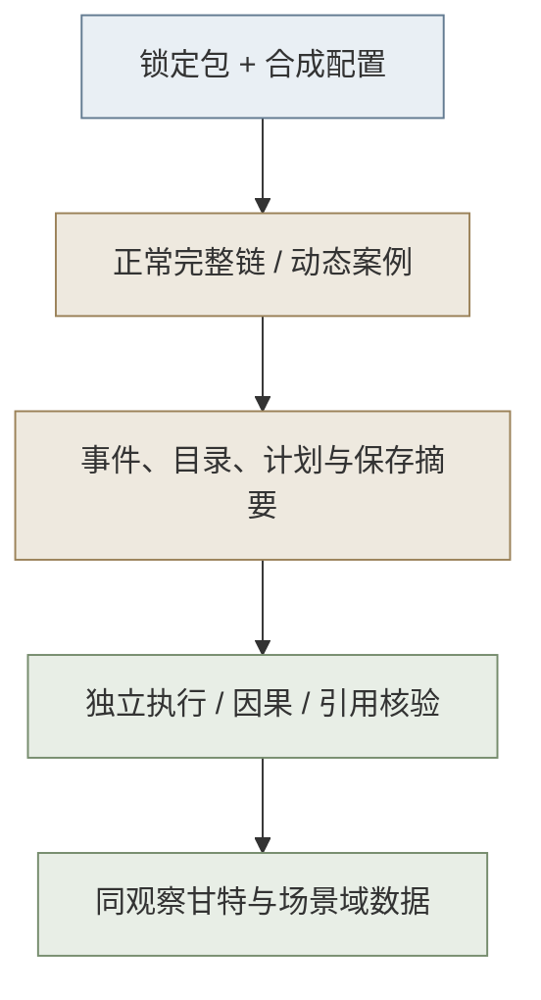

<div align="center">


# Adaptive HRC Scheduling

**面向模块化建筑工厂的人机协作自适应调度研究**

联合选择协作模式、任务顺序和资源安排，在 CPU / Isaac Sim 中执行，保存可独立核验的决策与读回。

[](https://github.com/delongwangshu49-hub/adaptive-hrc-scheduling/actions/workflows/ci.yml) [](pyproject.toml) [](LICENSE) [](docs/model/S18_simulation_scope_proposal_r1.md)

[项目概览](#overview) · [运行画面](#showcase) · [快速开始](#quickstart) · [工作原理](#architecture) · [验证与边界](#validation) · [文档](#docs)

</div>

<a id="overview"></a>

## 把生产约束、协作安排和执行证据接起来

模块制造中的安排需要同时满足前序、人员资格与疲劳、设备、物料、空间和在制占用。本项目将这些约束放入统一合法域，根据已交付的状态观察，调整尚未执行的任务、协作模式和资源安排，并保留在制段、承诺、载荷与人员历史。

- **生产模型：** 结构、MEP、内装、质量放行与外部接收，共享人员、设备、材料和空间约束。
- **自适应闭环：** 规则与联合安排共用合法域、预算和回退，动态订单及人员变更经同一会话契约受理。
- **可复核证据：** 命令、事件、读回、目录和计划绑定身份与摘要，保存后独立重建实际轨迹及显示数据。

Windows 工作台将原生 Isaac 视口与 React/WebEngine 甘特相邻承载，提供普通单、急单、人员变更、只读重建和安全停止入口。模型、执行、界面与负责人操作分别验收，当前成果属于 **S18-SIM-A1 仿真研究域**。

<a id="showcase"></a>

## 运行画面

### 原生工厂场景



*最终常规入口 Kit 的原生捕获：计划 v2、状态 revision 329、模拟时刻 0.850075 h。该运行以 STOPPED/COMPLETE 保存，实际原生退出 0；仍有 29 项义务、1 件未接收。此图展示局部场景，不代表整单完成。*

### 完整 CPU 链的资源甘特



*真实 Qt/Web 归档重建：`P063-NORMAL` 实际接收 1/1，436 项有效静态工序完成，终点 272.156822 h。归档保留“陈旧/只读”，左侧原生面板保持未连接。它与上方 Kit 图来自不同运行和采样，不是同步合成帧。*

<details>
<summary>查看动态变更案例与图像来源</summary>



`P063-DYNAMIC-r2` 中一次 ORDER_UPDATE 获得同 ID 的 ACCEPTED/APPLIED，目录 v1 / 完整计划 v2，随后按原 STOP 保存。该局部案例与正常完整链分别评价。三张 PNG 均为原始证据的逐字节副本；来源、摘要和采样范围见[图像来源](docs/public_validation/visual_provenance.json)。

</details>

<a id="quickstart"></a>

## 快速开始

CPU 路径不需要 Isaac Sim 或 GPU。固定使用 **Python 3.12.13**、**uv 0.12.3**；Windows 命令使用 **PowerShell 7**。

```powershell
git clone https://github.com/delongwangshu49-hub/adaptive-hrc-scheduling.git
cd adaptive-hrc-scheduling
uv python install 3.12.13
uv sync --locked --link-mode copy
uv run --locked python -I -m adaptive_hrc_scheduling
```

最后一条命令输出包元数据。生产工具、复现脚本和桌面入口使用完整源码仓库；核心 wheel 与桌面/Isaac 依赖分别安装。

### 选择一条运行路径

| 目标 | 入口 | 输出与范围 |
| --- | --- | --- |
| 执行正常单件 CPU 生产 | 下方正常生产命令 | report、事件、决定、执行/因果审计；以真实接收和终态判断完成 |
| 复现最终安装包与保存件 | [安装、执行与重建指南](docs/public_validation/reproduction.md) | 干净安装、正常完整链、动态案例、计划引用与双域投影核验 |
| 使用 Windows 双图工作台 | 下方桌面命令及[工作台指南](docs/public_workbench/usage.md) | Qt/WebEngine 与原生 Kit；已审环境的交互路径 |
| 核验开发改动 | [完整共享检查](#checks) | 锁、格式、源码测试、构建、隔离 wheel 测试和依赖核对 |

```powershell
uv run --locked python scripts/verify_production_chain.py --output .local/new-normal-cpu --backend light --simulation --products 1 --variant SR-W1 --scenario NORMAL --until-h 720
```

输出目录须尚不存在。观察 report、实际接收、双审计与真实退出；局部检查点不等于整单完成。

### Windows 工作台

```powershell
uv sync --locked --project desktop/p051
& ./desktop/p051/.venv/Scripts/python.exe ./scripts/run_p051_workbench.py --help
& ./desktop/p051/.venv/Scripts/python.exe ./scripts/run_p051_workbench.py
```

仓库包含受测 Web 构建文件。Kit 启动适配沿用已审 Windows 环境和默认安装位置 `D:/Dev/tools/isaac-sim-6.1`；其他安装布局需适配。普通/急单和人员变更先预览、确认，再经共享契约提交；受理、生效、执行和接收分别记录。

<a id="architecture"></a>

## 工作原理



固定研究与交互来源分开。动态目录保留 C0 和版本历史，旧命令按接纳版本核验；未来计划、实际执行、旧版/阻塞与未知状态分别呈现。显示故障不自动重启业务或重放请求，归档读取不刷新生产者源龄。

### 从执行记录到可复现结果



重建要求相同证据恢复相同目录、事件与业务显示数据；精确颜色/W编号外观还需显式保存的显示缓存。完整预测计划的未来区间与实际派发、实际完成分别绑定。重新运行时的墙钟和搜索结果不要求逐字节相同。

<a id="validation"></a>

## 验证与当前范围

| 证据 | 已成立事实 | 使用范围 |
| --- | --- | --- |
| 正常完整 CPU 链 | 436/436 有效静态工序、实际接收 1/1；COMPLETED/COMPLETE；1023 次实际开始/完成 | 最终核心包的完整单产品 SR-W1 合成案例 |
| 动态变更与保存 | ORDER_UPDATE 同 ID 接纳/应用，目录 v1 / 完整计划 v2；原三组档案 2332 个计划引用绑定 | 动态案例和局部 Kit 的 STOPPED 不替代完整链 |
| 独立审阅及有限修复 | 完整候选/实际采用、终态禁写、真实退出和交付计划引用分别核验；保留全部原失败 | 按各修复的明确范围关闭，不等同于零遗留 |
| 本地发布候选 | 原完整共享入口退出 0；源码与隔离 wheel 各 1251 项；前端 23 项、辅助 8 项 | 保留 G05 全部 1209 项身份；历史私有 1281 项集合单列 |
| 原生与负责人验收 | 已审环境的 Qt/Kit/窗口及局部真实读回 | CPU CI 不替代原生硬件或 P08 负责人操作 |

[结构化证据](docs/public_validation/evidence_summary.json)、[本地验证回执](docs/public_validation/validation_summary.json)、[失败与修复](docs/public_validation/failures_and_repairs.md)及[来源摘要](docs/public_validation/provenance.json)提供具体范围。当前提交的 Ubuntu / Windows CPU CI 以 [Actions](https://github.com/delongwangshu49-hub/adaptive-hrc-scheduling/actions/workflows/ci.yml) 为准；顶部徽章跟随 main，不把历史 CI 写成本次提交结果。

### 保留的边界

- **性能：** 源龄 2 秒 NOT_MET，持续 4 Hz 未建立，稳段不足，10/s 与 50/s 资格未得。
- **连续生产与人工：** E20 原同 Kit 全接收、WIP/J3 HOLD 剩余完成、手动 REST 和 P08 负责人操作仍保留原未达/待办状态。
- **原生与研究：** 历史 621.01 K01 根因 OPEN，工业 G2 OPEN；USD 运动学读回不等于工业动力学或安全认证。正式方法优势和最终联合验收尚未建立。
- **工具链：** 锁定 Vite 8.0.0 的 npm 审计仍有高等级告警，见[工具链审计](docs/public_validation/toolchain_advisories.md)；本包使用静态构建文件，未自动升级该依赖。

<a id="status"></a>

<details>
<summary>查看阶段状态与历史成果</summary>

| 范围 | 当前状态 |
| --- | --- |
| P00–P04 | 需求/模型/契约、动态订单与人员、持续会话与投影后端，按原版本保留 |
| P05 | 工作台、完整计划与实时甘特、限定连续生产及19格研究覆盖，见[P05历史摘要](docs/public_workbench/README.md) |
| P06.1 | 动态独立核验本地完成；原R1/R2限定关闭 |
| P06.2 | 负责人批准的有限功能范围完成；原性能目标未全部达到 |
| P06.3 | 正常完整CPU链、动态复现及保存重建本地完成；P063-R1按引用/显示绑定范围关闭 |
| P07–P09 | 统计、负责人操作和最终验收按后续实际授权推进，本包不预记通过 |

原始大轨迹、受限资料和私有治理保留在受控本地；公开入口提供可获得的合成输入、生成工具、摘要和身份绑定。

</details>

<a id="checks"></a>

## 开发与完整检查

```powershell
uv run --locked --no-cache --no-editable --reinstall-package adaptive-hrc-scheduling python scripts/check.py
```

共享入口包含锁、Ruff/格式、源码测试、构建，以及全新隔离 wheel 环境中的完整测试和依赖核对。GitHub Ubuntu/Windows 每作业上限为120分钟；检查命令和断言不缩减。前端构建使用独立的 `desktop/p051/web` 锁文件，说明见[工作台指南](docs/public_workbench/usage.md)。

```text
src/adaptive_hrc_scheduling/   领域、契约、计划、执行与投影
scripts/                     生产、独立审计、复现与桌面入口
desktop/p051/                Qt / React 工作台及受测 Web 资产
sim/                         Isaac 场景与读回适配
examples/reproduction/        公开合成配置与预算输入
tests/                       CPU 检查与可分发夹具
docs/public_validation/       P06证据、复现、限制与来源
```

<a id="docs"></a>

## 文档导航

| 想了解什么 | 从这里开始 |
| --- | --- |
| 当前能力、数字与限制 | [P06概览](docs/public_validation/README.md) · [结构化证据](docs/public_validation/evidence_summary.json) |
| 安装包、执行与保存重建 | [复现指南](docs/public_validation/reproduction.md) · [环境隔离](docs/setup.md) |
| 工作台与交互 | [操作与构建](docs/public_workbench/usage.md) · [24案例](docs/public_workbench/interaction_cases.tsv) · [UI能力](docs/public_workbench/ui_capabilities.tsv) |
| 模型与闭环 | [生产规范](docs/model/specification.md) · [动态后端](docs/public_backend/README.md) · [共享契约](docs/public_delivery_r2/interaction_contract_r3.md) |
| 失败、修复与图像来源 | [修复索引](docs/public_validation/failures_and_repairs.md) · [图像身份](docs/public_validation/visual_provenance.json) |
| 历史研究与设计 | [P05研究覆盖](docs/public_workbench/coverage.tsv) · [设计及批准](docs/public_workbench/design_and_approval.md) · [仿真范围](docs/model/S18_simulation_scope_proposal_r1.md) |

## 贡献与许可

欢迎通过 [Issues](https://github.com/delongwangshu49-hub/adaptive-hrc-scheduling/issues)提交可复现问题：版本、命令、预期/实际结果和脱敏证据有助于定位。AI辅助开发和自动化验证与负责人实际操作分别记录。

自有代码采用 [MIT License](LICENSE)。第三方软件与资产按各自条款使用，来源见[资产登记](docs/sim/asset_register.tsv)。阶段提交与标签保留历史版本及失败，最终联合验收另行进行。
