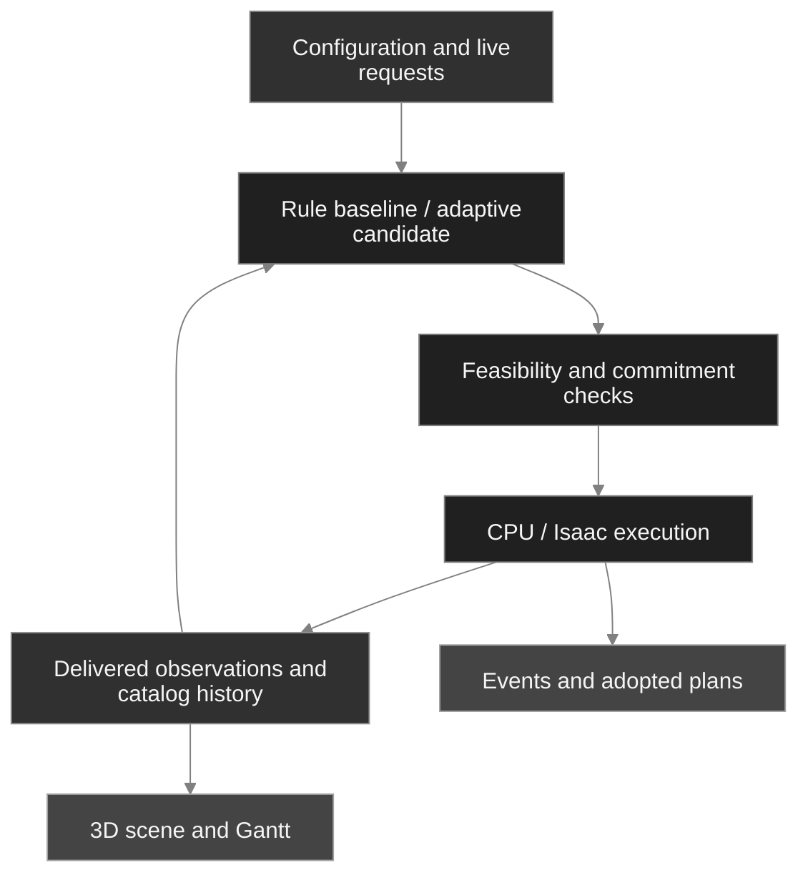

<h1 align="center">Adaptive HRC Scheduling</h1>

<p align="center">
  <a href="README.md">English</a> · <a href="README.zh-CN.md">简体中文</a>
</p>

<p align="center">Dynamic human-robot collaborative scheduling for modular building production.</p>

<p align="center">
  <a href="pyproject.toml"></a>
  <a href="LICENSE"></a>
  <a href="https://github.com/delongwangshu49-hub/adaptive-hrc-scheduling/actions/workflows/ci.yml"></a>
</p>

<p align="center"><a href="#quick-start">Quick start</a> · <a href="#architecture">Architecture</a> · <a href="#research-results">Results</a> · <a href="#known-limitations-and-unfinished-work">Known limitations</a> · <a href="#documentation">Documentation</a></p>

Adaptive HRC Scheduling is a research prototype for production planning, execution feedback and reproducible analysis. It models task precedence, worker qualifications and fatigue, collaboration modes, equipment, materials, transport and space constraints in one production system.


An actual archived workbench window. The original image, run identity and capture scope are recorded in [visual provenance](docs/public_validation/visual_provenance.json).

## Project status

The current application domain is **S18-SIM-A1 simulation research**. The CPU workflow and the optional Windows / Isaac workbench have separate environments.

| Area | What the evidence establishes | Remaining scope |
| --- | --- | --- |
| Normal CPU reference | 436 static operations completed; 1/1 product received | One complete reference case |
| Continuous dynamic Kit case | 1 product received and 3 unreceived at the 387.732 h observation end | Full dynamic completion remains unproven |
| Live delivery performance | Functional display and request paths were exercised | 2 s source-age target unmet; sustained 4 Hz unestablished; 10/s and 50/s load qualification insufficient |
| Desktop milestone | An owner-approved, limited functional scope was closed after shutdown issues | Its original performance and broader acceptance goals remain open |

[Known limitations](#known-limitations-and-unfinished-work) lists the unfinished work and the scope of those closures.

## What you can do

| Workflow | Capabilities |
| --- | --- |
| Model production | Products, operations, qualifications, calendars, fatigue and recovery, equipment, material stock, transport and occupancy |
| Compare schedules | Rule baselines and adaptive candidates under shared feasibility and commitment checks |
| Apply changes | Orders, urgency, cancellation, equipment faults and repair, worker departure and return, with request receipts and catalog history |
| Inspect execution | CPU backend or the optional Isaac workbench, with actual operations and adopted future plans shown separately |
| Reproduce results | Product, worker, resource and cost ledgers with source hashes, independent checks and saved domain exports |

## Quick start

Start by rebuilding the saved results. This path needs **Python 3.12.13** and **uv 0.12.3**; it does not require a GPU, Isaac Sim or a new production run. Commands below use PowerShell 7.

```powershell
git clone https://github.com/delongwangshu49-hub/adaptive-hrc-scheduling.git
cd adaptive-hrc-scheduling
uv python install 3.12.13
uv venv --python 3.12.13 .local/results-env
uv pip install --python .local/results-env/Scripts/python.exe -r analysis/p07/requirements.txt
& .local/results-env/Scripts/python.exe analysis/p07/presentation.py replay --output .local/results-demo
```

Choose a new output directory. `.local/results-demo` contains the original recomputed statistics and domain exports, nine question-led tables in `presentation/`, and four figures in `figures/`. Input hashes, exposure integrals, worker denominators and presentation data are checked; the replay rejects access to the original private run archives. On Linux/macOS, use `.local/results-env/bin/python` as the environment interpreter.

For a new normal CPU reference run:

```powershell
uv sync --locked --link-mode copy
uv run --locked python scripts/verify_production_chain.py --output .local/new-normal-cpu --backend light --simulation --products 1 --variant SR-W1 --scenario NORMAL --until-h 720
```

This command executes a complete case. Inspect the saved end state, actual product receipts and independent audit together. The [production and reconstruction guide](docs/public_validation/reproduction.md) explains installation, saved-run checks and distribution scope. The core wheel contains the runtime; analysis inputs and figures are supplied in the full source bundle.

### Optional Windows workbench

The desktop application uses PySide6 / Qt WebEngine and packaged Web assets. Configure Isaac Sim separately using the [workbench guide](docs/public_workbench/usage.md).

```powershell
uv sync --locked --project desktop/p051
& ./desktop/p051/.venv/Scripts/python.exe ./scripts/run_p051_workbench.py --help
& ./desktop/p051/.venv/Scripts/python.exe ./scripts/run_p051_workbench.py
```

<details>
<summary>Archived normal production and dynamic order update</summary>


The normal single-product CPU reference completed 436 static operations and received its product.


The dynamic checkpoint preserves the updated catalog and full plan, then stops and saves. A saved checkpoint is distinct from full order completion. Both images retain their original bytes; see [provenance](docs/public_validation/visual_provenance.json).

</details>

## Architecture

The scheduler consumes delivered observations. Catalog history preserves the initial configuration and subsequent versions; execution commands are checked against the version accepted for that command.



The workbench distinguishes actual execution, adopted future plans, unscheduled tasks and unknown states. A display failure does not automatically replay a business request.


Exposure curves retain recovery-to-zero breakpoints. Actual lifecycles and the common evaluation window are reported separately, as are total display rows and full-plan rows.

## Research results

The study uses five fixed scenarios, four existing mechanism cells, dynamic workforce checkpoints and an archived continuous Kit run. These are deterministic cases with distinct run identities and observation windows, not random replicates.

### Strategy outcomes and computational cost

ADAPTIVE and EDD have the same last actual receipt time in all five scenarios. Across scenarios, each method has nine noncancelled received run-products; all nine are late by **123.86 to 363.86 h**.

| Scenario | ΔΣE (F·h) | Recorded wall change | Cached-plan STARTED |
| --- | ---: | ---: | ---: |
| N | 0 | +5.98% | 24 / 2031 (1.18%) |
| H | 0 | +7.82% | 24 / 2036 (1.18%) |
| F | 0 | +7.43% | 21 / 2032 (1.03%) |
| U | −0.001013 | +57.29% | 29 / 2043 (1.42%) |
| C | 0 | +2.19% | 24 / 1066 (2.25%) |

N/H denote normal/higher initial fatigue, F a fault-and-repair case, U an urgent order, and C cancellation. Δ is ADAPTIVE minus EDD over the common 720 h window; U's relative exposure difference is −0.000419%. Wall times are single recorded runs, so they do not establish a causal overhead or a general performance benchmark. Cached-plan shares use all classified STARTED commands as the denominator, not candidate adoption attempts. C retains its original censored end state, and its cancelled product is excluded from delivery comparisons. [Exact values and product lateness](docs/public_results/README.md#策略与交付) (Chinese).

### Collaboration saves branch labour; the delivery effect depends on the case


Sequential human-robot mode (HR) reduces branch labour by about **68%**. Last receipt moves **22.07 h** earlier only with higher initial fatigue; it does not change in the normal-initial-fatigue case. Branch savings therefore do not translate proportionally into whole-order acceleration.

All-person exposure here uses the common 720 h evaluation window, including the derived recovery tail after the actual lifecycle. Receipt times are actual events. The two HR cells reuse the N/H EDD runs; these are mode contrasts, not evidence of an ADAPTIVE advantage or additional independent samples.

### An adopted plan still has to reach execution and receipt


In the same E20 r14 run, the two normal additions wait **52.97 / 120.88 h** from registration to their first non-service STARTED command; the urgent product waits **24.38 h**. At STOP, only P1 has been received. Urgent P4 remains unreceived, with a tardiness lower bound of **290.73 h**.

Plan adoption shares registration's simulation timestamp; that does not measure wall-clock response latency. First non-service STARTED may include transport. Dotted lines connect observed events rather than continuous processing. [Product events and censoring](docs/public_results/README.md#订单响应) (Chinese).

### Waiting and initial fatigue explain different parts of exposure


Within the normal EDD actual lifecycle, WAIT accounts for **91.06%** of calendar-eligible person-hours and **68.98%** of model exposure. The model accumulates WAIT fatigue at +0.02 F/h and recovers at 0.2 F/h in REST/OFF_SHIFT. These shares motivate inspecting waiting arrangements and model assumptions; they do not by themselves establish a production bottleneck or measured physiological burden. The exposure denominator includes actual recovery phases.


The N/H EDD configurations differ only in initial F, from 0.2 to 0.6. Added exposure over the actual lifecycle is **63.81 F·h**, with **99.02%** occurring in the first 24 h. All interval and recovery-zero breakpoints are retained, and mean-curve area multiplied by 15 matches the worker-level integral. The two contribution windows have unequal lengths; the bars show exposure amounts, not rates. [Activity and window ledgers](docs/public_results/README.md#人员时间与暴露) (Chinese).

### Workforce changes and cancellation need explicit denominators

| Question | Recorded quantities | Interpretation |
| --- | --- | --- |
| How much worker time is available? | In the CPU checkpoint, W1 has 0.2597 h presence and availability; ordinary workers have 6.1990 / 5.6990 h | Availability intersects presence, calendar, qualification validity and worker state. It is distinct from unoccupied time. The 13 equal-denominator workers are grouped together. |
| What was already spent before cancellation? | Per run: 28 returned lots, STEEL 3.318 t, 0.7473 person-hours and 96.10 m transport | Empty return of 61.30 m is included in transport. Monetary cost remains unknown where policy parameters are missing. |

The original C run remains censored at 720 h. The time to the last recorded cancelled command does not establish exact cleanup duration. [Grouped workforce and cancellation accounts](docs/public_results/README.md#图表与数据) (Chinese).

<details>
<summary>Full worker trajectories and resource ownership records</summary>


The complete worker view supports checks beyond the aggregate first-day curve. Recovery-to-zero breakpoints and the original actual lifecycle are preserved.


Ownership intervals show when resources were held, including resources with no holding interval in a case. They do not measure continuous processing or establish bottleneck causality. [Metric definitions](docs/metrics/p07_metrics_definition_r3.md) (Chinese).

</details>

## Known limitations and unfinished work

Status snapshot: **2 November 2026**. Functional milestone closures and the original full project goals have different acceptance scopes.

| Area | Open limitation or restricted scope |
| --- | --- |
| Strategy effectiveness | The fixed study has not established a general ADAPTIVE advantage. All nine noncancelled received run-products per method are late; the only resolved total-exposure difference is tiny. |
| Live performance | The 2 s source-age target is unmet. Sustained 4 Hz is unestablished, and steady-state plus 10/s and 50/s qualification is insufficient. The desktop milestone closed within an owner-approved limited functional scope. |
| Dynamic completion and WIP | Original E20 stopped with 1/4 received; WIP/J3 HOLD residual completion is not established. Complete normal CPU references and saved local checkpoints do not fill those gaps. |
| Native lifecycle | Selected save/shutdown paths passed after an asynchronous capture barrier repair. The historical 621.01-driver K01 root cause remains open; this was not an SDK or driver fix. |
| Manual operations and acceptance | Manual REST, owner-operated checks and final joint acceptance remain pending. P08/P09 have not started. |
| Industrial applicability | The domain is simulation research. USD kinematic readback does not establish industrial dynamics or safety certification; industrial G2 remains open. |
| Costs and measurements | Currency policies are incomplete in some cases. CPU time and peak memory were not recorded. Unknown values remain unknown rather than zero. |
| Frontend dependency | The pinned 2026-11-01 toolchain audit reports one high-severity Vite dependency entry. No dependency upgrade was included; see [audit and deployment scope](docs/public_validation/toolchain_advisories.md). |

The [failure and repair record](docs/public_validation/failures_and_repairs.md), [limited desktop closeout](docs/validation/P06_2_limited_scope_completion_r1.md), and [project status](docs/public_results/status.md) retain the original boundaries and evidence (Chinese).

<details>
<summary>Material failures and the scope of subsequent repairs</summary>

| Record | Repair or closure | What remains |
| --- | --- | --- |
| Native shutdown hang | An asynchronous screenshot barrier was added; a later selected native close returned successfully | The original failed run and historical driver-crash root cause remain in the record |
| Saved-plan reference checks | Invalid version, foreign-run plan and missing-reference copies are rejected after a bounded validator repair | The repair does not change scheduling results or erase the original false-pass evidence |
| P07 analysis and exports | Recovery-zero plotting, result validation, cancellation ledgers and display/plan row labels were repaired | Previous results, figures and review findings remain traceable |
| First G07 publication | Git line-ending normalization broke 108 active hash pins; byte-preserving attributes and a regression fixed the r2 export | The r1 tag, failed byte checks and cancelled CI are retained |

[P06 failures](docs/public_validation/failures_and_repairs.md) · [P07 repairs](docs/validation/P07_limited_repair_r1.md) · [G07 publication record](docs/validation/G07_publication_r1.md) (Chinese).

</details>

## Development and validation

Run the same CPU entry point used by CI:

```powershell
uv run --locked --no-cache --no-editable --reinstall-package adaptive-hrc-scheduling python scripts/check.py
```

Run the P07 checks separately:

```powershell
uv run --locked python -m unittest discover -s tests -p 'test_p07*.py' -v
```

The published baseline is `4158ba0` / `step-P07-r2`, whose Ubuntu/Windows source and isolated-wheel CI rounds each ran 1273 tests. The preceding local presentation candidate passed 1276 tests in each of its source and isolated-wheel rounds. This bilingual README revision has its own local checks and package receipt; it has **not been published**, and no new remote CI is claimed. See the [current candidate record](docs/delivery/g07_presentation_candidate_r2.json).

```text
src/adaptive_hrc_scheduling/   Production model, contracts, scheduling and execution
scripts/                     Production, audit and desktop entry points
desktop/p051/                Qt / React workbench
sim/                         Isaac scene and readback adapters
analysis/p07/                Offline analysis, validation and figures
examples/reproduction/        Configurations and derived replay measurements
docs/                        Guides, model definitions and evidence
```

Report issues with the version, reproduction steps, actual end state and relevant logs. Contributions should preserve existing assertions, failure records and evidence scope. Use [GitHub Issues](https://github.com/delongwangshu49-hub/adaptive-hrc-scheduling/issues) to discuss changes.

## Documentation

The detailed guides currently use Simplified Chinese; this README provides the English entry point.

| Topic | Guide |
| --- | --- |
| Setup and CPU execution | [Environment setup](docs/setup.md) · [Production and saved-run reconstruction](docs/public_validation/reproduction.md) |
| Desktop interaction | [Workbench usage](docs/public_workbench/usage.md) · [Interaction cases](docs/public_workbench/interaction_cases.tsv) |
| Model and contracts | [Production specification](docs/model/specification.md) · [Dynamic backend](docs/public_backend/README.md) · [Shared interaction contract](docs/public_delivery_r2/interaction_contract_r3.md) |
| Research evidence | [Results and replay guide](docs/public_results/README.md) · [Metric definitions](docs/metrics/p07_metrics_definition_r3.md) · [Public input manifest](examples/reproduction/p07/r3/manifest.json) |
| Scope and provenance | [Current status](docs/public_results/status.md) · [Evidence summary](docs/public_validation/evidence_summary.json) · [Visual sources](docs/public_validation/visual_provenance.json) |

## License

Code is available under the [MIT License](LICENSE). Model assumptions, image sources and data scope are documented with their respective evidence.
