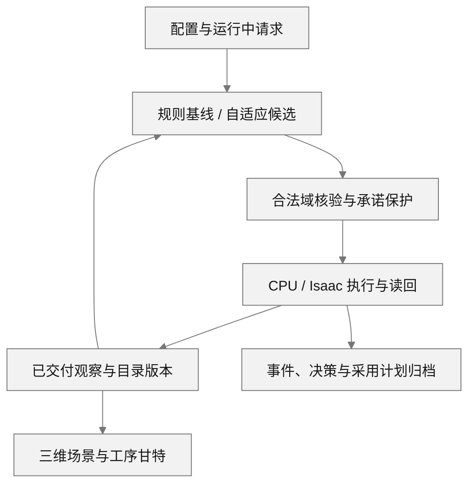

# Adaptive HRC Scheduling

**面向模块化建筑制造的动态人机协作调度与执行仿真。**

将任务前序、人员疲劳、协作模式、设备、物料和空间约束放进同一生产模型，根据执行反馈调整后续安排，并保存可独立核验的运行记录。

[](pyproject.toml)
[](LICENSE)
[](https://github.com/delongwangshu49-hub/adaptive-hrc-scheduling/actions/workflows/ci.yml)

[快速开始](#快速开始) · [工作台](#工作台) · [系统架构](#系统架构) · [研究结果](#研究结果) · [文档](#文档)

<a id="overview"></a>

## 可以用它做什么

- **描述生产系统。** 定义产品工序、人员资格与日历、疲劳累积和恢复，以及设备、物料、搬运路线和占位约束。
- **比较调度策略。** 在同一合法域中运行规则基线和自适应策略，区分候选安排、实际采用、执行结果及计算预算。
- **处理运行中变化。** 通过共享会话提交普通单、急单、取消、设备故障与维修、人员到离岗和返回，跟踪受理、生效与业务结果。
- **查看执行过程。** 使用 CPU 后端或 Isaac Sim，在工作台中对照三维场景、实际工序和未来计划。
- **复现分析。** 从保存的事件和状态生成逐产品、人员、资源及成本统计，核对图表、双域导出和结论的来源。

<a id="status"></a>

当前模型用于 **S18-SIM-A1 仿真研究**。CPU 分析与可选的 Windows / Isaac 工作台分开安装；应用范围和仍未达到的目标见[项目状态](docs/public_results/status.md)。

<a id="quickstart"></a>

## 快速开始

先用已保存的测量数据重算研究结果：无需 GPU、Isaac Sim 或重新运行生产。使用 **Python 3.12.13**、**uv 0.12.3**；下面是 PowerShell 7 命令。

```powershell
git clone https://github.com/delongwangshu49-hub/adaptive-hrc-scheduling.git
cd adaptive-hrc-scheduling
uv python install 3.12.13
uv venv --python 3.12.13 .local/results-env
uv pip install --python .local/results-env/Scripts/python.exe -r analysis/p07/requirements.txt
& .local/results-env/Scripts/python.exe analysis/p07/presentation.py replay --output .local/results-demo
```

成功后，`.local/results-demo` 中包含原统计、双域导出，以及 `presentation/` 中按问题整理的九张数据表和 `figures/` 中的四幅图。入口核对输入摘要、积分、人员分母与图表数据，并拒绝读取原私有运行档案。输出目录请选择新目录。Linux/macOS 的环境解释器路径为 `.local/results-env/bin/python`。

| 接下来想做什么 | 入口 |
| --- | --- |
| 理解数据、指标和比较方法 | [研究结果与再生指南](docs/public_results/README.md) |
| 执行新的正常 CPU 生产案例 | [安装与生产复现](docs/public_validation/reproduction.md) |
| 使用 Isaac Sim 双图工作台 | [工作台安装与操作](docs/public_workbench/usage.md) |
| 检查保存件、目录及计划引用 | [保存重建与独立核验](docs/public_validation/reproduction.md#执行及重建) |

新的生产运行使用完整源码仓库和核心环境：

```powershell
uv sync --locked --link-mode copy
uv run --locked python scripts/verify_production_chain.py --output .local/new-normal-cpu --backend light --simulation --products 1 --variant SR-W1 --scenario NORMAL --until-h 720
```

该命令执行完整案例；结束状态、实际产品接收和独立审计共同决定结果。核心 wheel、分析材料和桌面依赖的分发范围见[安装说明](docs/public_validation/reproduction.md)。

<a id="showcase"></a>

## 工作台


实际运行的原生窗口：左侧 Isaac 场景与右侧甘特共同呈现执行状态。截图的运行身份、版本和采样范围见[图像来源](docs/public_validation/visual_provenance.json)。

工作台提供参数配置、运行中请求、回执查看、停止保存和只读重建。Windows 环境使用 PySide6 / Qt WebEngine 和受测 Web 静态资产，Isaac Sim 单独配置：

```powershell
uv sync --locked --project desktop/p051
& ./desktop/p051/.venv/Scripts/python.exe ./scripts/run_p051_workbench.py --help
& ./desktop/p051/.venv/Scripts/python.exe ./scripts/run_p051_workbench.py
```

<details>
<summary>查看正常生产与动态变更的归档画面</summary>


正常单产品 CPU 案例完成436项静态工序并实际接收产品。图为已保存的只读甘特。


动态案例展示订单变更后的目录与完整计划，并按原停止操作保存。局部检查点与完整生产终点分开评价。两图均保留原始字节，来源见[图像记录](docs/public_validation/visual_provenance.json)。

</details>

<a id="architecture"></a>

## 系统架构

同一生产契约连接模型、调度、后端和工作台。调度只消费已交付观察；动态目录保留初始配置和版本历史，实际命令按接纳时的版本核验。



实际执行、已采用但尚未执行的计划、未安排任务和未知状态分别显示。显示故障不自动重放业务请求，归档读取保留原观察的时效语义。


图表消费经过核验的测量数据。疲劳曲线保留恢复至零的折点；实际生命周期与共同评价窗口分列；甘特总展示行与完整计划行分别计数。

<a id="validation"></a>

## 研究结果

研究材料回答三个层次的问题：策略是否改善交付、局部协作机制是否减少人员负担、运行中变更是否转化为实际产出。固定研究、动态 CPU 检查点和真实 Kit 记录分别保留运行身份与观察窗口。

### 策略比较：当前案例没有形成交付收益

五情景中，ADAPTIVE 与 EDD 的末次实际接收时刻均相同。每方法九个未取消且已接收的产品全部迟交，迟交范围为 **123.86–363.86 h**。同时比较共同窗暴露、原运行墙钟和实际命令来源：

| 情景 | ΔΣE（F·h） | 墙钟变化 | 缓存来源 STARTED |
| --- | ---: | ---: | ---: |
| N | 0 | +5.98% | 24 / 2031（1.18%） |
| H | 0 | +7.82% | 24 / 2036（1.18%） |
| F | 0 | +7.43% | 21 / 2032（1.03%） |
| U | −0.001013 | +57.29% | 29 / 2043（1.42%） |
| C | 0 | +2.19% | 24 / 1066（2.25%） |

N/H 为普通/较高初始疲劳，F 为故障维修，U 为急单，C 为取消。Δ 为共同 720 h 窗口内 ADAPTIVE − EDD；U 的相对差为 −0.000419%。墙钟为各一条原记录，不能当作重复性能基准或因果加速比。缓存来源占比以全部已分类 STARTED 为分母，并非候选采用率。C 的取消对象不计入正常交付比较，原截尾保持。[原值与逐产品迟交](docs/public_results/README.md#策略与交付)

### 协作机制：局部省人时，整单收益取决于条件


顺序人机协作（HR）使对应分支人时减少约 **68%**；整单末次接收只在较高初始疲劳下提前 **22.07 h**，普通初始疲劳下没有改变。分支节省不能直接等同于整单等比例加速。本图全员暴露采用共同 720 h 评价窗，含生命周期结束后的派生恢复尾段；接收时刻来自实际事件。这是四个既有机制格的比较；HR 复用 N/H 的 EDD 运行，**不能算成 ADAPTIVE 的策略收益或新增独立样本**。

### 订单响应：进入计划之后，还要看实际开工与接收


E20 同一次 r14 运行中，普通新增产品首次非服务命令 STARTED 分别比注册晚 **52.97 / 120.88 h**，急单晚 **24.38 h**。停止观察时仅 P1 接收，急单 P4 尚未接收且迟交至少 **290.73 h**。计划采用与注册具有同一仿真时间戳，不代表现实等待为零；图中的虚线仅连接已观察事件，不表示持续加工。[事件明细与截尾说明](docs/public_results/README.md#订单响应)

### 人员暴露：等待占了多少，初始疲劳影响持续多久


普通 EDD 的实际观察窗内，WAIT 占日历可用人时 **91.06%**、占模型暴露 **68.98%**。模型在 WAIT 中按 +0.02 F/h 累积疲劳，REST/OFF_SHIFT 按 0.2 F/h 恢复；因此这些比例首先提示应检查等待安排和模型假设，不能单凭此图认定生产瓶颈或真实生理负担。上图时间分母是日历可用容量；下图包含实际 REST/OFF_SHIFT 的暴露。


N/H 的 EDD 配置仅初始疲劳从 0.2 改为 0.6；实际全生命周期新增 **63.81 F·h** 暴露，其中 **99.02%** 来自首 24 h。曲线保留所有区间与恢复至零的折点，首日曲线积分与逐人区间积分相符。下方两段长度不同，比较的是暴露贡献量。[完整活动账与时间窗口](docs/public_results/README.md#人员时间与暴露)

### 动态人员与取消：把分母和已耗资源交代清楚

| 问题 | 关键记录 | 如何使用 |
| --- | --- | --- |
| 到离岗后还能用多少人时？ | CPU 检查点中 W1 在场与可用均为 0.2597 h；同窗普通人员分别为 6.1990 / 5.6990 h | 可用量取在场∩日历∩资格有效期∩人员状态，不等于未占用的空闲工时；相同的 13 人合并列示 |
| 取消是否意味着资源从未消耗？ | 每运行退回 28 lot、STEEL 3.318 t；已耗 0.7473 人时、搬运 96.10 m | 人时分项相加，空返 61.30 m 已含在搬运内；货币成本仍缺政策参数 |

[逐组人员分母、取消资源账与九张数据表](docs/public_results/README.md#图表与数据) · [指标定义](docs/metrics/p07_metrics_definition_r3.md) · [来源与验证](docs/public_results/README.md#来源与验证)

<a id="docs"></a>

## 文档

| 主题 | 文档 |
| --- | --- |
| 入门与环境 | [安装](docs/setup.md) · [CPU生产与保存重建](docs/public_validation/reproduction.md) |
| 工作台与交互 | [操作指南](docs/public_workbench/usage.md) · [交互案例](docs/public_workbench/interaction_cases.tsv) |
| 模型与执行 | [生产规范](docs/model/specification.md) · [动态后端](docs/public_backend/README.md) · [共享契约](docs/public_delivery_r2/interaction_contract_r3.md) |
| 数据、图表与研究复现 | [结果指南](docs/public_results/README.md) · [指标定义](docs/metrics/p07_metrics_definition_r3.md) · [派生输入](examples/reproduction/p07/r3/manifest.json) |
| 验证与使用边界 | [当前状态](docs/public_results/status.md) · [既有执行证据](docs/public_validation/evidence_summary.json) · [失败与修复](docs/public_validation/failures_and_repairs.md) |

<a id="checks"></a>

## 开发与贡献

完整 CPU 检查使用与 CI 相同的入口：

```powershell
uv run --locked --no-cache --no-editable --reinstall-package adaptive-hrc-scheduling python scripts/check.py
```

分析工具还可独立运行定向测试：

```powershell
uv run --locked python -m unittest discover -s tests -p 'test_p07*.py' -v
```

```text
src/adaptive_hrc_scheduling/   模型、契约、调度与执行
scripts/                     生产、核验与桌面入口
desktop/p051/                Qt / React 工作台
sim/                         Isaac 场景与读回适配
analysis/p07/                离线分析、验证与图表
examples/reproduction/        合成配置与派生测量输入
docs/                        指南、模型与证据
```

问题反馈请附最小复现步骤、版本、实际状态和相关日志；改动应保留已有断言、失败记录及来源范围。通过 [GitHub Issues](https://github.com/delongwangshu49-hub/adaptive-hrc-scheduling/issues) 讨论问题与改进，再提交附有验证结果的变更。

## 许可

代码采用 [MIT License](LICENSE)。模型假设、图像来源和数据适用范围随对应文档提供。
