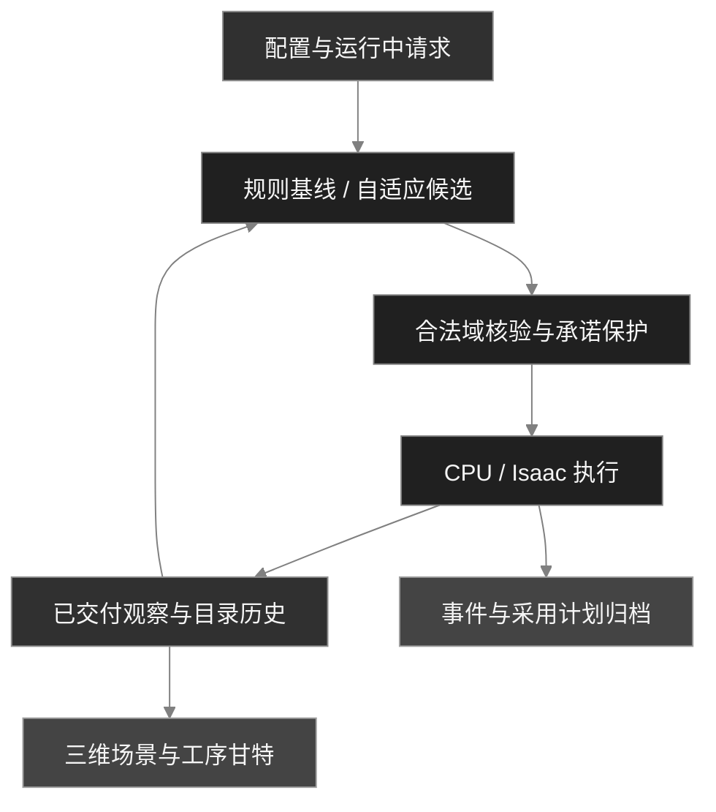

<h1 align="center">Adaptive HRC Scheduling</h1>

<p align="center">
  <a href="README.md">English</a> · <a href="README.zh-CN.md">简体中文</a>
</p>

<p align="center">面向钢结构模块化集成建筑（MiC）制造的人机协作调度与仿真工作台。</p>

<p align="center">
  <a href="pyproject.toml"></a>
  <a href="LICENSE"></a>
  <a href="https://github.com/delongwangshu49-hub/adaptive-hrc-scheduling/actions/workflows/ci.yml"></a>
</p>

<p align="center"><a href="#快速开始">快速开始</a> · <a href="#系统架构">系统架构</a> · <a href="#研究结果">研究结果</a> · <a href="#已知限制与未完成目标">已知限制</a> · <a href="#文档">文档</a></p>

Adaptive HRC Scheduling 面向**钢结构模块化集成建筑（MiC）的工厂制造**，把模块生产任务、人员疲劳、机器人协作和资源约束连接到调度、执行仿真与甘特图。可用它运行参考案例、施加订单和人员变更，并从保存的记录复现研究结果。

**第一正式版 v1.0.1 已提供 Windows 便携工作台和中英双语报告。** 本机已验证的主要功能可用，仍可能存在 bug 或尚未发现的问题。


实际归档的原生工作台窗口。原图、运行身份与采样范围见[图像来源](docs/public_validation/visual_provenance.json)。

## 第一正式版

| 获取内容 | 入口 |
| --- | --- |
| Windows x64 便携工作台 · 340 MB | [下载 ZIP](https://github.com/delongwangshu49-hub/adaptive-hrc-scheduling/releases/download/v1.0.1/HRC-Workbench-Windows-x64.zip) · [使用说明](docs/releases/v1.0.1.zh-CN.md) |
| 中文报告 · 22 页 | [阅读 PDF](reports/final/report-mic-zh_reviewed.pdf) · [直接下载](https://github.com/delongwangshu49-hub/adaptive-hrc-scheduling/releases/download/v1.0.1/report-mic-zh_reviewed.pdf) |
| English report · 24 pages | [阅读 PDF](reports/final/report-mic-en_reviewed.pdf) · [直接下载](https://github.com/delongwangshu49-hub/adaptive-hrc-scheduling/releases/download/v1.0.1/report-mic-en_reviewed.pdf) |
| 版本与完整性 | [发布记录](https://github.com/delongwangshu49-hub/adaptive-hrc-scheduling/releases/tag/v1.0.1) · [SHA-256](docs/releases/v1.0.1-SHA256SUMS.txt) |

便携包自带 Python、Qt、调度程序、甘特前端和只读示例。CPU 模式可直接使用；原生三维视口连接用户单独安装的 Isaac Sim。现有参考案例、研究图表与可复现输入继续保留。

## 可以用它做什么

| 工作流 | 能力 |
| --- | --- |
| 描述生产 | 产品、工序、资格、日历、疲劳与恢复、设备、物料、搬运和占位 |
| 比较计划 | 在共同合法域与承诺保护条件下运行规则基线和自适应候选 |
| 应用变更 | 新单、急单、取消、设备故障与维修、人员离岗与返回，保留回执及目录历史 |
| 检查执行 | CPU 后端或可选 Isaac 工作台，分别呈现实际工序与已采用的未来计划 |
| 复现结果 | 产品、人员、资源与成本账，附来源摘要、独立核验和已保存双域导出 |

## 快速开始

### Windows 便携版

1. [下载 ZIP](https://github.com/delongwangshu49-hub/adaptive-hrc-scheduling/releases/download/v1.0.1/HRC-Workbench-Windows-x64.zip)，完整解压后双击 `HRC-Workbench.exe`，保留同级 `app` 文件夹。
2. 在 **启动配置** 中运行默认 CPU 案例，或通过 **便携设置与示例** 打开只读示例。
3. 初次排程和甘特核验需要等待；结束时使用 **安全停止**，等工作进程退出。默认结果位于 `%LOCALAPPDATA%\HRCWorkbench\runs`。

原生 3D 另需 **Isaac Sim 6.1 与 PowerShell 7**。在设置中选择 Isaac 安装根目录，并使用纯 ASCII 的可写结果路径，例如 `C:\HRC\runs`。CPU 和存档支持中文路径。完整步骤及日志位置见[便携版指南](docs/releases/v1.0.1.zh-CN.md)。

### 从源码复现研究样例

先从保存数据重算结果。需要 **Python 3.12.13** 和 **uv 0.12.3**，无需 GPU、Isaac Sim 或新的生产运行。以下命令使用 PowerShell 7。

```powershell
git clone https://github.com/delongwangshu49-hub/adaptive-hrc-scheduling.git
cd adaptive-hrc-scheduling
uv python install 3.12.13
uv venv --python 3.12.13 .local/results-env
uv pip install --python .local/results-env/Scripts/python.exe -r analysis/p07/requirements.txt
& .local/results-env/Scripts/python.exe analysis/p07/presentation.py replay --output .local/results-demo
```

输出目录请选择新目录。`.local/results-demo` 中包含原统计与双域导出，`presentation/` 中有九张按问题组织的数据表，`figures/` 中有四幅图。入口核对输入摘要、暴露积分、人员分母和展示数据，并拒绝读取原私有运行档案。Linux/macOS 的环境解释器路径为 `.local/results-env/bin/python`。

新的正常 CPU 参考案例使用：

```powershell
uv sync --locked --link-mode copy
uv run --locked python scripts/verify_production_chain.py --output .local/new-normal-cpu --backend light --simulation --products 1 --variant SR-W1 --scenario NORMAL --until-h 720
```

该命令执行完整案例。应同时检查保存终态、实际产品接收和独立审计。[生产与重建指南](docs/public_validation/reproduction.md)说明安装、保存件检查和分发范围。核心 wheel 提供运行时，离线分析输入与图表位于完整源码包。

### 从源码运行 Windows 工作台

桌面应用使用 PySide6 / Qt WebEngine。先按以下命令重建与当前源码匹配的前端；Isaac Sim 按[工作台指南](docs/public_workbench/usage.md)单独配置。

```powershell
uv sync --locked --project desktop/p051
npm.cmd --prefix desktop/p051/web ci
npm.cmd --prefix desktop/p051/web run build
& ./desktop/p051/.venv/Scripts/python.exe ./scripts/run_p051_workbench.py --help
& ./desktop/p051/.venv/Scripts/python.exe ./scripts/run_p051_workbench.py
```

<details>
<summary>正常生产与动态订单变更的归档画面</summary>


正常单产品 CPU 参考案例完成 436 项静态工序，并实际接收产品。


动态检查点保留更新后的目录和完整计划，随后停止并保存。保存局部检查点不代表整单完成。两图保持原始字节，见[来源记录](docs/public_validation/visual_provenance.json)。

</details>

## 系统架构

调度器只消费已交付观察。目录历史保留初始配置及后续版本，执行命令按其接纳时的版本检查。



工作台分别呈现实际执行、已采用的未来计划、未安排任务与未知状态。显示故障不会自动重放业务请求。


暴露曲线保留恢复至零的折点；实际生命周期与共同评价窗分列，总展示行与完整计划行分别计数。

## 研究结果

材料覆盖五个固定情景、四个既有机制格、动态人员检查点和一次连续 Kit 归档。它们各有运行身份与观察窗口，属于确定性案例，不能合并为随机重复样本。

### 策略结果与计算代价

五情景中，ADAPTIVE 与 EDD 的末次实际接收时刻均相同。跨情景每方法共九个未取消且已接收的产品运行记录，全部迟交 **123.86 至 363.86 h**。

| 情景 | ΔΣE（F·h） | 原运行墙钟变化 | 缓存来源 STARTED |
| --- | ---: | ---: | ---: |
| N | 0 | +5.98% | 24 / 2031（1.18%） |
| H | 0 | +7.82% | 24 / 2036（1.18%） |
| F | 0 | +7.43% | 21 / 2032（1.03%） |
| U | −0.001013 | +57.29% | 29 / 2043（1.42%） |
| C | 0 | +2.19% | 24 / 1066（2.25%） |

N/H 为普通/较高初始疲劳，F 为故障维修，U 为急单，C 为取消。Δ 为共同 720 h 窗口内 ADAPTIVE 减 EDD；U 的相对暴露差为 −0.000419%。墙钟各只有一条原运行记录，不能据此认定因果开销或一般性能。缓存来源占比以全部已分类 STARTED 为分母，不是候选采用率。C 保留原截尾终态，取消产品不纳入交付比较。[原值与逐产品迟交](docs/public_results/README.md#策略与交付)。

### 协作分支省人时，交付收益取决于具体条件


顺序人机协作模式（HR）使对应分支人时减少约 **68%**。末次接收只在较高初始疲劳下提前 **22.07 h**，普通初始疲劳下没有改变。分支节省没有等比例传递为整单加速。

本图全员暴露采用共同 720 h 评价窗，包含实际生命周期结束后的派生恢复尾段；接收时刻来自实际事件。两个 HR 格复用 N/H 的 EDD 运行，这是协作模式对照，不是 ADAPTIVE 策略优势，也不增加独立样本。

### 进入计划后，还要看实际执行与接收


E20 同一次 r14 运行中，两个普通新增产品从注册到首次非服务 STARTED 分别等待 **52.97 / 120.88 h**，急单等待 **24.38 h**。停止时仅 P1 接收；急单 P4 尚未接收，迟交下界为 **290.73 h**。

计划采用与注册共享仿真时间戳，不代表测得现实响应延迟为零。首次非服务 STARTED 可以包含搬运；虚线连接已观察事件，不表示持续加工。[逐产品事件与截尾说明](docs/public_results/README.md#订单响应)。

### 等待与初始疲劳解释了不同的暴露构成


普通 EDD 的实际生命周期内，WAIT 占日历可用人时 **91.06%**、占模型暴露 **68.98%**。模型在 WAIT 中按 +0.02 F/h 累积疲劳，在 REST/OFF_SHIFT 中按 0.2 F/h 恢复。这些比例提示应检查等待安排和模型假设，不能单独证明生产瓶颈或真实生理负担。暴露分母包含实际恢复阶段。


N/H 的 EDD 配置仅初始 F 从 0.2 改为 0.6。实际全生命周期新增暴露 **63.81 F·h**，其中 **99.02%** 来自首 24 h。曲线保留全部区间端点和恢复至零折点，均值曲线积分乘 15 与逐人积分相符。两个贡献窗口长度不同，柱表示总暴露量，不是单位时间率。[活动账与窗口积分](docs/public_results/README.md#人员时间与暴露)。

### 动态人员与取消需要明确分母

| 问题 | 实际记录 | 解读 |
| --- | --- | --- |
| 还有多少可用人员时间？ | CPU 检查点中 W1 在场与可用均为 0.2597 h；普通人员分别为 6.1990 / 5.6990 h | 可用量取在场、日历、资格有效期与人员状态的交集，不等于未占用的空闲时间。相同分母的 13 人合并展示。 |
| 取消前已经消耗什么？ | 每运行退回 28 lot、STEEL 3.318 t，已耗 0.7473 人时和 96.10 m 搬运 | 空返 61.30 m 已含在搬运中；缺少货币策略参数的成本仍未知。 |

原 C 运行保持 720 h 截尾；最后一条已记录取消命令的完成时间不能证明精确清理耗时。[人员分组与取消资源账](docs/public_results/README.md#图表与数据)。

<details>
<summary>完整人员轨迹与资源所有权记录</summary>


完整人员图支持检查首日均值之外的个体过程，保留恢复至零折点与原实际生命周期。


所有权区间表示资源何时被持有，也保留某案例中没有持有区间的资源。它不等于持续加工时间，也不能建立瓶颈因果关系。[指标定义](docs/metrics/p07_metrics_definition_r3.md)。

</details>

## 已知限制与未完成目标

初排、重排和甘特核验仍偏慢，等待反馈也有待改善；实时性能目标、部分动态完成与在制品取消路径尚未全部达成。手动 REST 未实现，异机与长期运行验证、负责人连续人工验收仍待完成。当前版本用于仿真研究。

针对这些问题，正在评估成熟方案并规划后续改进。详细边界与使用条件见[版本说明](docs/releases/v1.0.1.zh-CN.md#已知问题与验证范围)；欢迎通过 [Issues](https://github.com/delongwangshu49-hub/adaptive-hrc-scheduling/issues) 提交 bug 和复现记录。

## 开发与验证

与 CI 相同的 CPU 检查入口：

```powershell
uv run --locked --no-cache --no-editable --reinstall-package adaptive-hrc-scheduling python scripts/check.py
```

单独执行 P07 检查：

```powershell
uv run --locked python -m unittest discover -s tests -p 'test_p07*.py' -v
```

既有 G07 发布 `step-P07-r3` 的 Ubuntu/Windows 源码及隔离 wheel 四轮 CI 各通过 1276 项检查。便携包另完成 23 项前端和 41 项 Python 定向检查，以及本机 CPU、存档和外置 Kit 验证。当前发布提交的 CI 结果见上方徽章与 [Actions](https://github.com/delongwangshu49-hub/adaptive-hrc-scheduling/actions/workflows/ci.yml)；封包验证范围见[版本说明](docs/releases/v1.0.1.zh-CN.md)。

```text
src/adaptive_hrc_scheduling/   生产模型、契约、调度与执行
scripts/                     生产、审计与桌面入口
desktop/p051/                Qt / React 工作台
sim/                         Isaac 场景与读回适配
analysis/p07/                离线分析、验证与图表
examples/reproduction/        配置与派生再生测量输入
docs/                        指南、模型定义与证据
```

反馈问题时请附版本、复现步骤、实际终态与相关日志。贡献应保留已有断言、失败记录与证据范围；通过 [GitHub Issues](https://github.com/delongwangshu49-hub/adaptive-hrc-scheduling/issues) 讨论改动。

## 文档

报告与版本使用指南提供中英双语，详细研究证据保留原有中文记录。

| 主题 | 指南 |
| --- | --- |
| 正式版与报告 | [便携版指南](docs/releases/v1.0.1.zh-CN.md) · [中文 PDF](reports/final/report-mic-zh_reviewed.pdf) · [English PDF](reports/final/report-mic-en_reviewed.pdf) |
| 安装与 CPU 执行 | [环境安装](docs/setup.md) · [生产与保存重建](docs/public_validation/reproduction.md) |
| 桌面交互 | [工作台操作](docs/public_workbench/usage.md) · [交互案例](docs/public_workbench/interaction_cases.tsv) |
| 模型与契约 | [生产规范](docs/model/specification.md) · [动态后端](docs/public_backend/README.md) · [共享交互契约](docs/public_delivery_r2/interaction_contract_r3.md) |
| 研究证据 | [结果与再生指南](docs/public_results/README.md) · [指标定义](docs/metrics/p07_metrics_definition_r3.md) · [公开输入清单](examples/reproduction/p07/r3/manifest.json) |
| 范围与来源 | [项目状态](docs/public_results/status.md) · [证据汇总](docs/public_validation/evidence_summary.json) · [图像来源](docs/public_validation/visual_provenance.json) |

## 许可

项目代码采用 [MIT License](LICENSE)。便携包所含第三方运行时分别遵循其[组件许可](desktop/p051/portable/THIRD-PARTY.md)。模型假设、图像来源与数据范围随对应证据文档提供。


## W5 本地集成候选

**READY_FOR_OWNER_REVIEW / NOT_PUBLISHED。** 本地 v1.1.0 提案集成已验证计划等待反馈与单次调用独占的回放准备。重排期间保留上一已验证甘特图，切图绑定当前任务，安全 STOP 与独立核验保持。`P051_PREVIEW_REUSE=0` 使用完整 Python 准备路径；`P051_WAIT_FEEDBACK=0` 隐藏新增反馈。上方已发布 v1.0.1 入口继续有效。

历史 W3 四组 CPU 配对中提交至已核验投影减少 17.33%、净回放减少 26.50%，数值绑定此前隔离候选。W5 的功能与封包检查不替代新的四组性能或工业资格验证。见[候选指南](docs/releases/v1.1.0-candidate.zh-CN.md)与[验证摘要](docs/validation/W5_integration_r1.md)。E12 仍待负责人本人验收，P08 整体未完。
