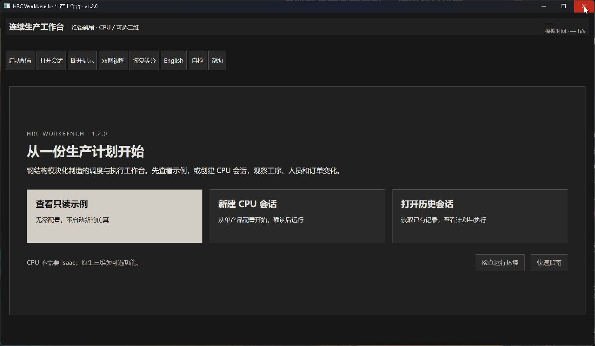
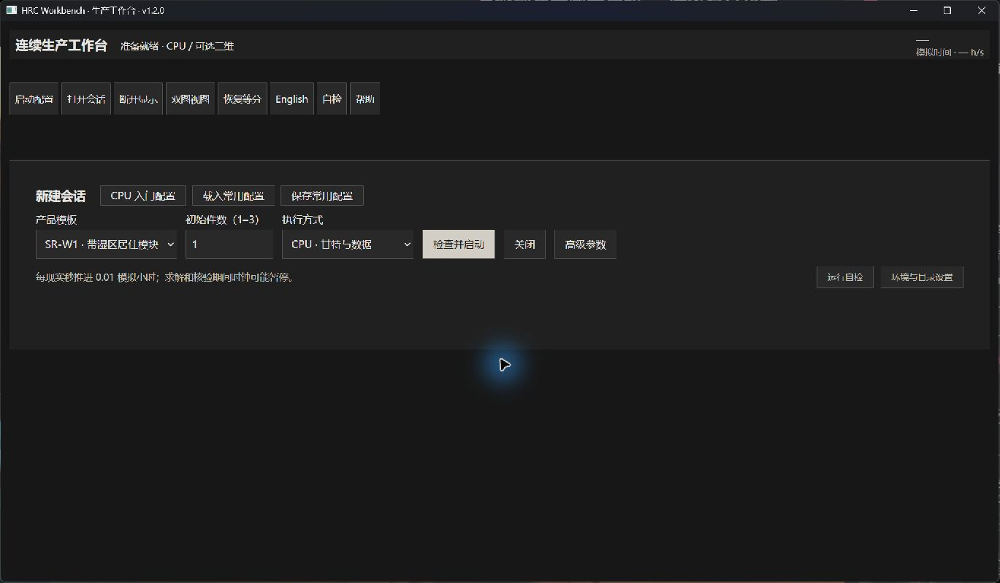
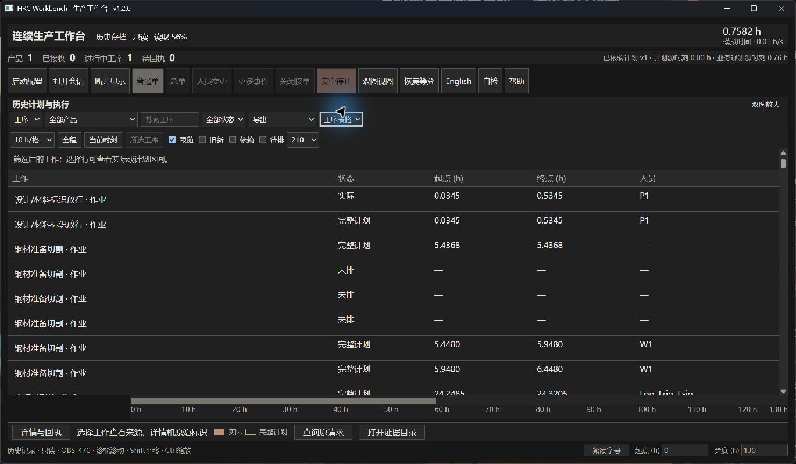
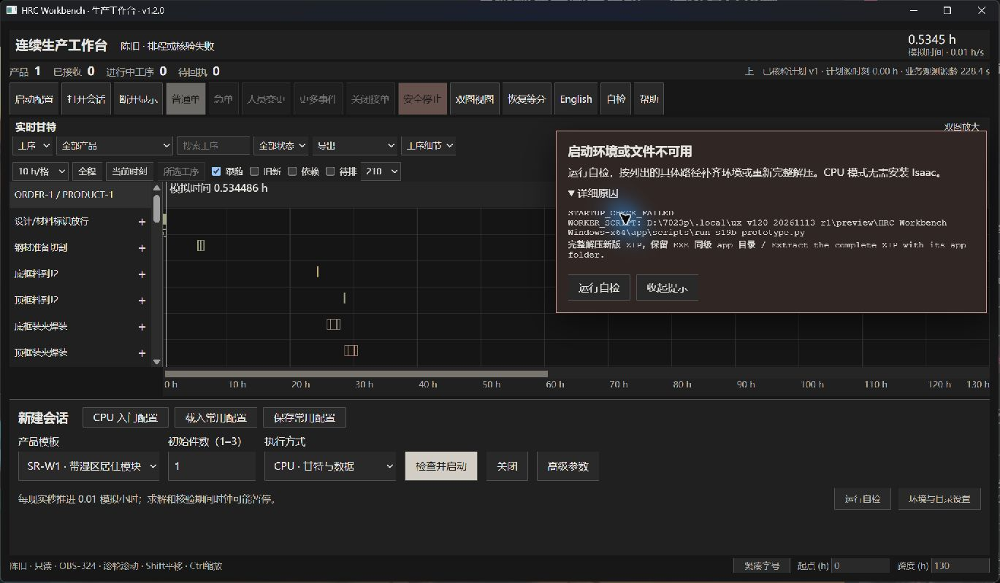

# HRC Workbench v1.2.0 user guide

Extract the entire ZIP and keep the adjacent app directory. Open HRC-Workbench.exe, then choose **Explore example**, **New CPU session**, or **Open saved session**. CPU works without Isaac. Native 3D requires a separately configured Isaac Sim 6.1 and PowerShell 7.

The example and saved sessions are read-only. Loading progress describes historical data being checked; the changing source time does not mean new production is running. CPU/archive sessions default to a full-width timeline. Dual view and Equal split retain the native side-by-side layout.

**Check & start** validates the worker interpreter, scripts, assets, imports and results directory before preparing production. Source installations need both environments: run `uv sync --locked` and `uv sync --locked --project desktop/p051` from the root, then `npm.cmd --prefix desktop/p051/web ci` and `npm.cmd --prefix desktop/p051/web run build` in PowerShell 7. A working desktop environment alone does not establish that the CPU worker is installed.

Choose the CPU starter or save a local configuration preset. The advanced simulation rate is simulation hours per real second. Planning and independent verification may pause the clock. Runtime orders and changes still require parameter review and confirmation. Requests sent, accepted, applied and actual product receipt remain distinct. Use Safe stop and wait for saving and actual worker exit before closing a live session.

Use Process detail, Product overview or Accessible table. Overview retains the original intervals; it does not reschedule work. Filled bars show actual work, outlines show plans. Unknown ends are not zero-duration completions. Full plan fits the time domain, Selection focuses selected work, and Current time returns to the source time. Arrow keys/Home/End navigate process-name buttons; Tab reaches controls. Larger/compact text changes display density only.

Details separates work, resources, requests and evidence. Export offers PNG/PDF for currently displayed rows/time window, CSV for filtered rows, and JSON for the delivered projection. Exports include filters, source identity/time, plan version and legend. A view export is not a full archive backup and does not include the native 3D image.

Diagnostics offers a quick prerequisite check and a full integrity/log check. Neither starts production or installs software. Full diagnostics requires PowerShell 7 and writes text and JSON reports; the window shows their location. If the application cannot open, run HRC-SelfCheck.cmd beside the executable. Share the diagnostic scripts, report and supplied AI repair guide with an assistant that can access the affected computer. Review local paths/log excerpts before sharing. WinError 2 alone does not establish the missing file or prove the teammate's issue has been resolved.

The application version is 1.2.0; the research library retains its separate version. Existing research results, limitations, human acceptance and industrial/performance qualification do not change through a UI release.

## Screens at a glance

