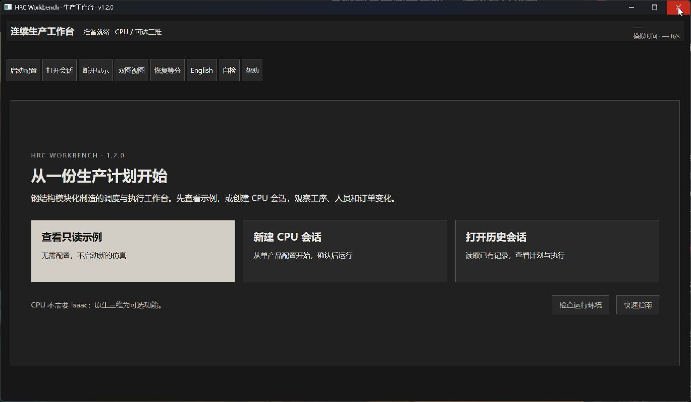
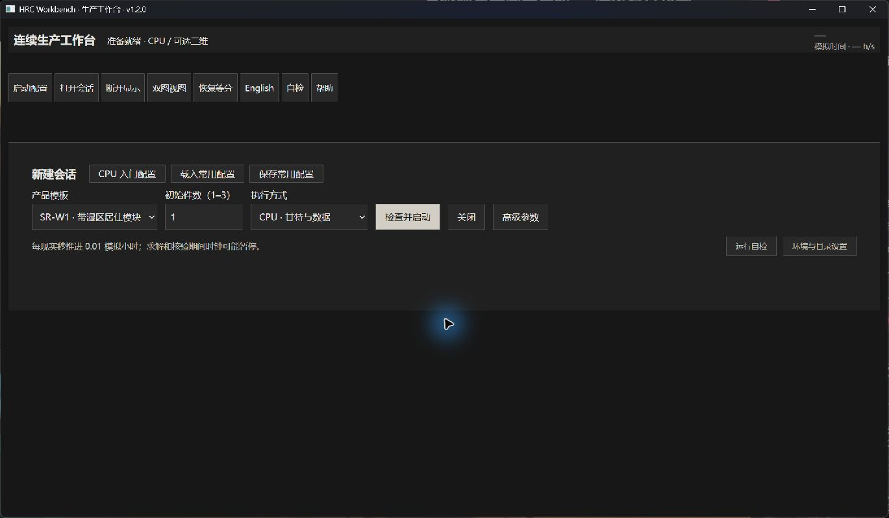
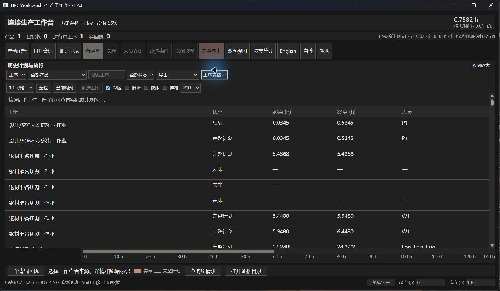
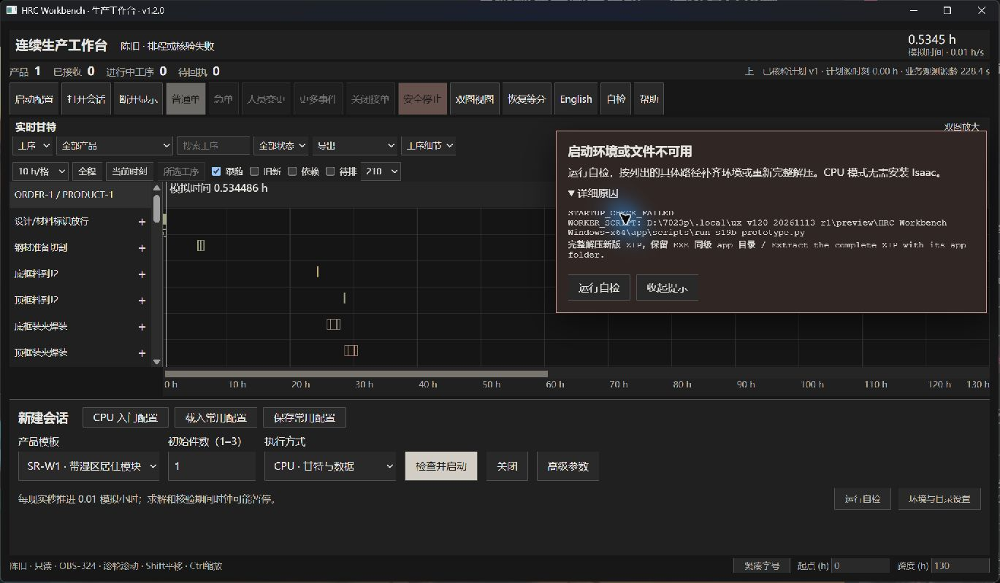

# HRC Workbench v1.2.0 新版使用指南

本版改进日常操作、阅读展示与故障自检。CPU 无需安装 Isaac；原生三维仍需单独配置 Isaac Sim 6.1 和 PowerShell 7。应用版本为 1.2.0，核心研究库版本另行保留，不代表重新取得工业或性能资格。

## 先体验

完整解压 Windows 运行包，双击 HRC-Workbench.exe。保留同级 app 文件夹。首页点击“查看只读示例”，无需启动生产即可看到计划和执行。历史存档会标明“只读”和读取进度；源时刻随历史数据逐批加载变化，不表示正在运行新的生产。

CPU 和历史存档默认使用甘特优先布局。选择“双图视图”可恢复三维/甘特横排，“恢复等分”恢复原双图比例。无三维会话时相机和定位按钮不可用；这不是 CPU 故障。

## 新建与日常操作

点击“新建 CPU 会话”或“启动配置”。先选择单产品 CPU 入门配置，确认模板和件数。高级参数中，0.01 h/s 表示每现实秒推进 0.01 模拟小时；求解与独立核验可暂停模拟时钟，不保证同倍率墙钟性能。常用配置可在本机保存和重新载入。

“检查并启动”先检查后台解释器、工作脚本、前端资源、依赖和结果目录；失败会显示具体路径与修复方法，不继续创建生产。源码版必须分别安装两个环境：项目根目录运行 `uv sync --locked`，再运行 `uv sync --locked --project desktop/p051`，然后 `npm.cmd --prefix desktop/p051/web ci` 和 `npm.cmd --prefix desktop/p051/web run build`。命令在 PowerShell 7 中执行。

运行中的普通单、急单、人员与设备变化仍需核对参数并确认。现有对象 ID 输入框支持匹配已知对象。已发送、已接纳、已生效和产品已接收分别查看，不以出现未来条带代替实际完成。无原生环境、只读或数据尚未核验时，不会开放业务写入。

结束活动会话使用“安全停止”，等待原回执、保存和实际工作进程退出；不要用结束进程代替正常停止。

## 阅读与展示

- 顶部概览列出产品数、实际已接收、进行中工序与待回执；未知显示“—”。点击概览打开详情。
- 工序细节显示具体执行/计划段；产品概览将同一产品的原始工序段合并到同一行，不改变其时间范围。
- “工序表格”提供可键盘选择的工作、状态、起止和人员；长列表可进一步筛选。图上名称按钮支持上下箭头/Home/End；Tab 可访问工具栏。
- “全程”查看完整时间域，“所选工序”聚焦选中工作，“当前时刻”回到源时刻附近。下方滚动条与迷你位置条展示时间窗口。
- 实心是实际执行，空心是计划；尚无结束区间不视为零时长完成。舒适/紧凑字号只改变显示密度。
- 详情分为工序、资源、请求记录、来源与证据。身份可选择复制；原始回执保留。

“导出”可选择 PNG/PDF 当前显示行和当前时间窗、CSV 筛选结果、JSON 完整已交付投影。展示图附来源、计划版本、模拟时刻、过滤条件和实际/计划图例。显示或导出都不等于完整运行档案备份。CSV 包含数值起止时间；需要进一步计算时使用 CSV/JSON。原生三维截图不包含在甘特导出中。

## 发生报错时

1. 点击“自检”，先运行快速启动检查，按 FAIL 中的具体路径处理。
2. 若仍不明确，运行“完整校验与日志自检”。检查包内逐文件摘要、两种解释器、Qt/OR-Tools、数据、设置与日志；检查不会启动生产，也不会自动安装或修改环境。
3. 完整自检同时生成文本和 JSON 报告，路径显示在窗口。也可“保存诊断 JSON”到指定位置。
4. 程序无法打开时，双击运行包根目录 HRC-SelfCheck.cmd。它需要 PowerShell 7；缺失时会明确提示，不使用 Windows PowerShell 5.1 代替。
5. 将“工作台排错与AI修复指南.txt”、app/tools/diagnostics 全目录、诊断报告与本次错误交给能够访问组员本机文件/终端的 AI。指南写明定位、备份、修复、复查和实际启动验收。普通网页聊天无法直接操作组员电脑。

WinError 2 只表示找不到所需文件，不能仅凭截图断定是 Python。源码界面环境可正常而后台根环境缺失；便携包也可能缺资源或工作脚本。新检查会列出实际路径。只有组员本机修复并完成复查后，才能确认其故障已解决。

## 文档入口

快速体验和日常操作使用本指南；具体故障使用排错与 AI 修复指南；研究问题、方法、结果及原有限结论使用随原发布的双语研究报告；开发和复现使用仓库 README 与公开复现说明。历史研究数值、失败和报告均保留，界面新版不自动更新研究结论。

## 界面速览

