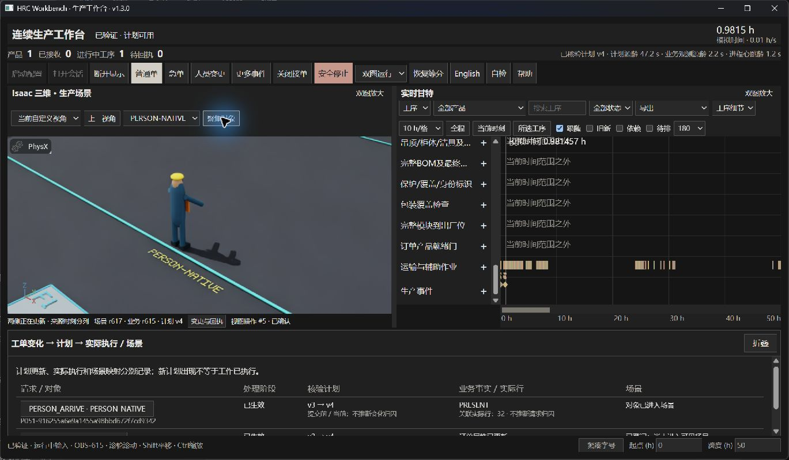
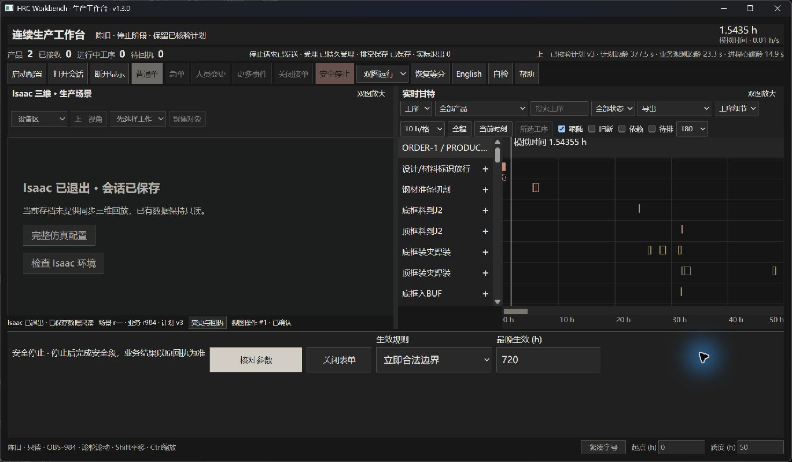

# HRC Workbench v1.3.0 local candidate guide

Application 1.3.0 / core library 0.1.0, based on local v1.2.0. Local revision native-r2, not published. Authorized native interaction and exit checks have been performed. Direct 3D clicking/box selection remains open, so full native acceptance is not complete. See the [native validation record](../validation/UX_v1.3.0_native_validation_r2.md).

Extract the complete Windows ZIP and keep app beside HRC-Workbench.exe. Choose Start full simulation; Isaac is the default backend. Review template, quantity, method and rate, check prerequisites, then confirm. Configure Isaac Sim 6.1 and PowerShell 7, with a writable ASCII-only results path. Startup distinguishes Kit startup, scene construction, first frame, scheduling and independent verification. CPU data mode is an explicit alternative; examples and archives do not claim live Isaac or synchronized 3D replay.

Isaac remains on the left and the timeline on the right. Operate, Demonstrate and Analyze adjust the split while retaining both panels. Drag the separator or restore equal split. Supported client size starts at 1280×720; minimum useful widths constrain ratios on smaller screens. Help and diagnostics dock on the right. Event menus and forms use the shared bottom area.

Timeline selection selects its scene object. Direct 3D clicking/box selection and reverse timeline selection remain unverified; use timeline or related-object selection and focus in this candidate. Selection alone does not move the camera. Focus object moves to the selected related product, person or device; Previous view restores the prior camera. Future objects without actual scene mappings cannot be focused. Each side retains its own source time and state revision; the timeline also identifies its plan version. Filled bars show actual execution and outlines show plans. Filtering, comparison, overview, process details, table accessibility and time navigation remain available.

Review parameters before submitting new or urgent orders, priority/due changes, workforce changes, equipment failure or repair. Same-client requests are consumed in producer sequence; querying an original request does not create another business event. Changes & receipts separates acceptance, application, plan versions, execution facts and scene mapping. ACCEPTED is durable admission; APPLIED is an effective change, not production completion. Current plan versions do not establish exclusive causality. Manual rest remains unavailable and explicitly disabled.

Export scene + timeline as PNG/PDF, or export the timeline alone, filtered CSV and raw JSON. Combined export freezes timeline data at the click, then captures Isaac; both source times remain explicit and production continues. It does not claim a single synchronized frame. Combined export requires an active Isaac session. CSV preserves original interval values.

Diagnostics targets the active backend, with package integrity and logs in the full check. If the UI cannot start, run HRC-SelfCheck.cmd and use the included troubleshooting guide. Inspect local paths and logs before sharing reports. Safe stop drains started segments, saves the session and confirms actual process exit before read-only reopening. Research, performance and industrial qualification limits remain; the teammate's own machine still needs retesting.

Registered future objects can remain invisible in USD. The interface distinguishes registration from actual visibility and disables focus until a related object is visible.

This revision waits for renderer capture completion before closing and prevents stale STOPPED control data from replacing an observed EXITED state. Two repaired native sessions and two windowless exit checks saved successfully and returned actual exit code 0. The earlier SDK shutdown failure remains recorded; its precise internal cause has not been established. Preserve logs and check actual exit status if a stall recurs.

Native testing also found and repaired a false frozen-prefix rejection caused by a tiny difference between predicted and actual completed endpoints. Order updates, worker arrival, equipment failure and repair were exercised through the native interface. A new urgent order was registered and its revised plan adopted; its new product had not yet reached visible execution when the run stopped. Application does not mean production completion.

One urgent-order candidate took approximately 456 seconds to plan, followed by independent verification. Watch the phase and original request receipt rather than submitting duplicates. This revision does not resolve the existing solver performance target. Direct scene clicking/box selection, multi-display DPI and the teammate's own computer remain unverified; owner E12 acceptance remains pending.

