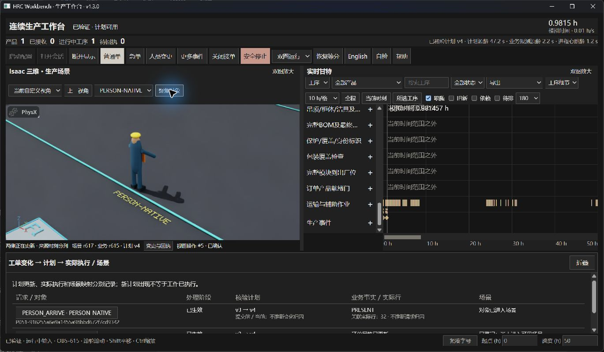
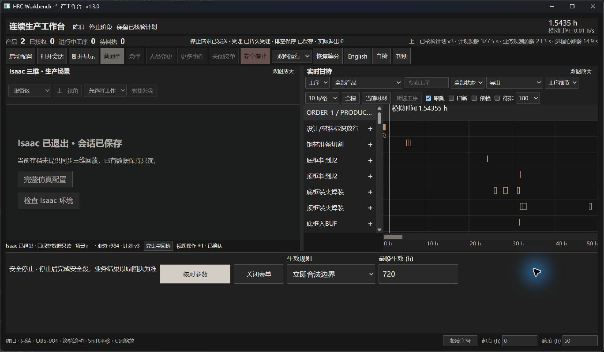

# HRC Workbench v1.3.0 本地候选使用指南

应用版本 1.3.0，核心库 0.1.0，基于本地 v1.2.0。本次为 native-r2 本地修订，暂不发布。已获准并实际完成主要原生操作与退出复验；三维直接点击/框选仍未通过验收，不能称为完整原生验收通过。详见[原生验收记录](../validation/UX_v1.3.0_native_validation_r2.md)。

## 开始完整仿真

完整解压 Windows ZIP，保留同级 app 目录，启动 HRC-Workbench.exe。首页“启动完整仿真”默认使用 Isaac；选择模板、件数、方法和模拟倍率，先检查环境，再确认启动。Isaac Sim 6.1 与 PowerShell 7 需要在本机配置；Isaac 结果路径须使用纯 ASCII 可写目录。启动时分别显示 Kit 启动、场景构建、首帧、排程和独立核验，首次加载可能较慢。

CPU 数据模式是配置中的显式选择；只读示例与历史会话不代表实时 Isaac 或三维回放。缺少 Isaac 时不会自动切换成 CPU，也不会显示假的三维成功状态。

## 同时使用 Isaac 和甘特

左侧持续显示生产场景，右侧显示计划与实际。双图运行、场景讲解和排程分析调整比例；拖动分隔线可自定义，恢复等分可复位。窗口最小支持 1280×720 客户区，较小屏幕上比例会受到两侧最小可用宽度约束。

选择甘特工作会选择关联三维对象。三维直接点击/框选与反向甘特联动仍待核验；当前可从甘特或关联对象入口选择和聚焦。选择本身不移动相机。需要观察细节时，选择关联人员、设备或产品，再点击“聚焦对象”；“上一视角”返回之前的位置。对象已登记但尚未进入可见场景时会明确标注，并禁用聚焦，避免空视角。

两侧分别显示模拟时刻、状态版本和计划版本。版本一致只表示这些已交付状态的对应关系；不同步、等待画面或数据陈旧会明确显示。甘特实心表示实际执行，空心表示计划。旧新对比、筛选、概览、工序展开和可键盘操作的表格保留。计划刷新时尽量保持选择和时间范围；旧工作消失后保留历史选择，不能当成当前可执行工作。

## 工单和资源变更

普通单、急单、修改交期/优先级、人员到离岗及设备故障/维修均先核对参数再确认。人员和更多事件在底部操作区展开，不覆盖三维。连续请求按同一客户端序号消费；重复查询使用原请求 ID，不重新创建业务请求。

“变更与回执”显示请求、接纳/生效阶段、提交前与当前计划版本、实际执行事实和场景映射。ACCEPTED 只表示持久接纳，APPLIED 表示变更生效，不表示产品完工；当前计划版本也不自动证明某条请求是变化的唯一原因。新增产品或人员要等实际映射完成后才能定位。手动休息仍未实现，界面明确禁用。

## 导出与排错

甘特导出菜单提供双图 PNG/PDF、单独甘特 PNG/PDF、CSV 与原始 JSON。双图导出冻结点击时的甘特数据，再取得 Isaac 截图，保留两边各自的来源时刻；仿真继续运行，不能把两次采样当成严格同一帧。双图导出需要活动 Isaac 会话。CSV 保留筛选后的原数值，不截成可见窗口长度。

“帮助”和“自检”停靠在右侧，左侧场景继续显示。自检按当前后端检查；完整自检检查清单、依赖和日志。若无法启动界面，运行 HRC-SelfCheck.cmd，详见同包排错指南。报告可交给组员或 AI 排错，先检查其中的本机路径和日志内容。

结束时使用“安全停止”，等待安全段排空、会话保存和实际进程退出，随后可只读重开。不要把窗口关闭当成停止完成。现有研究结果、工业资格和性能限制保持，组员电脑仍需要其本人复测。

本次修复了截图异步任务未完全回收便进入关闭的问题，并修正退出后仍显示“等待首帧”的状态回退。修复后的两次原生会话与两次无窗口退出检查均实际返回 0，保存完整；原 SDK 关闭卡住的失败记录仍保留。若再次发生，保留会话目录和日志，核对“实际退出”状态；不要通过反复点击停止或重开实例判断成功。

原生实测还修复了已完成工序的预计终点与实际回执存在微小浮点差异、导致重排被错误拒绝的问题。工单修改、人员加入、设备故障和维修均已通过原生操作核对。新增急单在此次运行中完成登记并采用新计划，但新产品尚未进入可见生产阶段；“已生效”不等于已开工或完工。

新急单的一次候选计划计算耗时约 456 秒，之后还有独立核验。等待期间查看阶段状态和原请求回执，避免重复提交。本次没有解决求解性能目标。三维直接点击/框选、跨屏 DPI 与组员电脑复测仍未关闭；负责人 E12 人工验收仍待本人完成。

