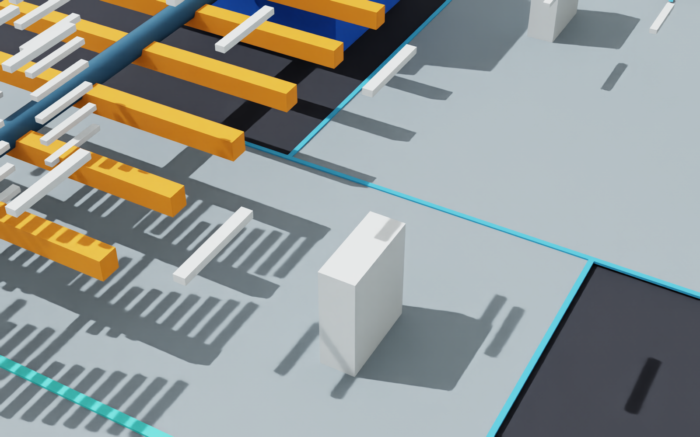
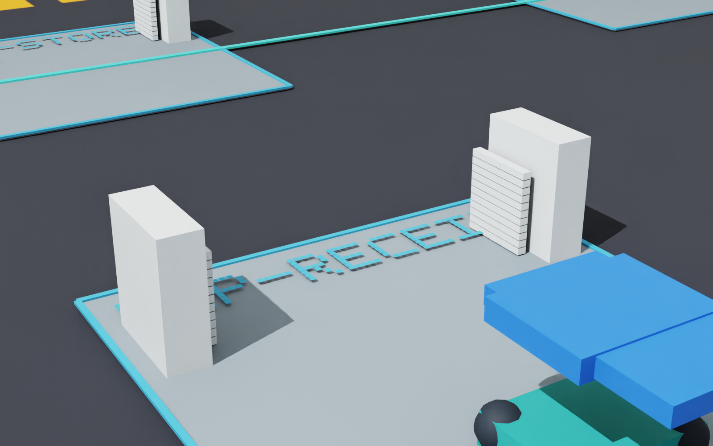
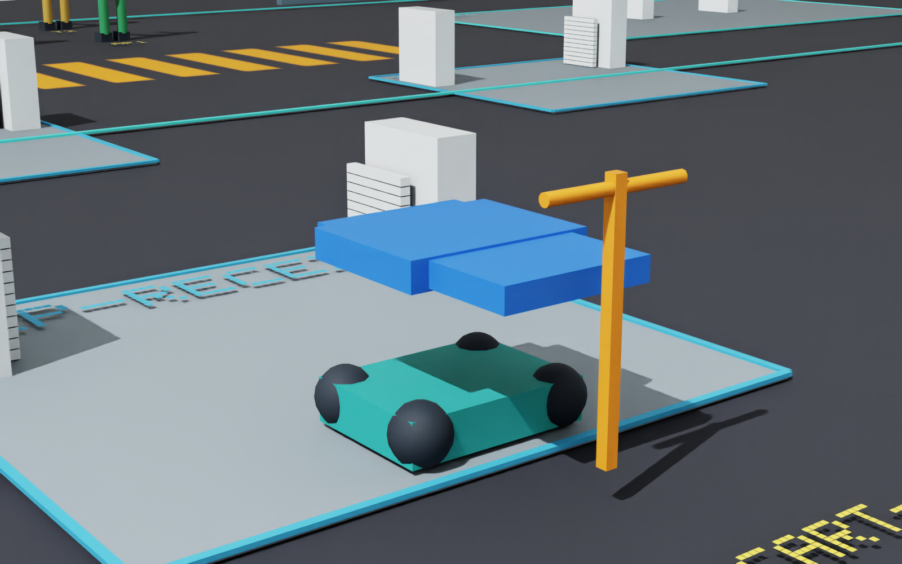
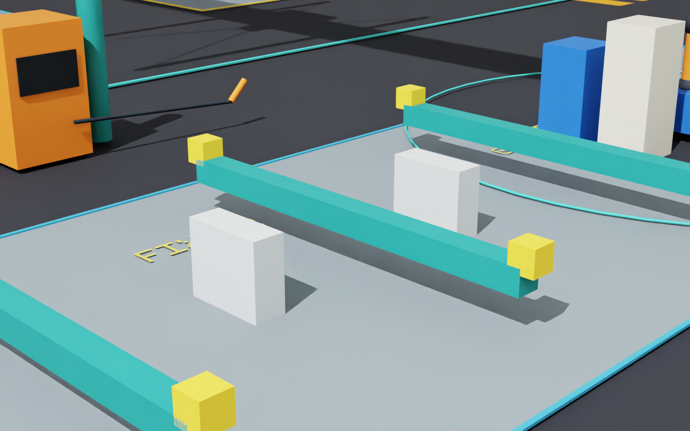
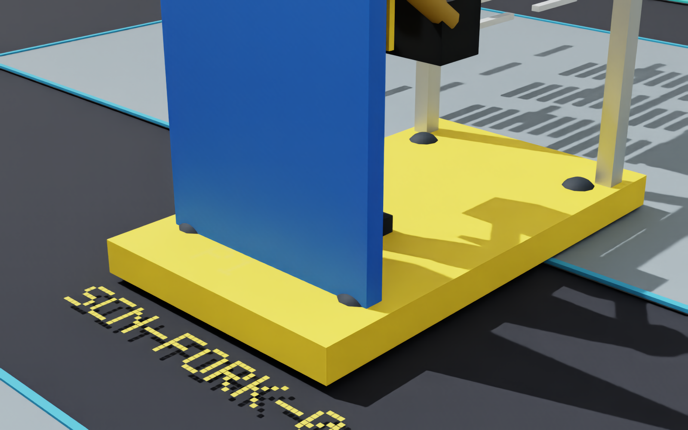
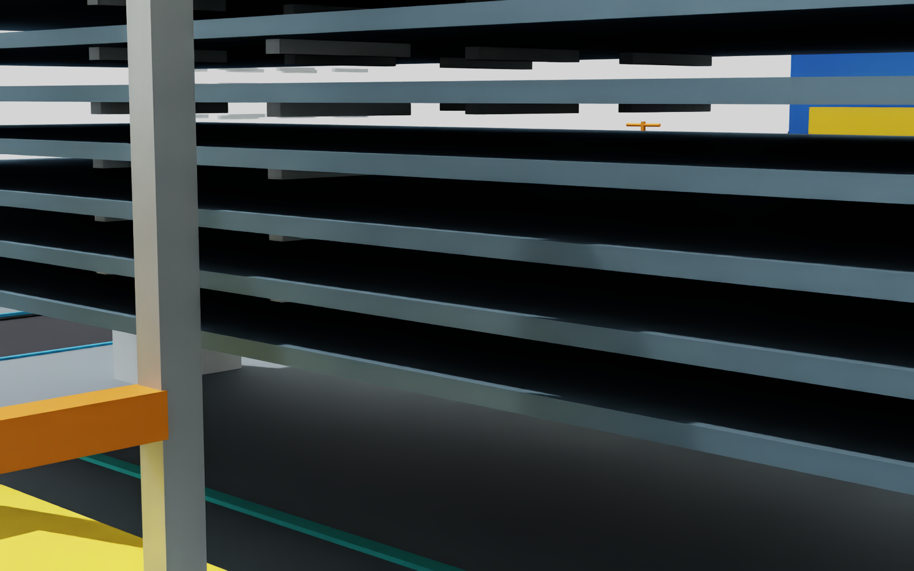

# 紧急修正：全场盘点与有界根因排查

2026-10-12；PR177 / LOG242。**INVESTIGATION_COMPLETE_WITH_DOCUMENTED_LIMITS / PROPOSAL_PENDING / IMPLEMENTATION_NOT_AUTHORIZED**。问题仍为 OPEN / NOT_FIXED。沿用 main 和原目录，未修改正式场景、几何、碰撞、生产源码或旧封包。拟修复见[具体方案](emergency_scene_correction_proposal_r1.md)，机器记录见[验证摘要](../validation/emergency_scene_investigation_r1.json)。

已确认问题涉及支承、材料/组件存在状态、夹具、机器人/焊机底座、车辆结构、吊机轨道接口、人员站立接口和 CUT1 进料结构。原 478/510 是一次可见碰撞对象的 AABB 连通筛查，不能代表本轮问题总数；本轮也不把有限状态采样称为所有连续时刻或物理承载证明。

## 覆盖与实际执行

| 未修复源码生成的初始配置 | 全部 Boundable | 可见几何 | 可见碰撞体 | 零数量但可见材料包络 |
| --- | ---: | ---: | ---: | ---: |
| SR-W1，1 产品 | 1313 | 1296 | 711 | 120 |
| SR-W2，1 产品 | 1316 | 1299 | 714 | 123 |
| SR-W1，2 产品 | 1437 | 1420 | 835 | 240 |
| SR-W2，2 产品 | 1443 | 1426 | 841 | 246 |
| SR-W1，3 产品 | 1561 | 1544 | 959 | 360 |
| SR-W2，3 产品 | 1570 | 1553 | 968 | 369 |

遍历全部实际 USD 几何，保存可见性、碰撞/刚体 API、稳定实体 ID、路径、世界/局部矩阵、尺寸和坐标。六配置重复初始化根层内容相同，没有重复 sceneId 或实例残留。底面坐标与子包络半高偏移一致，未复现单位错配、重复缩放或局部/世界坐标串用。父子分组保持位置并不等于存在实际连接件。

| 连续原生 USD 诊断 | 实际结束 h | 接收数 | 执行/决策审计 | 说明 |
| --- | ---: | ---: | --- | --- |
| SR-W1 单产品 NORMAL | 272.35047973655236 | 1 | PASS / PASS | 同一次初始化至接收 |
| SR-W2 单产品 NORMAL | 292.6237847222222 | 1 | PASS / PASS | 同一次初始化至接收 |
| SR-W1 三产品 NORMAL / 720h | 720 | 2 | PASS / PASS | WINDOW_CENSORED，第三产品未完成；原结果保留 |
| SR-W1 三产品 WV01 | 845.6183333333332 | 3 | PASS / PASS | 使用原获批 B2_SUPPLEMENTAL_960、rework=true、840h 开始接收；复现 FG1/FG2 满槽及第三产品等待 |

四条诊断共保存 **590 份完整几何快照**，包括初始/末态及有限动作、换装、物料转换、叉运/推车/吊运、工具部署/收回与外接收状态。它们使用原生 USD 库和未修改执行端，**不是新的完整 Kit 双后端链或刚体物理试验**。返工启用配置不等于实际发生返工；本轮未新跑所有故障、中断、取消或任意连续帧。

补充对两产品类型的动作/阶段代表状态及六初始配置共 40 个场景做了全部可见实体精查，涵盖无碰撞的可见结构。立方体使用世界 OBB 分离轴；球/圆柱/胶囊使用变换逆映射的共同内部点证明相交。共同点不存在不等于不相交；剩余 28 次球/显示覆盖层 AABB 候选又用轴对齐椭球—盒最邻近点精查，18 次是假阳性、10 次是显示涂装覆盖层接触。没有把地面涂装、标签和正常装配接触计作未预期实体穿插。

## 已确认的 11 类问题

所有坐标单位为 m。`key(ID)` 是现行源码的 UTF-8 十六进制路径编码。完整逐对象矩阵、路径和时刻在本地原始记录中，下面给出可稳定复现的入口。

| ID / 优先级 | 实体、实际路径及证据 | 根因与置信度 |
| --- | --- | --- |
| F01 / P1 | 246 固定短杆；`/World/Static/<key(落点-support-i)>`；尺寸 `(0.06,0.50,0.04)`，中心 `(x±spread,y,z-0.02)` | `production_port.py::reset` 为未来落点建立永久横条，未配套表达完整承载框架。高置信；结构强度未证明 |
| F02 / P1 | 132 托片；如 `SC-HOLDER-MEP-RECEIVE-0`，范围 x=4.92..4.98、y=23.65..24.15、z=0.035..0.040 | `production_support_port.py::__init__` 只建立 5mm 托片；除横条外缺少至地面的连续支架。高置信 |
| F03 / P1 | 132 移动横条；`/World/S15/Supports/<key(SC-root-index)>/Body`；初始中心高度 0.06..0.56，每层节距 0.05 | `production_supports.py::parking/deployed/movements` 描述位置和运动，不描述完整固定/收存/导向结构；运动中的实际抓持/连接证据也不足。高置信；不能仅给静止画面补装饰 |
| F04 / P1 | SR-W1 初始 120 个材料与 4 个组件/产品包络全在 `(-30,0,0)` 底面占位处，可见且有碰撞；124 对象产生 7626 个精确盒体相交对 | `production_port.py::reset` 无条件建立可见 Envelope；数量 0、尚未到货或未生成的事实未控制实体生命周期。SR-W2 127 对象产生 8001 对。是场外占位错误，不冒称解释了负责人截图中所有场内重叠 |
| F05 / P1 | FIX-J2/FIX-J3 共六根 `Cross0..2`；J2 Cross1 范围 z=0.30..0.50 | `target_scene.py::build` 建横梁/夹头但无落地腿。高置信；已有夹头/横梁小范围嵌合属于正常装配 |
| F06 / P2 | R1 `/BaseMount/Base` 最低 z≈0.10；两焊机 `/Power` 最低 z≈0.05 | 安装偏移和机箱高度组合后没有补底座。分别缺 100mm、50mm 下部连接。高置信；不改变机器人关节或操作手位 |
| F07 / P1 | 叉车、推车、测试车共 12 个球形轮子最低 z=0.025；两车 Tray 最低 z≈0.69、Deck 顶 z≈0.23 | `target_scene.py::vehicles` 球半径/中心留出 25mm 地隙；两托盘之间缺少约 460mm 支柱。是实际几何间隙，非碰撞筛查误报 |
| F08 / P2 | 叉车 Controls、推车/测试车 HandlePost | 控制件/手柄与车身缺少明确机械连接。仅靠同父节点变换一起移动。高置信；人员控制接触另列正常界面，不按全部手臂接触判缺陷 |
| F09 / P1 | `/World/Crane/Bogie0..1` 与 rail-south/north 体积穿入 z≈0.06；四球形 Wheel 与轨道也相交 | 方形底座无轨道槽，球轮最低 z=0 而轨道顶 z=0.16；如 `(28.5,4,0.12)` 同时严格在轮子椭球及轨道盒内部，椭球归一平方值 0.2704。高置信；原轨道接触豁免未检验形状匹配 |
| F10 / P2 | 0.6642091666666666h，`PRODUCT-1.ST-C.04.DELIVER-0`；P1 Boot0/1 与叉车 Deck | 靴底 z≈0.20，车板顶 z≈0.23，两个实际盒体均穿入约 30mm。根因是站立基准与板顶不一致；初始 P1 在别处，不能用初始靴位置作该证明 |
| F11 / P1 | 5.436826666666667h / CUT.RESERVE；ST-B.09、ST-T.05 与 `/Equipment/<key(CUT1)>/FeedExtension`，转换后 NET 包仍复现 | FeedExtension 圆柱中心 z=0.8、半径 0.1，顶面 0.9 高于材料底 0.8；共同内点如 `(14.9499999993,7.5999999810,0.8124999998)`。它没有碰撞 API，所以原碰撞筛查漏报。进料纵梁与 Housing 还留约 0.1m 连接缺口。高置信 |

原 2mm 邻接算法以最低 z≤0.05 的对象作为“地面起点”，会把离地 25mm 的车轮、35mm 的托片当作起点；本轮直接核对真实地面 z=0 和形状。因此没有沿用 478 数量作为真实悬浮数。吊机斜腿、人员身体等无碰撞结构可形成可见连接，隐藏 Occupancy 是保守占用代理，不是被偷偷隐藏的生产实体。这些也说明仅看可见碰撞图不充分。

## 当前未修复的真实图像

以下初始图从未修改当前源码独立生成真实 Kit 场景；不是 AI 图片或方案实施预览。

两张动态图来自另一次真实 Kit / 原执行端的 6h 有限前缀，时刻分别为 0.6642091666666666h 和 5.436826666666667h；完整 PNG、实际渲染相机矩阵及图前后生产状态/对象属性守卫另存。图用于定位当前对象，穿插量由上述精确读回确定。

另有[全场](images/emergency-scene/r1/initial-overview.png)、[机器人底座](images/emergency-scene/r1/robot-base.png)、[测试车](images/emergency-scene/r1/test-frame.png)和[场外重叠占位](images/emergency-scene/r1/offsite-ghosts.png)。场外图中多个重叠包络被较大包络遮住，图片单独不能数清对象；数量来自逐实体读回。

## 证据限制、失败与复现

静态最终 Kit 程序和动态有限前缀程序分别完整关闭并实际 exit0；静态八图生产 `/World` 子树（除相机）属性/关系/类型/变换摘要保持。根层并非字节相同：Kit 更新 `/Render` 的诊断相机关联，并添加该相机曝光属性；完整差异已核对，不将其误写成“整个根层不变”。动态拍图前后生产状态及生产对象摘要保持。RC 完整关闭返回后显式退出 helper、跳过解释器最终收尾的原限制保持。

首轮原生诊断因逐包采样过密主动中止，保留其 129 个快照和实际中断；720h 三产品截尾及错误 NORMAL/960h 的 `WV01_EXACT_SCENARIO_REQUIRED` 拒绝保留。Kit 静态 r1—r6 的无帧、相机帧、根层守卫失败及动态图文件尾标识错误、遮挡构图均保留。最终只读截图使用现有运行时和图形缓存；未安装新栈。没有以退出 0 覆盖失败图或自动宣布人工图审通过。

本地原始目录为 `.local/emergency-scene-20261012/`：六初始化、四条连续诊断、590 快照、全部可见实体精查、直接形状证明、候选几何及拒绝版本、Kit 图像/矩阵、源码保全和封包索引均分开保存。只读脚本 `diagnose.py --out <新目录>` 可复现六初始配置；`--chain --variant SR-W1 --products 1` 复现单产品；三产品补充使用 `--products 3 --until-h 960 --sample-after 720`，脚本显式选择原 WV01 的 rework/840h 配置。原生库路径仅在本地脚本中，公开材料不含机器配置。

本轮未实施修复、未跑修改后验证或人工验收。支承新结构仅做有限几何设计，不是应力、刚体或工业承载认证。后续验收必须按[方案验证关口](emergency_scene_correction_proposal_r1.md#验证与停止条件)实际完成。
