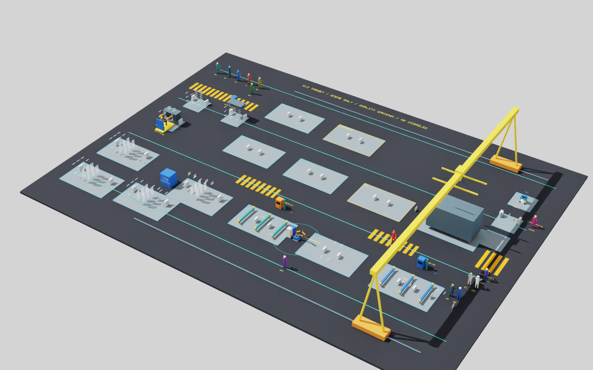
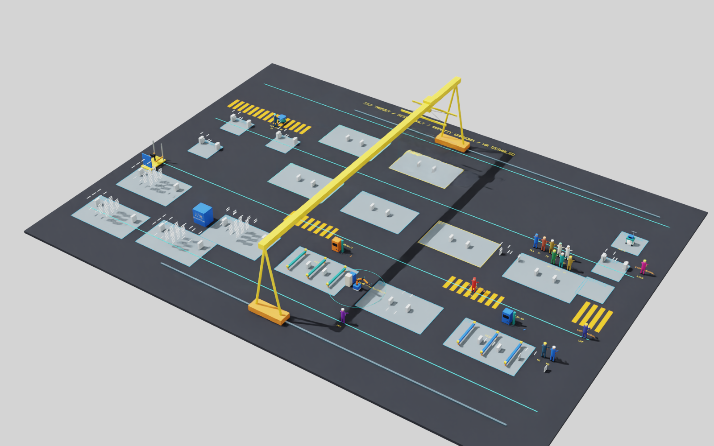

# 有限模型修复：兼容项与完整单件审阅

2026-10-12；PR178 / PR179。状态 **COMPATIBLE_ITEMS_VERIFIED_WITH_LIMITS / SUPPORT_REPAIR_OPEN / OWNER_REVIEW_PENDING / NOT_PUBLISHED**。这份报告不表示全部场景整改完成。

已完成设备、车辆接口、吊机轮轨、CUT1细节和物料存在状态的兼容修订。最终英文 Isaac 原生面板已实际点击 `Start full product`，完成原 SR-W1 / NORMAL 单产品的完整生产与收货，并正常关闭、进程返回0。重新打开的同一面板停在 Ready，供负责人实际审阅与试跑。AI实际按钮检查不代替负责人人工验收。

## 原生产流程的验证

| 项目 | 最终实际结果 |
| --- | --- |
| 产品类型、数量和原窗口 | SR-W1、1件、NORMAL、原720h窗口 |
| 工序 | 448个静态声明，其中本用例436个有效工序全部完成；条件分支保持原规则 |
| 出厂与接收 | READY 1、实际合成边界接收1 |
| 完成时刻 | 272.35047973655236h，与修复前已通过记录完全相同 |
| 执行／决策审计 | CPU、真实Kit及最终独立比较各PASS |
| 严格比较 | 4400个事件、2070条决策及最终状态比较通过；时间差0，最大几何差6.85e-14m以内 |
| 与原成功记录直接比较 | 配置文件、最终状态、解压后的完整事件与决策四者逐字节相同 |
| 最终源码绑定 | 两后端共同捕获的104份生产src/sim文件与当前文件完全相同；不同启动器的独立记录保留 |
| 最终Kit出口 | 完整关闭返回，实际进程exit0；保留RC解释器收尾的既有helper退出限制 |

因此，本用例中的原流程、工时、路线、落点、手位及生产决策没有因当前兼容修订改变。该结论不扩展为全部历史矩阵在新模型上已经复跑；原矩阵仍对应其原模型快照，全部封包和失败保持。本轮没有重跑所有历史矩阵，也没有新增正式在线性能、工业物理或整步验收结论。

## 实际模型变更

| 对象 | 已应用的兼容修订 | 保持／限制 |
| --- | --- | --- |
| 两工装、R1、两焊机 | 12条落地腿、机器人100mm底座、两焊机50mm底板及电缆接口 | 原设备根、关节、夹头、接触点和操作不变 |
| 叉车、推车、测试车 | 轮底接地、托盘立柱和手柄连接、叉车控制件连接 | 叉车轮高0.1875m保持原0.20m脚板通道；其它车轮高0.25m。原载具根、货叉、人员路线和手位不变 |
| P1脚板 | Deck顶从原0.23m调整至0.20m，匹配原站位；控制柱下端实际接到新Deck | 原人物身体、脚部和站立根不移动 |
| 吊机 | 两Bogie原路径改为各12个实心块，保留外界限并留轨槽和轮舱；车轮落到轨顶，增加4轴 | 原轨道、整机根、梁、吊钩、载荷能力及轨迹不变；不是动力学认证 |
| CUT1 | 原长进料绘制收回原Housing范围，滚轮／防护／入口表达与机器连接并启用实际碰撞 | PRE-IN仍是原独立符号工作面；没有新增连续物理送料动作或改材料落点／工时 |
| 物料和组件 | 未到货／未生成时不可见且无实体碰撞；实际到货／生成后恢复；消费后的实体同步退出 | 保留声明ID、尺寸、数量和谱系。实际持有库存不能因逻辑available为0而隐藏；正常完整链各实际输入读回通过 |

六个初始配置的几何净增均为57；SR-W1单件初始Boundable 1313→1370、可见1296→1229、可见碰撞711→659。净可见量减少来自124个尚未实际存在的包络，而非删除／隐藏支承缺陷。全部原510条横杆和托片的实体、可见性和碰撞保持。

六个初始配置中人物和原静态支承几何不变，新增修正件没有AABB地面连通性断点；这不是结构强度证明。288次实际椭球—Bogie盒体检查未见轮舱穿入，轮底与轨顶差小于1e-6m。最终实际Kit导出USD对原成功末态的892项人物／支承／静态几何边界读回差为0。31项目标场景回归和本次源码Ruff检查通过。完整实际USD世界仍有原有未连接对象，未以局部通过冒称全场已修复。

## 仍未完成的支承修复

固定承载架、收存托片和可重配横杆的完整连接仍 **OPEN / NOT_FIXED**。原先直接补后梁／落地柱的候选挡住原货叉或空载回程；保持2.4m深度的被动导向框架候选又挡住原W2步行。相关候选已撤回，原对象原样保留，未加碰撞豁免、隐藏或伪造修复。

有界设计搜索使用原成功记录7377个保守扫掠盒；加密三维连接候选中仍有36根PRE-IN／PRE-OUT横条未找到通过路径。这个搜索失败不是数学不可行性证明，也不能把其余候选当成已完成结构方案。全部候选、实际停滞链和原失败保持，详见[剩余问题与失败](../validation/emergency_scene_limited_repair_remaining_r2.json)。当前整体整改尚未完成；本包只提交上述已验证兼容项和完整单件审阅，不申请将这三类问题关闭。

原方案的2.8m附件深度、0.04h／对、新控制站及新生产步骤没有应用。`production_supports.py`、`production_support_port.py`、生产配方、Schema、领域生产源码和输入保持修复前字节。工业G2仍OPEN／NOT_ESTABLISHED，B2/B3及后续步骤未启动，无Git发布。

## 原生审阅

英文面板 `Model repair review` 右侧：

1. 在Ready时点击 **Start full product**，实际运行原完整单件流程。
2. **Overview / Fixed bars / Attachments / Robot** 仅改变显示相机；可以直接操作真实Kit视口。
3. **Display delay** 只增加画面等待的墙钟时间，不改变仿真工时。显示采用实际事件边界，不是连续物理动画。
4. 完成收货和两项审计后才显示PASS。**SUPPORT FRAME REPAIR REMAINS OPEN**仍保留。
5. 结束后 **Start new full trial** 新建独立试跑记录和初始场景；此前完整记录保持。它不提供运行中生产重置、插单或B2停机功能。

当前工作台B1源码未由本轮修改。本工作区另有负责人已安排的桌面样式改动；其文件和记录保留，不计为本次模型修复。原生审阅入口仅用于本轮，不替换B1。

运行记录位于本地 `.local/emergency-repair-20261012/`；完整原始日志和机器配置仅本地保存。[验证摘要](../validation/emergency_scene_limited_repair_r2.json)、[几何读回](../validation/emergency_scene_limited_repair_geometry_r2.json)、[独立比较](../validation/emergency_scene_limited_repair_parity_r2.json)与本地确切封包绑定。负责人视觉／体验验收和发布尚未发生。

## 实际Kit图片

