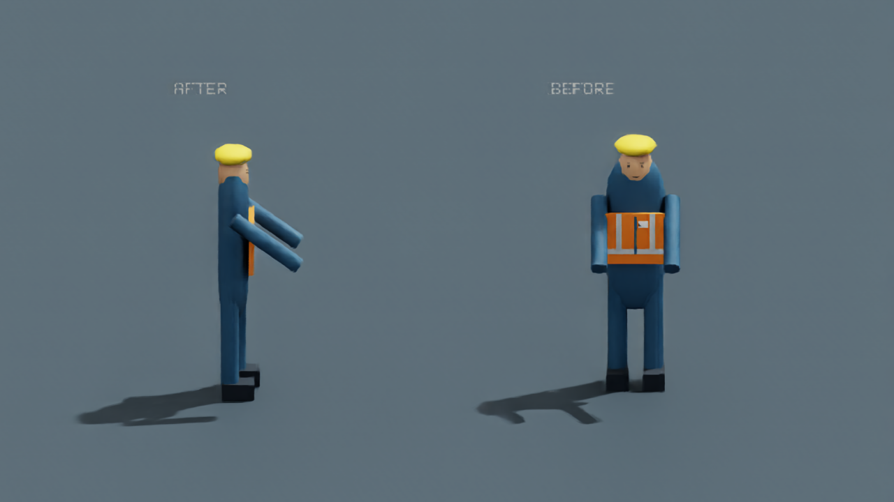
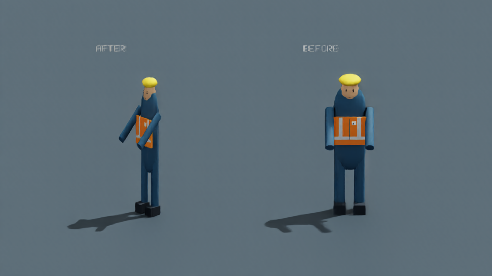
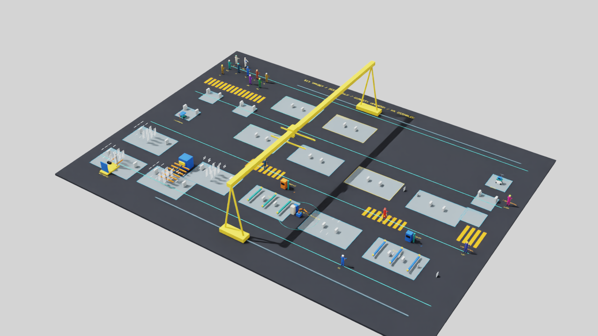

# S19A剩余内容与有限修复：完成候选 r2

2026-10-11；PR169 / LOG227—LOG228。负责人授权一次性完成剩余内容及有限修复，形成一个确切包，审批后再上传。本轮本地实现、固定验证和图文证据已齐备，状态 **IMPLEMENTATION_AND_EVIDENCE_COMPLETE_WITH_LIMITS / OWNER_ACCEPTANCE_PENDING / NOT_APPROVED / NOT_PUBLISHED**。人工审阅、工作判据及整步验收仍由负责人对本包决定，不预写通过。

## 本次集中完成的内容

普通行走采用原+Y正面轴跟随现有路线；在原拐角附近平滑转向，停步去掉脚步并保持朝向，再起步恢复。可视部件新增独立视觉变换，围绕原身体包络中心转向；为了严格不超原长宽，转弯时在XY平面自适应缩小（缩放<=1），Z高度保持。**这是受尺寸约束的表现取舍，转弯中身体比例会收窄，供本次视频审阅；不能视为人体动力学或新骨骼模型。**原部件尺寸、涂装、控制根、碰撞/占用、路线、速度、工时、容量和人因保持。

操作、叉车有限倒退/侧移保留原控制姿态。推车和测试车只改变脚步，上肢保持原姿态和手位；普通WALK阶段不冒称存在控制器握持绑定。实际操作恢复/保持原手位后才进行已有控制校验，不统一翻转所有人物或旋转碰撞盒。

F1在全部8处场景导出入口有限修复：在展平的副本上将贴图复制为内容摘要命名的本地资源，并改为相对路径，现场USD不改。SR-W1/SR-W2移到新审阅目录后解析到该目录资源并实际Kit回放；缺失贴图明确拒绝且不留下假成功USD。C1落实为公开`verify_s19a_visual.py`及`render_s19a_visual.py`入口，配套固定用例和事前声明协议。

## 整组对照与视频

[打开完整图册及36秒对照视频](../sim/images/s19a/completion-r2/index.html)。所有人物对照左候选、右已发布静态基线。12段分别展示四向、转弯、折返、停步/再起步、叉车接触倒退/侧移、测试车操作、带载推车和原W1真实路线。视频使用独立审阅副本；原40.4m路线加速回放，不改变原12点、1m/s或生产时间。带载审阅使用已有MEP构件副本，其工业能力不作新主张。

## 实际验证

- 新9项方向/包络边界回归；源码858项/249.591s、隔离wheel858项/219.443s通过，锁文件/Ruff/格式/构建/依赖检查通过。完整检查期间核心src/sim/tests保持，随后仅加强公开渲染CLI的协议校验；最终Ruff及公开CLI真实Kit复现均在冻结最终代码上完成，此绑定区别如实保存。
- 独立USD守卫3,816次逐帧检查覆盖15人全部朝向、受限脚步、操作姿态恢复/上肢保持、六路线及停步稳定；T1—T4完整原场景前后领域快照和障碍集合一致，重置稳定；两产品初始化/迁移及缺失贴图负例通过。
- 真Kit12段/864帧逐帧守卫，身体包络最大数值增量1.33e-15m（小于1e-6m容差），操作手位最大误差4.84e-10m（小于1e-6m容差）；根位移前后一致，相机读回阈值1e-4。最终完整关闭、退出0，日志无Traceback/fatal。
- 实际USD有限命令前缀前后相等：P1 WALK与FORK EMPTY_RETURN均STARTED/COMPLETED，共4回执；这是初始有限见证，不替代全部原长链。

原审核、静态图片/贴图、失败和冻结输入保持。首轮相机异步读回、次轮Windows截图短暂写锁、初始格式诊断均保留；修正捕获等待/格式后最终入口完整成功，不把诊断改写为模型失败或抹除。

## 事前工作判据与同负载性能

协议[原声明JSON](../model/S19A_visual_protocol_r2.json)在测量前固定：1280×720、RayTracedLighting、ABBA顺序，每轮合计预热60/采样180帧，三段各20/60，分别双人交叉、带载推车、测试车移动。全部前后领域快照摘要相同。候选工作上限为中位比1.50、P95比1.65；本轮实测中位比1.0813、P95比1.0429，满足这些事前声明的数值工作判据。**判据的负责人认可与整体视觉/性能验收仍随本包待审；不声称硬实时、GPU专用计时、人体工效或方法优势。**

| 次序 | 版本 | 中位ms | P95 ms | 最大ms |
| --- | --- | ---: | ---: | ---: |
| 1 | before | 9.404 | 11.569 | 71.501 |
| 2 | after | 10.191 | 12.188 | 13.106 |
| 3 | after | 10.538 | 12.591 | 73.388 |
| 4 | before | 9.767 | 12.191 | 72.287 |

## 可复现入口与审批出口

在已有Isaac Python中先运行`python scripts/verify_s19a_visual.py --output .local/s19a-review-guard`，再运行`python scripts/render_s19a_visual.py --output .local/s19a-review-render --verified-snapshots .local/s19a-review-guard --ffmpeg-path <已安装编码器路径>`。默认参考`step-S19A-static-r1`，默认用例/协议为本包JSON；每次输出目录必须新建。视频编码器仅为本地工具，不把可执行文件或额外运行依赖装入项目或公开包。

本包将A1路线方向、A2固定动作/手位矩阵、A3视频/工作判据/实测证据、F1受测修复和整体视觉验收集中交负责人决定。实现/证据已本地完成；人工验收不可由AI代填。工业G2保持OPEN/NOT_ESTABLISHED，S19B及S20—S28未启动。

拟目标仓库为现有`delongwangshu49-hub/adaptive-hrc-scheduling`，main父提交`07de8d761a8adea3e5219355d682429381a68a70`；批准后一个确切提交、新注释标签`step-S19A-r1`、main/标签原子推送并核验树/CI。当前没有暂存、提交、建标签、推送、PR或附件上传。本包含此前未发布的审阅治理，不改原封存审阅字节。确切文件清单、完整差异和逐文件摘要见本地ZIP的`_review`目录；机器摘要见[S19A候选记录](S19A_completion_r2.json)。
