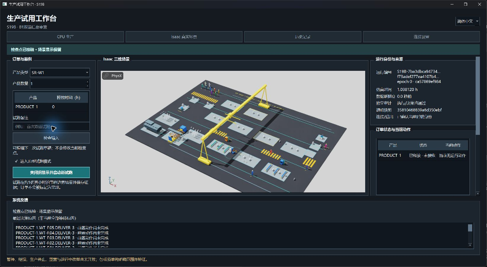
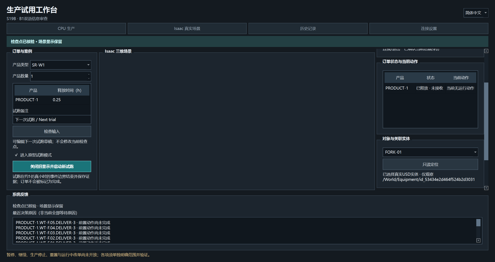
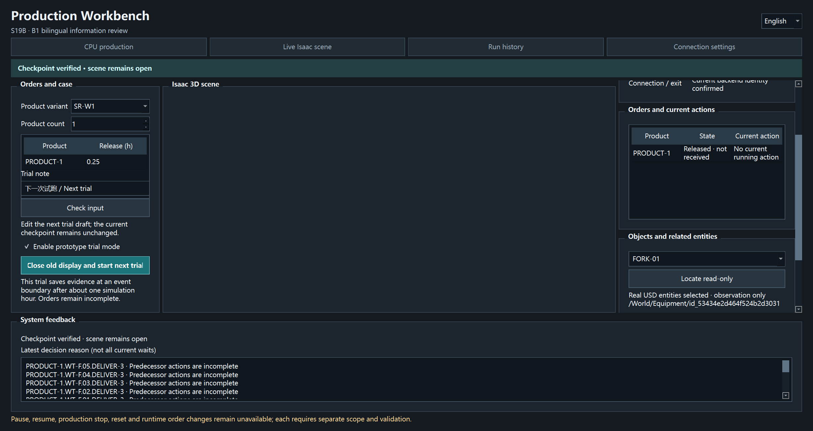

# S19B B1图审反馈修订

PR176 / LOG240。候选 **S19B-20261012-B1-feedback-r1** 为 **B1_UI_FEEDBACK_VERIFIED_WITH_LIMITS / OWNER_REVIEW_PENDING / NOT_APPROVED / NOT_PUBLISHED**。本轮按负责人要求修订暗色、浅色字、方角控件、中央真实视口自适应，并处理检查点后输入区被整组禁用的问题；另对截图里的悬浮短杆做实际只读追溯。

## 三项界面修订

| 反馈 | 现在的行为 | 事实边界 |
| --- | --- | --- |
| 界面暗色、字体浅色、按钮方角 | 全工作台及Qt预览统一暗色调色板，正文浅色、方角按钮及输入控件，中英保持 | 未改原模型材质、场景光照或生产数值 |
| 三维自动铺满中间视窗 | Kit按实际UI客户区调整渲染尺寸；内部视口去标题和编辑器停靠占位，保持在同一个Kit原生子窗口内 | 仍是主工作台中央原生嵌入，没有另建场景OS窗口；用户相机导航保持 |
| 左侧所有东西点不动 | 已核验检查点只保留显示时，可以编辑“下一次试跑草稿”；按钮改为“关闭旧显示并启动新试跑” | 不修改当前运行。先核对旧显示的实际退出及保存证据，再用冻结的下一次草稿启动新身份；真实生产前缀/未知状态仍锁定输入 |

不能直接解除运行中的所有输入限制，否则会把运行前草稿混同为运行中订单修改。现在左侧提示明确区分运行前、生产前缀锁定、下一次草稿和等待旧显示退出。重复启动仍被抑制，旧显示未正常退出或证据无效时不会自动开始下一次。

## 实际结果

最终ui-r5 **14组真实Qt/原生流程、19项桌面契约通过**；整个验证程序退出0，CPU和两次真实Kit均有Qt退出0回执。三次运行各119个捕获文件与当前源码匹配，执行/决策审计均PASS。CPU与初次Kit均1.0381202777777776h，下一次草稿释放时间改为0.25h后，新Kit为1.0669369444444443h事件边界检查点；全部仍ready=0/received=0，非完整订单。

已实际核对：保留显示时更改产品数量、释放时间和备注，不改变旧`request.json`或`configuration.json`字节；新运行采用新run/request身份及0.25h草稿，只在旧Kit退出后启动。初次Kit读回UI视口892×411.3333逻辑单位，与主客户区相同；渲染892×411，fill_frame=true。原生父子包含、缩小/恢复、实际相机矩阵、合成原生滚轮、四类定位与旧身份/损坏/缺失负例保持。

14组覆盖了本轮受影响流程；原122核心回归、源码/隔离wheel858项保留，**没有把它们改称本轮重跑**。根依赖与领域/规划/生产/几何源码未修改。

上图来自Windows实际窗口捕获，已核对当前桌面存在对应窗口；含输入工具的鼠标标记，不是Qt布局图或合成拼图。新启动器授权等待曾超时，最终复用此前的工作台入口打开并检查实际画面，未凭后台进程记录宣布可见。

后两图是Qt控件布局抓图，不保证包含GPU子窗口；原始交换链图片见[实际Kit客户区](../sim/images/s19b/b1-feedback-r1/actual-kit-frame.png)。旧物理输入法/负责人任务、多屏与正式前端语义性能仍未验收，不能把本次工具输入和图审反馈当人工ACCEPTED。

## 悬浮支承是独立问题

**是问题，不是正常生产效果。** 白色短杆来自既有固定落点支承、移动支承及停放托片。真实USD中识别510个对象，AABB筛查478个未连到地面起点；诊断前后整个USD根层摘要相同。此筛查不构成结构或物理承载证明，也不改变既有生产审计。具体来源、局限和独立修复范围见[悬浮支承问题](../sim/S19B_scene_support_issue_r1.md)。

该项保持 **OPEN / NOT_FIXED**。负责人明确这是本步骤之外的问题，本次没有隐藏、移动或删除这些对象，也没有擅改原几何/碰撞和支承契约；后续须针对实际连接架、停放架、取放/换装路径及碰撞变化形成独立范围和验证。不能因为B1或原执行审计PASS就将其关闭。

## 封存与边界

[机器摘要](S19B_B1_feedback_r1.json)。原始14组索引位于`.local/s19b-b1-feedback-20261011/ui-r5/ui-verification.json`；同一反馈目录保留三次运行、契约/格式/依赖日志、来源/保护核验、逐文件摘要与完整差异。目录日期沿用跨日前创建的标签，候选按本次完成日标识。

`review-manifest.json`为确切累计文件集合，`review.diff`为相对HEAD完整差异，`feedback-from-B1-r1.diff`为相对原B1封包的完整差异；新zip及`review-receipt.json`独立封存。目标为现有仓库/main、拟标签为空、远端操作为空。原r1/r2原型及B1封包原摘要保持，全部历史文件/失败保留。

ui-r1至ui-r4的渲染DPI比较、停靠占位、SDK WindowHandle接口、相机读回滞留等失败均保留；最终固定仅在尺寸变化时更新UI布局，重绑定实际视口并以有界实际帧读回确认相机，未放宽成功阈值。原RC完整Kit关闭返回后显式helper退出、跳过解释器最终收尾限制保持。

当前新版已在负责人桌面打开简中真实Kit检查点，供继续审阅；本次审阅显示保留10分钟，普通入口默认5分钟。B2/B3、运行中订单变更、生产暂停/停止/重置及发布均未启动，工业G2 OPEN / NOT_ESTABLISHED保持。顺序仍为B1信息清晰性审阅→B2最小控制/负例→B3简中试用/英语演示及语义性能→确切验收/发布。
