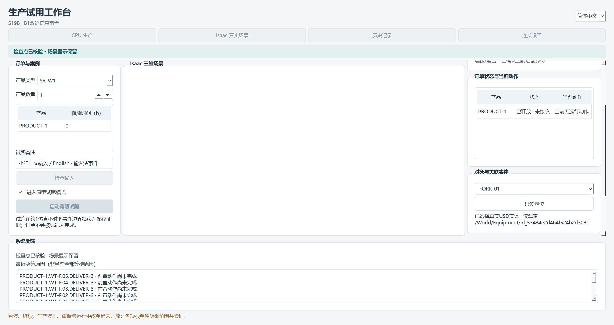
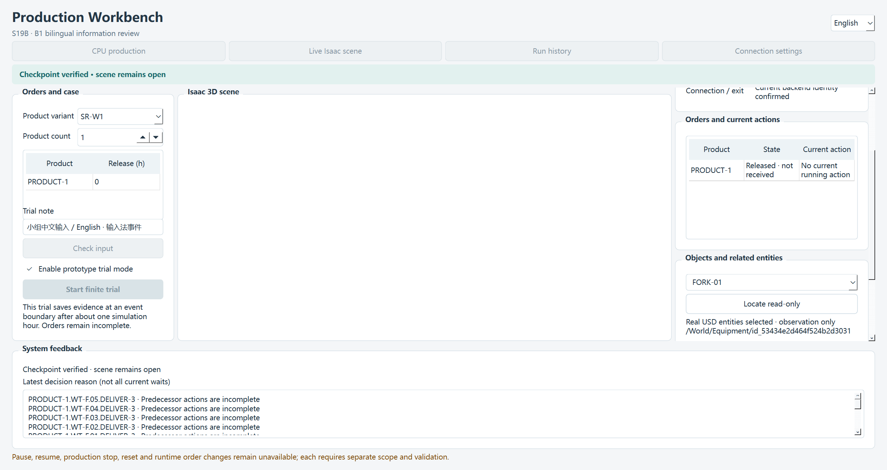
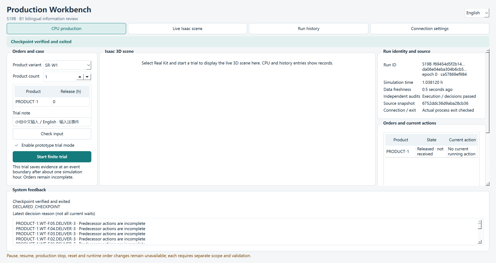
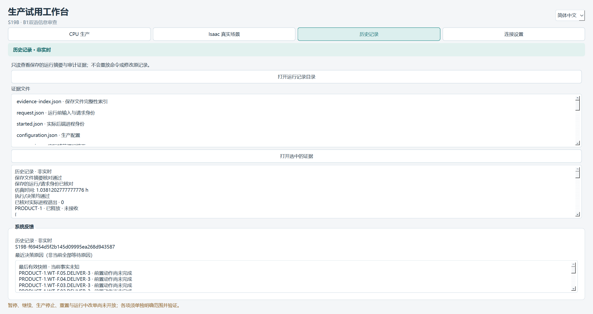
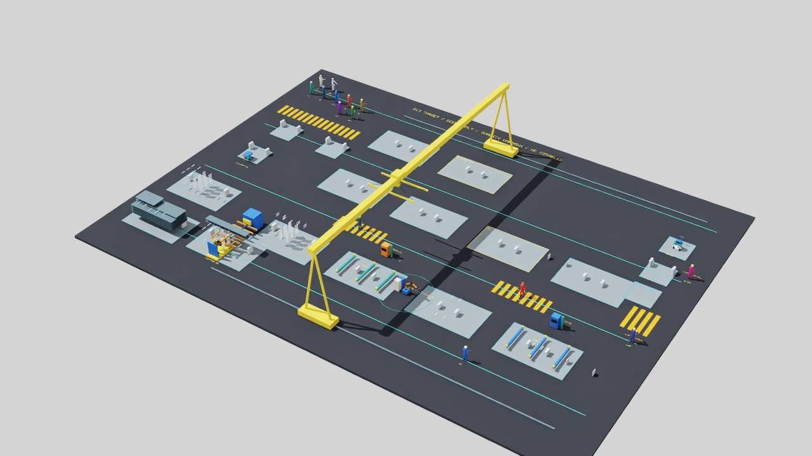
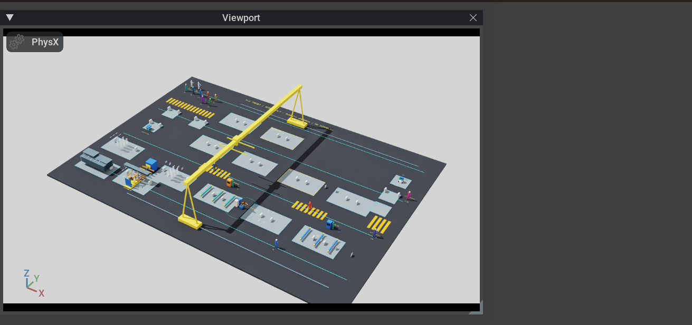

# S19B B1：双语信息与只读审查成果

2026-10-11；PR175 / LOG239。候选 **S19B-20261011-B1-r1** 当前为 **B1_INFORMATION_REVIEW_VERIFIED_WITH_LIMITS / OWNER_REVIEW_PENDING / NOT_APPROVED / NOT_PUBLISHED**。本地程序验证完成；负责人信息清晰性和人工操作验收尚未发生。沿用main和现有目录，没有分支、worktree、子代理、Git暂存/提交/标签/推送。工业G2保持OPEN / NOT_ESTABLISHED。

## 已实现的四项内容

| 内容 | 实际行为与事实来源 | 拒绝/未知边界 |
| --- | --- | --- |
| 双语状态 | 原后端运行/请求/epoch/序列绑定的快照；产品、实际动作开始/异常、阶段、数据年龄、连接、检查点、双审计、Qt实际退出 | 提交不等于确认；过期、缺失、损坏、旧身份、配置/源码版本不符显示未知，禁用定位/相机；退出后是保存的检查点事实 |
| 实际原因 | 在线日志最终原因优先，未回执时保留提案原因；中英解释关联原对象、观察/时刻/序号/来源、实际开始/拒绝回执，原码保留于提示与证据 | 最近决策不是所有当前订单等待原因；未提供明确未知，未审阅词条明确尚未翻译；不从颜色、订单进度或窗口存在猜测原因 |
| 实体定位 | 点击订单/动作单元格选择稳定ID，或在对象框选择/输入；用当前后端USD映射选择既有实体，动作选择相关实体/设备；实际读回选择路径 | 未映射由显示端拒绝，部分关联未映射单列；CPU/历史不伪造场景；静态目录不覆盖全部动态服务动作，不创建新节点或修改几何/生产状态 |
| 集中证据 | 当前检查点显示中可预览，退出后和历史均只读；输入、身份、配置、源码、预算、状态、事件、决策、原因、审计、映射、确认/退出、真实图片集中入口，带双语用途 | 新后端索引绑定身份及保存文件摘要，打开前重核；损坏/缺失/旧身份拒绝；旧无封存索引记录明确完整性未核验，不改写或重放 |

显示请求绑定运行/请求/epoch/序列/动作/目标。定位确认还须有实际选择路径和前后USD/生产状态摘要一致；相机确认还须实际帧矩阵误差小于1e-4。前端确认和后端输出各有独立事实边界，动态显示确认与Qt退出回执不混入静态后端索引。索引是本地字节完整性检查，不是签名或外部真实性认证。

显示模块仅由桌面/有限驱动使用，未进入领域、观察、规划器或在线预算接口。模型/几何/碰撞/路线/操作手位/工时/容量/人因和原生产参数保持。

## 最终实际验证

最终ui-r4完整验证程序实际退出0，共11组真实Qt/原生流程通过；19项桌面契约回归、122项相关核心回归通过，Ruff/格式和独立桌面依赖检查通过。核心回归覆盖在线预算、在线修复、观察隔离、场景和生产修复。原r1源码/隔离wheel各858项保持，**本次没有重跑或冒称新增858项全检查**。

| 路径 | 实际结果 | 原范围 |
| --- | --- | --- |
| CPU | 1.0381202777777776h，DECLARED_CHECKPOINT，执行/决策PASS；closed=true，Qt NormalExit/0，保存文件摘要核对通过 | 1产品SR-W1有限事件边界前缀，ready=0/received=0 |
| 真实嵌入Kit | 同检查点、双审计PASS及Qt NormalExit/0；真实原生父子包含、缩放和最小化恢复通过，150%本屏验证保持 | 原USD/RTX后端；完整Kit关闭返回后显式helper退出 |
| 历史 | 新CPU记录只读哈希保持，双语原因从原日志读取；损坏事件、缺失决策、旧运行退出身份均实际拒绝副本，失败入口清空旧摘要/原因 | 只读保存记录，不重建三维或重放命令 |

CPU/Kit各118个捕获实现文件与最终源码逐项匹配。四类真实定位分别为PRODUCT-1、P1、PRODUCT-1.ST-T.12.DELIVER-1关联实体/设备、FORK-01；每次实际读回路径与请求一致，USD整层文本和生产状态前后摘要相同。B1-UNMAPPED-ENTITY在真实显示端accepted=false，保留原选择，未修改场景。最终实际相机矩阵误差见[机器摘要](S19B_B1_r1.json)；合成原生滚轮仍实际改变渲染矩阵。

Qt数据负例通过注入读边界执行，包含过期、缺失、损坏、旧运行/请求、源码/配置漂移，当前产品状态转为未知、定位/相机禁用；不破坏真实后端文件。契约测试另覆盖布尔epoch/序列、重放、目标/动作错配、缺少实际定位/相机读回、全部14个必需证据文件的损坏/缺失与索引逃逸。负例不等于实际网络故障或负责人任务验收。

## 图片与审阅

以下Qt抓图只证明双语控件/布局和文本，**GPU原生子窗口未被Qt抓图包含**。不能把中央白区称为真实视口未运行，也不能把Qt图当完整桌面视觉证据；真实Kit显示由原生包含、USD实际选择/渲染读回及后两张SDK图片分别留证。

右栏在本次屏幕尺寸下需要滚动查看定位/相机/证据，长ID用提示及证据保留完整值。负责人仍须审阅原因是否易懂、操作是否方便、简中/英语展示是否合适。

## 证据、差异与保留

公开机器摘要：[S19B_B1_r1.json](S19B_B1_r1.json)。本地原始索引为`.local/s19b-b1-20261011/ui-r4/ui-verification.json`，同目录含两次实际运行；独立父进程退出回执、契约/122回归/依赖/格式日志、来源绑定、保护核验均在同一B1目录。

确切逐文件摘要、相对HEAD累计完整差异和相对步骤1-r2封包的逐文件完整差异见本地`review-manifest.json`、`review.diff`、`B1-from-r2.diff`及`review-receipt.json`；候选zip为`S19B-20261011-B1-r1-review.zip`。这些是可审阅快照，不是上传授权。目标仓库为现有adaptive-hrc-scheduling，分支main，拟标签为空，拟远端操作为空。

原r1/r2封包摘要分别保持932340ae39376cd390239a4af27ee24f9e99c9d9148ae1d80b5838f393409333、44758d3033d9c465e849ddc812431b6f4d8e16b753641a01b2457f690ae6073c。689份接续前已跟踪文件中，本轮/交接必要六份治理文件以外683份原字节保持；112份核心/场景及指定既有生产脚本Git内容与HEAD一致，含19个历史M文件。步骤1源码、原证据、全部失败封包仍保存于原位置。

本轮ui-r1至ui-r4均保留；早期受测代码与最终代码不同，不用早轮结果代替最终源码绑定。初始格式/布局挤压、默认uv外部缓存拒绝访问等诊断保留，已用仓库内独立缓存完成依赖检查；未安装新栈或重写根锁。Kit原停靠留白、启动窗口到挂接交接和RC收尾限制保持。

## 未完成与接续边界

本次仍只有事件边界前缀，非完整订单/整链或连续1:1动画。Kit完整关闭返回后显式结束helper，跳过RC解释器/插件最终收尾；不是普通解释器退出修复或B2生产停机。物理输入法候选、真实负责人任务、多屏、完整新桌面打包和正式前端语义/性能对照未验收。当前原因词表有限，保留未翻译/未知而不编造；历史无索引不获得完整性认证。

本地程序VERIFIED与负责人ACCEPTED分别登记，确切验收/发布另审。B2/B3、运行中插单/改单/通用取消、生产暂停/停止/重置及S20—S28未启动。接续顺序：**B1信息清晰性审阅 → B2最小控制/负例 → B3简中试用、英语演示及语义性能对照 → 确切成果验收/发布**。
