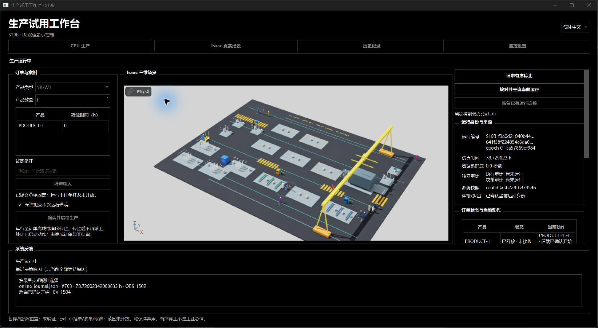
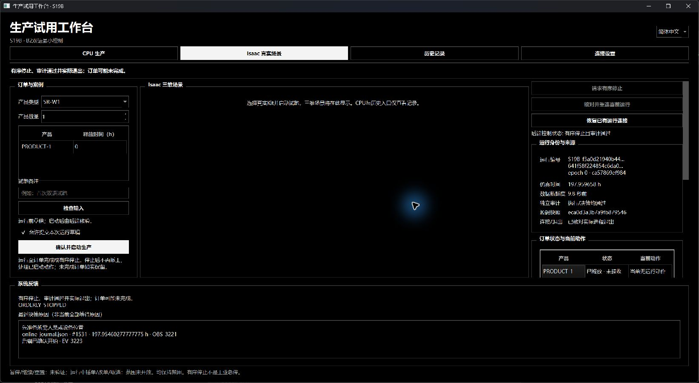

# S19B B2最小控制本地审阅

2026-10-14，PR181。候选 **S19B-20261014-B2-r1**：**B2_MINIMAL_CONTROL_VERIFIED_WITH_LIMITS / OWNER_REVIEW_PENDING / NOT_APPROVED / NOT_PUBLISHED**。已沿现有main直接实现输入校验、确认启动、有序停止、持久幂等确认及同一运行断连重连；B3、整步验收和发布另审。

## 现在的行为

默认工作台从原1h前缀切换到B2控制模式。运行前草稿需实际确认，提交后固定；后端独立校验严格字段/类型/数量/释放时间、草稿与后端确认、三份固定输入摘要和运行目录。永久exclusive-create声明限制同一提交目录只启动一个worker；重复启动不能覆盖结果或创建第二条生产运行。

控制协议记录run/request/epoch、命令ID、顺序、完整请求摘要和确认。后端在执行效果前保存受理记录；重复同内容回读原确认与最终结果，同ID不同内容、旧身份/epoch、乱序、未确认及非法动作/状态持久拒绝。受理、实际开始、停止处理中、最终保存和实际退出分别显示，超时不解释为成功或拒绝。

停止在下一次派工前边界禁止新生产/服务派工及外部生产事件，沿原CPU推进或Kit实际USD读回处理已启动动作。最终WAIT决策、执行/决策审计及未完成订单保留；异常/HOLD/无进展不能报停止成功。没有强杀、取消订单、清承诺、回滚或暂停/恢复生产。具体状态与能力表见[控制契约](../sim/S19B_B2_control_contract_r1.md)。

重连核对同一request、epoch、来源、未决命令、实际worker PID和Windows内核创建时间；新前端保留内核句柄观察实际退出。重连不重放历史命令、不启动新进程。已退出记录只有实际退出回执和保存证据齐备时只读打开；缺失、损坏、陈旧或失配保持未知。前端日志已改为文件输出，前端进程丢失不会再因日志管道断开使worker最终输出失败。

## 实测证据

| 范围 | 实际结果 |
| --- | --- |
| 全项目CPU检查 | 源码862项、独立wheel862项通过；包含4项真实生产停止边界/异常保留/无停止不变测试；Ruff、构建及依赖检查通过 |
| 桌面契约 | 23项通过，含输入来源、目录复制、幂等冲突、旧epoch/乱序、终态拒绝、只读恢复及缺失/损坏记录 |
| 最终真实Qt双语/CPU/中央Kit | 8组通过，独立父进程观察验证程序实际exit0；三个后端均两审计/保存证据/实际exit0 |
| 最终CPU停止 | 1.0468225h受理边界，完成已启动动作至1.1183425h；接收0，停止后无新派工或外部生产事件 |
| 前端实际进程丢失/恢复 | 新工作台恢复同一CPU worker，重复重连无重放；1.887753611111111h停止，保留内核句柄确认exit0，结束后只读恢复 |
| 最终嵌入Kit停止 | 0.7429091666666667h受理边界，实际USD读回至0.8156869444444444h；接收0、两审计PASS、完整Kit关闭返回、Qt实际exit0 |
| 完整正常路径 | CPU与中央嵌入Kit均完成436项本例有效静态工序，272.35047973655236h、接收1，两审计及实际exit0；原720h窗口/在线预算保持 |
| 负责人交互桌面 | 实际原生窗口可见、中央真实Kit显示并运行；AI经确认框启动/重连/停止。197.95460277777778h边界处理在途动作至197.95965833333333h，接收0、两审计/完整关闭/实际exit0 |

最终8组覆盖：中英草稿与明确返回拒绝、真实CPU重复/冲突/旧epoch/乱序等6类拒绝及第二worker拒绝、停止未决期间断连重连去重、前端实际进程丢失后恢复、已退出只读恢复、中央原生嵌入/缩放/自动铺满、B1只读定位/实际相机矩阵，以及Kit停止读回/审计/完整关闭/实际退出。全部停止在其受理边界之后均没有新ACCEPTED/STARTED/WORLD事件；未完成订单没有伪报完成。

最终三次Qt后端和负责人桌面各121个捕获文件与最终源码逐项相同。完整正常双后端均绑定相同执行/控制/场景源码与输入；运行开始后仅app.py确认弹窗外观和i18n.py“确认/返回”词条变化，最终Qt/负责人桌面已经另行覆盖这两项。该来源差异明确列于[机器摘要](S19B_B2_r1.json)，不称完整正常链所有121文件与最终界面字节相同。新B2在线正常链为4402事件/2072决策，不冒用紧急修正原4400事件/2070决策的字节一致结果；严格比较与独立重建记录见同一机器摘要。

两图来自实际Windows窗口捕获，包括GPU原生子窗口；不是Qt拼图。AI合成输入和本次程序验证不等于负责人人工任务或B3验收。

## 交付与边界

使用[工作台说明](../../desktop/s19b/README.md)中的现有启动入口，或当前已打开的简中工作台。当前显示本次停止事实，可检查证据，再确认新草稿试跑。“请求有序停止”与旧“关闭检查点显示”语义独立；旧无control请求继续按原有限前缀兼容，不能用来证明B2停机。

暂停/继续/重置和运行中插单/改单/通用取消继续禁用，界面给出双语原因。停止不是工业急停或硬实时保证，长计算或Kit读回期间可超时未知；停止后不支持继续生产或崩溃后重启旧worker。当前Windows本地单操作者协议不构成多用户鉴权/签名服务。正式性能/人工输入法/多屏及B3任务另审。

全黑黑白方角、B1双语、中央真实Kit自动铺满及已接收兼容模型保持。12个紧急兼容非治理封包成员和旧封包摘要再次核对；固定承载架/收存托片/可重配横杆仍TECHNICAL_OPEN_NOT_FIXED / NON_BLOCKING_FOR_DEMO。原510对象/可见性/碰撞、生产/路线/落点/手位/支承运动、2.4m和0.02h/对、观察隔离/原预算及工业G2 OPEN/NOT_ESTABLISHED保持。

Kit完整关闭返回后仍显式结束helper，跳过当前RC解释器/插件最终收尾；没有称该限制已修复。原失败、原未提交成果、全部旧包保留。首轮前端管道丢失导致worker exit1、类型恢复/测试假设与格式失败、比较器旧报告形状不兼容均留在新本地工作目录，不改写旧证据。

确切文件集合、逐文件SHA256、相对HEAD完整差异、相对接手包变化及新zip位于独立本地审阅目录`.local/s19b-b2-review-20261014/`。目标现有仓库/main，拟标签为空，拟远端操作为空；无Git暂存/提交/标签/推送。B3、整步验收、发布和S20—S28没有启动。
