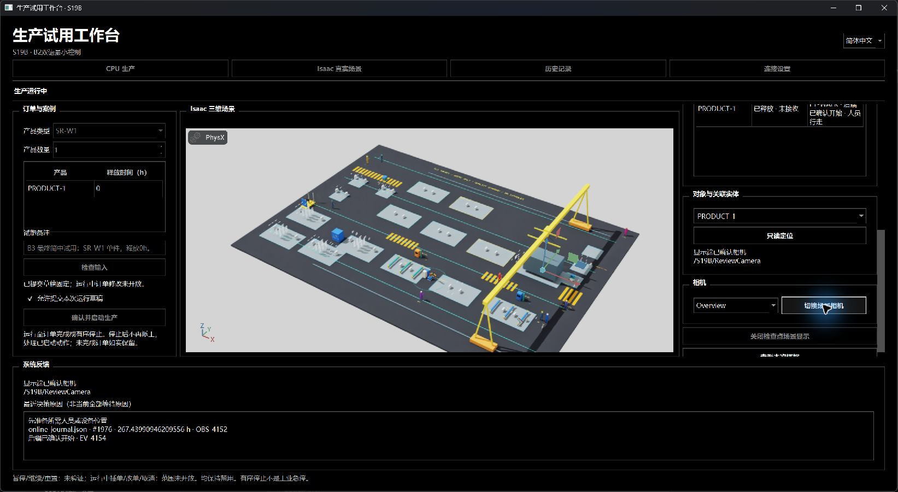
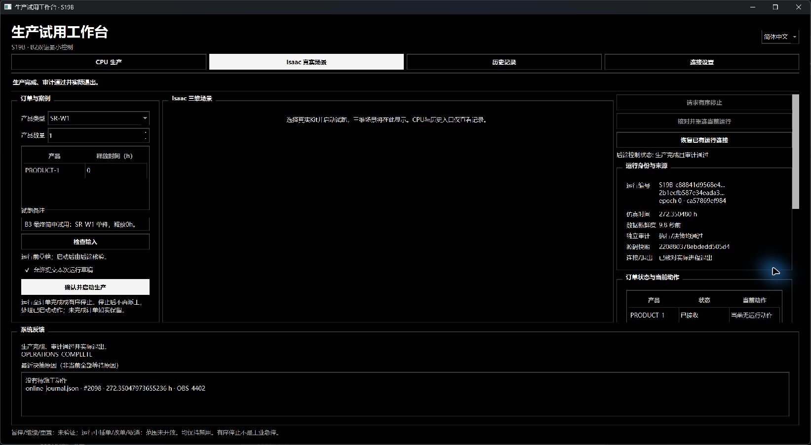
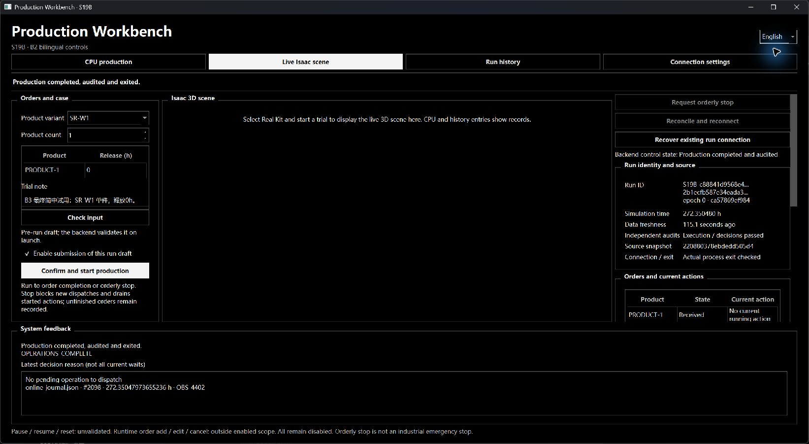
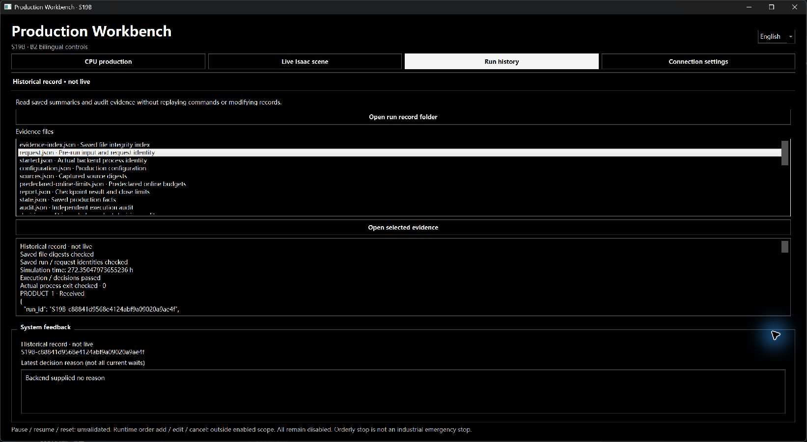
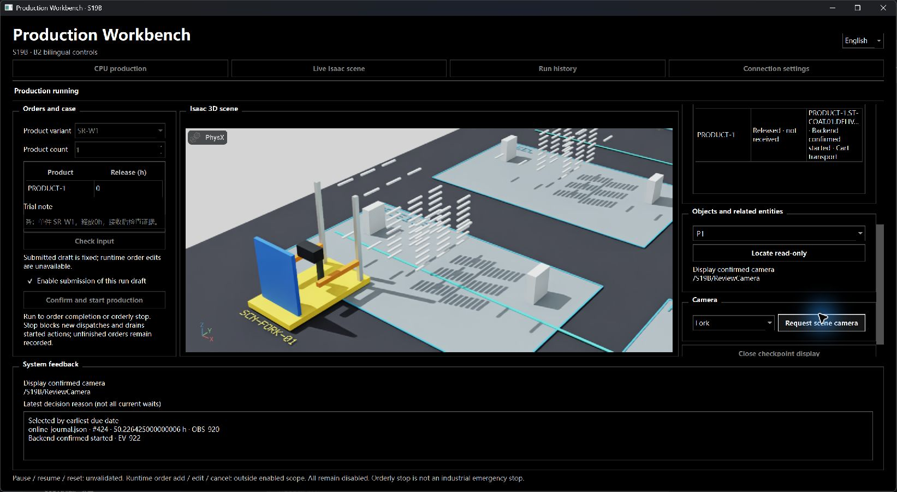

# S19B-4：B3实际试用、英语展示与有限对照

2026-10-14，PR182。AI已在真实Windows工作台完成新的简中完整SR-W1任务，再切英语检查同一保存记录、证据和只读历史。当前 **B3_ACTUAL_TRIAL_VERIFIED_WITH_LIMITS / FORMAL_PERFORMANCE_OPEN / OWNER_REVIEW_PENDING / NOT_APPROVED / NOT_PUBLISHED**。这是AI操作与程序验证记录，负责人人工体验和整步验收仍待进行。

## 实际任务与本轮修订

最终简中任务为SR-W1、单件、释放0h，备注“B3 最终简中试用：SR-W1 单件，释放0h。”。原NORMAL/720h与5s周期、50ms协作搜索预算保持。AI经原生工作台检查输入、启用提交、读回固定草稿确认并启动；中央Kit实际显示，运行中订单只读。实际原因区保留来源、观察/日志编号和开始回执；未知翻译明确保留限制，不推断全部等待原因。

最终运行 `S19B-c88841d9568e4124abf9a09020a9ae4f` 完成436个本例有效静态工序，272.35047973655236h、接收1。执行/决策审计均PASS，Kit完整关闭返回，Qt实际观察exit0。各121个捕获源码/输入全部与最终运行源码一致。产品只读定位实际选择既有USD节点，前后USD及生产状态摘要相同；Overview更新的实际矩阵误差2.84e-14，真实画面通过观察。

初次简中完整任务 `S19B-7d606e1a009542159ecbc60c1ff1df59` 同样接收1/双审计/exit0，但相机更新后实际GPU图持续变白，不能将矩阵确认当视觉通过。第二次独立英语完整运行 `S19B-944263a4a3ff4b37a663037b8effb247` 用修订显示端完成同一生产输入，Fork/Overview正常，亦接收1/双审计/exit0。前两次分别有2个/1个文件相对最终源码不同，单列为中间来源，不冒称最终121一致。原失败图、全部原运行及封包保持。

本轮只修订显示相机更新（保持活的Camera prim，更新其既有属性）和新运行初始化文案（立即清除前次退出/控制成功文案）。原相机预设、World几何/碰撞/生产状态不改。相机初始CopySpec保持，运行中更改显示Camera属性；本次视觉通过仅涵盖受测Overview/Fork及程序Top。三类支承问题仍技术OPEN，负责人决定用于演示且不阻断演示，不登记结构问题已修复。

## 英语展示路径

最终简中运行退出后切English：草稿中文备注、run/request/epoch、输入/源码摘要、272.35047973655236h、Received、双审计和实际退出事实保持。实时Locate/Camera/Stop此时禁用；中央留空，不复用旧图冒充在线。Inspect this run's evidence打开Historical record · not live，索引/保存身份核对通过，实际预览request.json；31个保存文件在只读历史操作前后逐字节一致。

可复现的课程展示顺序：打开 `scripts/start_s19b.ps1` → English → Live Isaac scene → SR-W1/1/0h → Check input → Enable submission → Confirm and start production → 核对新Run ID及实际初始化 → 中央真实场景/订单与动作/Latest decision reason → 只读对象定位及相机 → 完成/双审计/Actual process exit checked → Inspect this run's evidence/Run history → request、report、audit、decision-audit及实际退出证据。实时展示必须采用新身份；历史无需启动生产。需要提前结束才用Request orderly stop，并区分受理、处理、审计和真实退出；Pause/Resume/Reset及运行中订单修改继续禁用。

## 对照范围、失败与尚未关闭的出口

事前口径见[B3协议](../sim/S19B_B3_protocol_r1.md)，完整机器数据见[B3摘要](S19B_B3_r1.json)，实际文件绑定见[证据清单](S19B_B3_evidence_r1.json)。严格比较保留全部4402事件/2072决策、状态/观察/资源/人因/承诺及独立重建。旧B2 CPU与首次未修订任务严格PASS；修订后两次对旧B2严格比较因来源不同而FAILED，生产字段/时间与双重独立审计仍一致。失败不删除、不放宽比较器。最终源码新CPU基线接收1/双审计/实际exit0，与最终实际Kit各121捕获源码一致；其严格比较及两边独立执行/决策重建PASS，时间及其他数值最大差异0，几何最大差异6.85e-14m。

有限控件对照采用同一保存输入与实际journal的40个最长reason_fact（最大原因码19217字符），zh/en/en/zh，每块预热20次、200次、250ms间隔；全量状态/订单/原因、无曲线/分页。Qt offscreen控件/事件处理的P95最高9.74ms、max最高15.28ms，低于事前50/250ms限值；CPU每块2.23—2.56s，峰值工作集224804864字节。800次完整原始样本保留、输入摘要未变、无命令。此为含后台验证负载的显示压力回放，不含真实GPU绘制或新的在线派工，不能关闭正式性能出口。

正式同显示后端前端开关、无头与可见显示方式成本，以及规定两订单/物流冲突、B+1缓冲接收、有限故障反馈、零/过载预算的新前端在线ABBA仍 **OPEN**。已核对10份既有双后端对应负载PASS，但有9个源码差异，均保持原历史时点，不能代替最终前端对照。没有据S19A限值、主观流畅或回放宣称正式性能合格、硬实时或方法优势。当前封包是带明确缺口的B3审阅候选，整步出口未关闭。

新运行审计期间超过5s无快照会显示未知并禁用当前控制/定位，相机/证据也受当前身份限制；该期间没有心跳响应保证。部分实际原因码没有审阅译文，只读历史下“后端未提供原因”不等于生产没有等待。物理中文输入法候选、多屏/人工体验尚未验证。

回放r1进程内存句柄声明错误、r2离线journal触发在线体积上限、r3非最重排序、r4最终测量均留存。全项目检查首轮全局uv缓存访问失败，改用既有仓库隔离缓存后完成源码/wheel。Qt控制复验首轮内部8项PASS后解释器收尾崩溃（实际-1073741819及Python应用错误提示），保留为失败；修订验证器QObject清理顺序并复验，不能拿内部PASS替代实际exit0。读取csrss错误对话框的工具授权超时，该框未获核查/关闭；目标工作台之后实际恢复并完成证据预览。

## 保持与审阅交付

源码/隔离wheel各862项，24桌面契约、最终8组真实Qt/CPU/Kit控制、验证程序实际exit0通过；最终简中任务/新CPU基线/三次控制后端/回放控制后端共六次，各121捕获源码与当前运行源码一致。完整项目检查之后仅将验证程序清理提取为共同函数，其入口/退出另实际验证，最终Ruff检查/格式通过；生产与软件源码未再改动。验证程序与AI桌面均不等于负责人人工验收。Kit完整关闭后显式结束helper、跳过6.1RC解释器/插件最终收尾的原限制保持。

全黑黑白方角、B1简中/英语、中央真实Kit自动铺满及兼容修订保持；固定承载架/收存托片/可重配横杆TECHNICAL_OPEN_NOT_FIXED / NON_BLOCKING_FOR_DEMO，原510对象、生产/观察/预算、2.4m、0.02h/对与工业G2 OPEN/NOT_ESTABLISHED保持。原B2-r2、89文件中间包、六旧包、全部失败不改写。

新确切累计候选位于 `.local/s19b-b3-review-20261014-r1/`，清单、SHA256、差异、证据关联与zip独立保存；实际运行大文件留在其新目录，以完整摘要清单绑定。目标现有main，拟标签与远端操作为空，无Git暂存/提交/标签/推送、分支/worktree/子代理。整步验收、发布及S20—S28另审。
