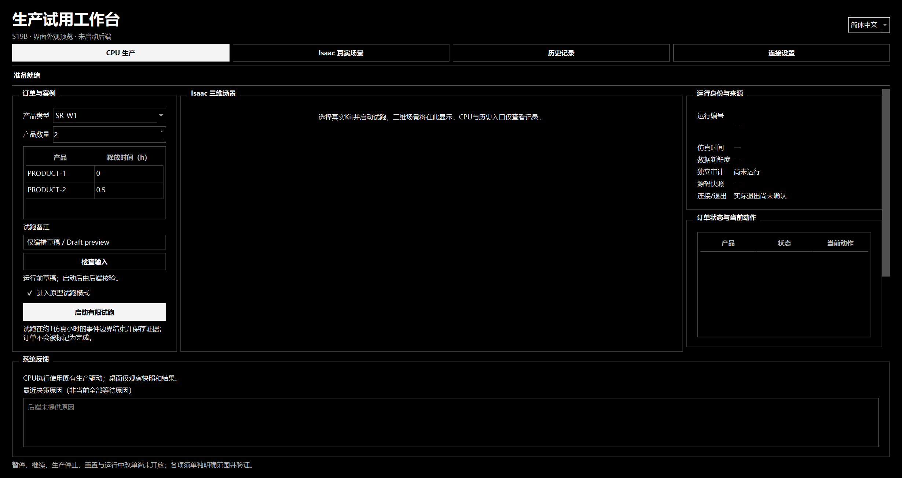
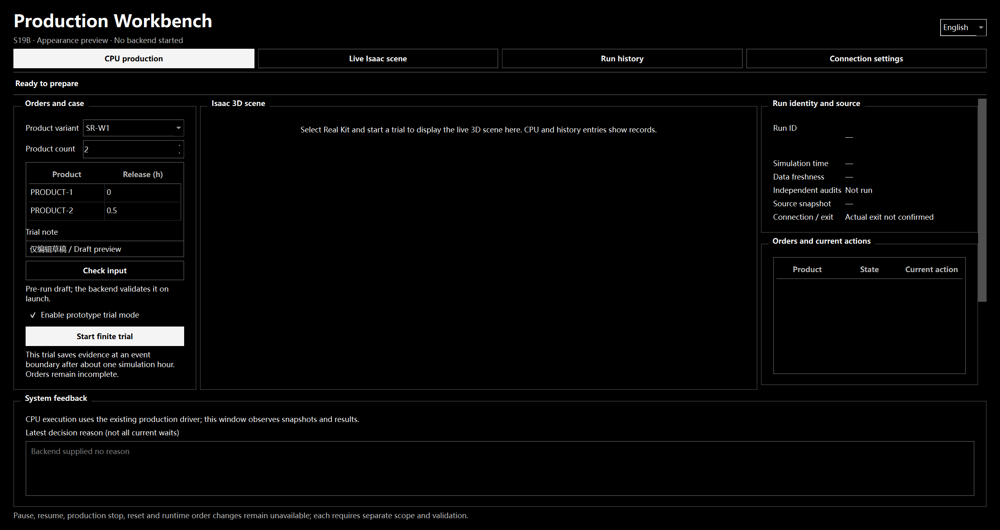
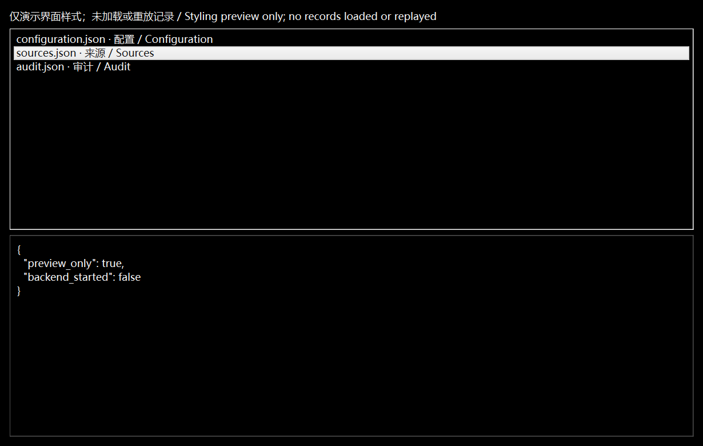

# S19B全黑／黑白极简界面修订

2026-10-12；本轮仅按负责人要求调整现有工作台视觉。状态 **UI_STYLE_REVIEW_READY / OWNER_REVIEW_PENDING / NOT_APPROVED / NOT_PUBLISHED**。

参考既有IFC ClashTrace的无彩底色、细分隔线、白色主按钮/选中态与文字层级。主背景和各面板改为纯黑，正文白色、次级文字和边框仅用中性灰；取消原蓝灰、青色和暖色提示。保留方角，突出标题，收紧控件留白，选中和焦点用黑白反差表示，状态/原因文字含义不变。

实际代码改动仅在`desktop/s19b/src/s19b_desktop/app.py`的`STYLE`与`configure_application`调色板。两部分之外的Python AST与修改前一致：输入、双语、运行/请求身份、证据、显示请求、检查点后的下一次草稿和实际退出后启动流程均未更改；中央真实Kit原生嵌入/自动铺满实现保持。

## 实际外观预览

以上是当前Windows Qt控件实际抓图，预览明确标注“未启动后端”，中央区域没有冒充真实场景的图片。中英切换后草稿摘要保持，没有创建运行/请求身份、没有启动CPU/Kit或重放历史记录。只读窗口中内容为标明的样式演示。初次offscreen平台缺字诊断保留于本地，最终用Windows Qt正常字体重新渲染和逐图检查。Ruff与格式检查通过；未为纯视觉修订重跑完整生产、性能或Kit链。

当前窗口尺寸下右栏仍可滚动；三维模型、材质、光照、生产/观察、预算及模型修复不属于本次改动。紧急修正对话的工作区改动由其继续负责，本轮未覆盖或恢复其文件，也不将它的新进度冒称本轮成果。

## 交接与封存

负责人会在“紧急修正”有结果后安排该对话交接回来，再将整合内容统一交接给新对话进行步骤三。当前只记录此接续安排，没有主动接入、修改或验收模型修复，也没有新建后续对话、启动步骤三或发布。

本地独立目录`.local/s19b-ui-monochrome-20261012`保留修改前界面源码、仅样式差异、逐文件摘要、Qt预览验证及本次界面包；此前全部B1/原型封包与失败保持。仅本次文件集合可作为样式审阅候选，不代表紧急修正或整个S19B的确切验收。目标现有仓库/main，拟标签为空，远端操作为空。负责人人工视觉认可仍待进行。
