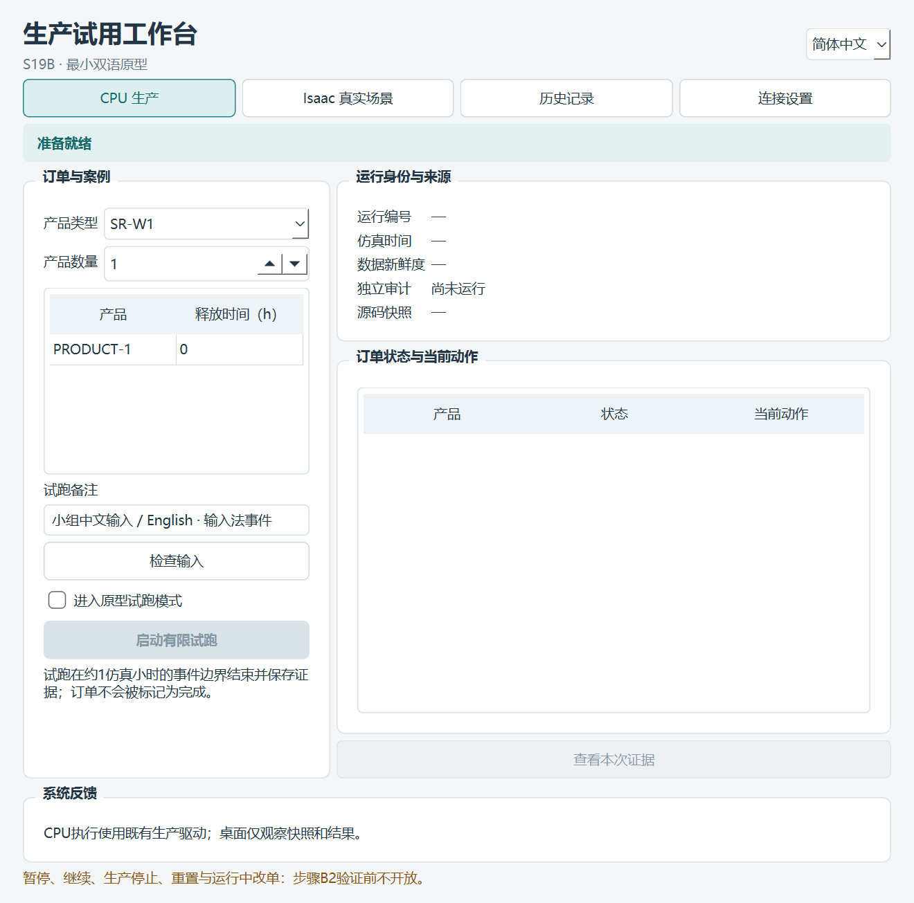
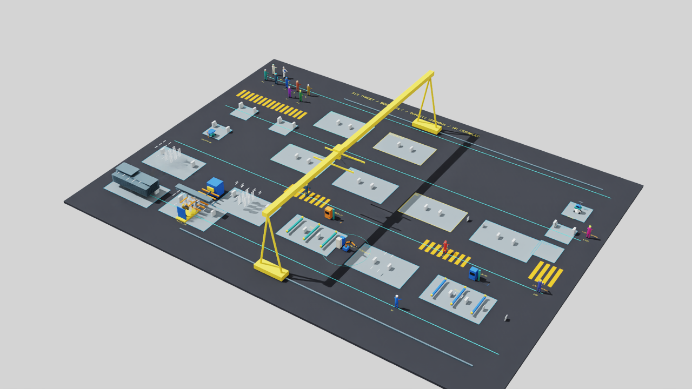

# S19B 方案B最小双语原型审阅

2026-10-11；PR173；仅步骤1。原型三入口、双语输入与状态连接已实际贯通，当前为 **MINIMAL_PROTOTYPE_VERIFIED_WITH_LIMITS / OWNER_REVIEW_PENDING / NOT_APPROVED / NOT_PUBLISHED**。完整CPU检查已实际退出0：源码858项/290.252s、隔离wheel858项/301.393s，锁/Ruff/格式/构建/依赖检查均通过；见[机器摘要](S19B_prototype_r1.json)。此页不认定B1、B2、B3或完整S19B完成，不代填负责人实际体验验收。

## 打开原型与本次图片

从现有仓库在PowerShell7运行 `./scripts/start_s19b.ps1`；依赖准备、连接设置和完整试用顺序见[桌面原型说明](../../desktop/s19b/README.md)。开发默认简中，右上角可切英语。CPU及历史入口无需Kit，真实场景使用原Isaac安装和生产驱动。

[英语界面](../sim/images/s19b/prototype-r1/workbench-en.png)、[只读历史入口](../sim/images/s19b/prototype-r1/history-zh.png)、[英语Kit检查点状态](../sim/images/s19b/prototype-r1/kit-checkpoint-en.png)。这些是实际Qt窗口抓图，不是设计示意。运行备注保留输入原文，不因英语界面而翻译。

Kit图来自同一真实生产前缀的USD视口，不是网页三维或历史画面伪装实时。新视口体验只加载已有扩展；原场景、人物运动、碰撞、工时/容量/人因及获批涂装保持。

## 实际检查结果

本地最终 `ui-final2` 程序返回 **PASS_WITH_DOCUMENTED_LIMITS**，独立父进程确认验证程序退出码0；五组实际Qt流程全部通过。两后端捕获源码与当前实现/视口/依赖配置摘要逐项相同。

| 项目 | 实际证据与结果 | 限定范围 |
| --- | --- | --- |
| 双语与中文输入 | 菜单/输入/状态/提示切换；Unicode粘贴与Qt输入法提交事件；切语言保持草稿；已有错误提示重翻译 | 合成Qt事件，不是物理输入法候选窗口/人工任务验收 |
| 输入验证 | NaN等无效释放时间拒绝且不启动；1—2产品草稿增减与0/0.5h输入；现有字段1—3/SR-W1/W2保留规则校验 | 最终实际生产样例为1产品SR-W1；不声称所有输入组合已受测 |
| CPU入口 | 原生产驱动/在线配置，终止DECLARED_CHECKPOINT，实际1.0381202777777776h，执行/决策审计均PASS，Qt收到exit0 | 1h阈值后的实际事件边界，不是完整订单 |
| 真实Kit入口 | 可见RTX/原USD生产端同一有限前缀，实际时间同上，双审计PASS，Kit关闭返回，Qt收到exit0 | 运动学/合成端口原限制保持，不是连续生产视频或全链重验 |
| 相机连接 | 从原Fork预设复制显示参数至独立显示相机，实际渲染矩阵最大误差3.552713678800501e-15，小于原1e-4判据 | 测到实际帧，不只验证camera_path赋值；原相机预设未修改 |
| 历史入口 | 实际CPU记录读入、配置类型恢复后精确摘要核对，语言切换前后记录文件摘要全部保持 | 只读摘要/证据入口，不是生产三维重建 |
| 窗口排布 | 150%缩放下原生像素边界：Qt[7,45,1349,1406]，Kit[1361,45,2548,1406]，不重叠 | 当前单机/主屏测量，未代替多显示器或负责人实际体验 |

另有8项前端契约回归通过：严格产品类型/数量/释放时间、非有限/重复JSON拒绝、UTF-8往返、只读记录/摘要漂移拒绝、旧身份/倒退序列/坏时钟拒绝、双语词条完整及生产配置整数/浮点精确摘要回归。前端独立锁/依赖一致性及Ruff检查/格式通过，基础CPU wheel的运行依赖仍为空。

## 本次修订与失败保留

所有失败都留在本地，不改写为通过：默认uv缓存目录访问失败后改为工作区缓存；初始完整Qt元包收缩到Essentials后共享DLL需重装该绑定；首轮控件点击位置未命中；历史原始JSON与声明浮点类型的摘要不同；默认可见Kit在关闭/脚本返回后进程滞留；专用体验的扩展目录/弃用API/RTX依赖诊断；Windows读写分享冲突；相机请求路径已变但实际矩阵仍旧；原生窗口与Qt逻辑坐标在150%下混用；首份最终验证程序外层回执为1；显式清理Qt对象后新轮由独立父进程核验0，不将上一轮视为验证程序正常退出。

修订后只加载安装内已存在的视口/RTX/物理扩展并禁用扩展注册表下载；OptiX缓存只改为独立本地目录，不删除原缓存。状态文件替换有界重试；配置摘要复用原严格生产契约的类型恢复/核验，不降低摘要精度或放宽旧规则。

专用 `/S19B/ReviewCamera` 为无生产几何的显示相机，原人物/设备及 `/World/Cameras` 预设保持；以固定显示相机身份绕开此RC切换绑定路径时的旧渲染矩阵。请求在实际矩阵通过后才确认，保留原1e-4阈值。没有直接改生产实体或给规划器提供显示/诊断真值。

退出方案为完整Kit关闭返回后显式结束独立helper，再由Qt记录进程退出；失败保留exit1。它跳过该RC滞留的解释器/插件最终收尾，不能宣传为普通解释器收尾已修复，也不是B2生产停止。当前没有已核验整链仍在运行时的用户停机、暂停、重置或重连服务。

## 限制与下一步

当前只有有限生产前缀，显示按事件边界更新，非墙钟1:1连续生产动画。输入释放时间/数量编辑在运行前，运行中只读，未实现插单/改单/通用取消。默认观察，显式进入原型试跑；暂停/继续、生产停止、重置及运行中订单操作保持不开放。独立源码及当前原模型/资产字节保持，不以本轮前缀替代原S15—S19长链的版本归属。

Qt窗口和Kit视口图像可检验布局与实际渲染；完整桌面截图在该执行环境返回黑图，保留不可用诊断，不当作桌面视觉通过。物理输入法候选、真实鼠标/键盘体验与负责人简中试用/英语演示仍待本人完成。新前端开关及规定负载语义/性能对照未做，不借用S19A1.50/1.65视觉工作上限宣布前端达标；不作硬实时、工业资格或新方法优势主张。

当前本地成果候选，源码/实现/验证由AI辅助完成，方案B与步骤1范围由负责人明确选择；没有新人工体验验收或发布批准。新确切文件集合、完整差异、逐文件摘要和实际回执本地留存；本轮未暂存/提交/建标签/推送。

顺序保留：**最小原型审阅→B1双语信息审查→B2最小控制/负例→B3负责人简中试用和英语演示及语义/性能对照→确切成果验收/发布**。工业G2 OPEN/NOT_ESTABLISHED，S20—S28未授权。
