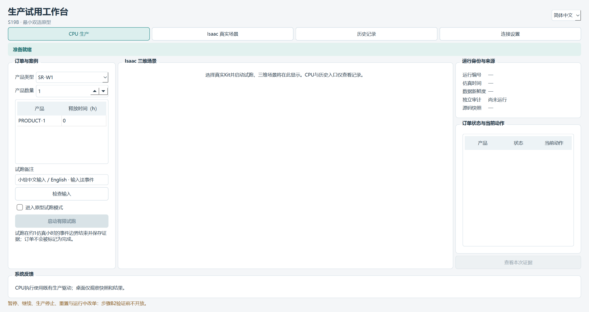
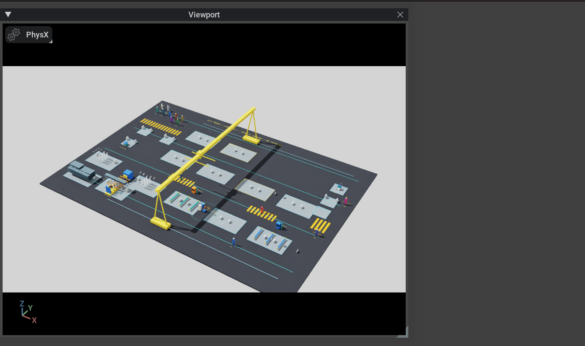

# S19B 步骤1：主界面内嵌真实Isaac视口

2026-10-11；PR174 / LOG237。按负责人的明确修订，方案B主桌面横向加宽，左侧订单与试跑输入、中央真实Kit原生子窗口、右侧状态与相机、下方系统反馈。Kit显示归属于同一个主窗口，随主窗口缩放和收起。当前 **EMBEDDED_MINIMAL_PROTOTYPE_VERIFIED_WITH_LIMITS / OWNER_REVIEW_PENDING / NOT_APPROVED / NOT_PUBLISHED**；仅步骤1修订，B1—B3未启动。原[r1](S19B_prototype_r1.md)和封包保留原字节，其独立场景窗口建议已由PR174覆盖。

## 打开与本次图证

从仓库在PowerShell7运行 `./scripts/start_s19b.ps1`，或使用已打开的修订工作台。选择Isaac入口、检查输入、进入原型试跑模式并启动。准备与完整说明见[桌面说明](../../desktop/s19b/README.md)，后续顺序见[步骤卡](../steps/S19B.md)。真实窗口在初始化阶段即可按当前运行身份挂接，生产状态仍须等待后端实际确认。

[英语控件布局](../sim/images/s19b/prototype-r2-embedded/workbench-en.png)与[只读历史入口](../sim/images/s19b/prototype-r2-embedded/history-zh.png)。这是实际Qt控件抓图；Qt普通抓图不保证包含GPU原生子窗口，不把空白区域声称为真实Kit显示失败或完整显示截图。

上图取自真实Kit交换链，包含其实际界面和视口；不是外置窗口或图片替代实现，也不是Qt与Kit合成的完整桌面图。[原USD视口截图](../sim/images/s19b/prototype-r2-embedded/production-scene.png)单列保存。原生父子关系、像素边界与实际相机输入另行核验；机器摘要见[JSON](S19B_prototype_r2.json)。Kit自身视口目前仍有少量标题/工具元素及停靠留白，布局效果待负责人实际体验审阅。

## 实际结果

最终ui-r9七组真实Qt/原生流程通过，独立父进程确认整个验证程序退出0；CPU和Kit子进程均实际退出0。两后端各117个捕获实现/视口/依赖文件与最终源码摘要逐项一致。

| 检查 | 实际结果与边界 |
| --- | --- |
| 双语、输入与历史 | Unicode粘贴/Qt输入法提交、语言切换保持草稿和身份、错误提示重翻译、无效输入拒绝、数量草稿及只读历史前后摘要保持 |
| 真实运行连接 | CPU/Kit均在1.0381202777777776h事件边界DECLARED_CHECKPOINT，执行/决策审计PASS；有限前缀，不是完整订单或新全链 |
| 主窗口嵌入 | 实际Kit HWND的父链到达Qt主窗口，IsChild成立；150%缩放下场景与host像素边界均为[540,390,1881,1185]，主窗口为[7,45,2489,1406] |
| 缩放与最小化恢复 | 缩小后host/场景均为[540,390,1671,1095]，恢复后两者重新一致，仍属原主窗口子窗口且可见 |
| 实际相机反馈 | Fork预设到独立显示相机的实际帧矩阵最大误差3.552713678800501e-15<1e-4；绑定运行/请求序列确认 |
| 嵌入视口输入 | 向已核验自有Kit子窗口发送合成焦点/鼠标/滚轮事件，实际渲染矩阵发生变化，最大元素差0.919780029987491；不是物理鼠标或负责人操作验收 |
| 退出与资源释放 | 检查点显示关闭、完整Kit关闭返回及Qt实际exit0回执；外部窗口包装释放，未将活Kit窗口重新置于桌面 |

9项桌面契约回归、Ruff/格式与独立依赖检查通过。新增Windows瞬时读分享冲突有界重试及持续拒绝失败回归，写入仍原子/有界；显示矩阵观察只在检查点阶段发布，节流为约5Hz，不进入规划事实或改变生产参数。

原r1完整根检查源码/隔离wheel各858项结果保持，本次核心/资产/根依赖文件原字节不变，没有重复运行不受影响的全量CPU检查。运行前字段及运行中只读范围保持，现有模型尺寸、碰撞、路线、手位、工时/容量/人因及获批人物/场景表现保持。

## 实现与失败保留

Windows使用[Qt QWindow.fromWinId](https://doc.qt.io/qt-6/qwindow.html#fromWinId)与[QWidget原生窗口容器](https://doc.qt.io/qt-6/qwidget.html#createWindowContainer)承载匹配运行/请求身份、worker PID与自有窗口标题的真实Kit窗口。消除顶层边框，Qt管理父子关系与容器；针对Kit/GLFW最小化恢复旧坐标，以当前容器原生坐标纠正。未增加Web三维、Qt到Isaac安装、流媒体或生产控制功能。

实际Kit MainWindow/DockSpace承载并停靠Viewport，隐藏Layer等编辑面板与原生菜单；保留专用显示相机及现有相机导航。原USD预设/生产实体不因显示操作改变。使用[Kit交换链捕获接口](https://docs.omniverse.nvidia.com/kit/docs/omni.kit.renderer.capture/latest/Overview.html)留证，GPU显示不以GDI或Qt控件抓图代替。

本轮窗口标题版本后缀识别、最小化恢复旧坐标、诊断矩阵扁平格式、精简Kit缺主布局/编辑面板遮挡、停靠API不匹配、状态读分享冲突等失败及首轮SDK原生/GDI抓图不完整诊断全部保留。早期启动时序挂接滞留假设未被最终证据支持，后续记录已纠正为实际恢复坐标问题；不把错误假设写成已证实根因。失败清理只针对本轮请求和启动时间匹配的已失败worker；最终验证不用强杀代替正常检查点退出。

## 限制与接续

当前为Windows单机/主屏150%原型；[跨进程DPI行为](https://learn.microsoft.com/en-us/windows/win32/api/winuser/nf-winuser-setparent)、多屏、真实鼠标/键盘、物理输入法候选及负责人任务体验仍需实际审阅。Qt/GDI抓图不完整或递归/黑区域只作为不可用诊断，不作完整窗口视觉通过。真实Kit窗口创建到检测挂接存在初始化交接，不承诺启动过程零闪现。

只跑有限前缀，事件边界运动学显示，非墙钟1:1连续生产动画。完整Kit关闭后显式结束helper、跳过该RC解释器最终收尾的原限制保持；不是B2生产停止。暂停/继续、用户生产停机、重置、运行中插单/改单/通用取消未开放；前端语义/性能规定负载对照未做。工业G2 OPEN/NOT_ESTABLISHED，S20—S28未启动。

负责人决定布局与步骤范围，AI辅助实现/验证；人工体验验收待负责人完成。目标仓库adaptive-hrc-scheduling、分支main，本包不提议新标签，拟远端操作为空，未暂存/提交/建标签/推送。

接续顺序：**本轮嵌入原型体验审阅 → B1双语信息审查 → B2最小控制与负例 → B3简中试用/英语演示及语义性能对照 → 确切成果验收与发布**。
