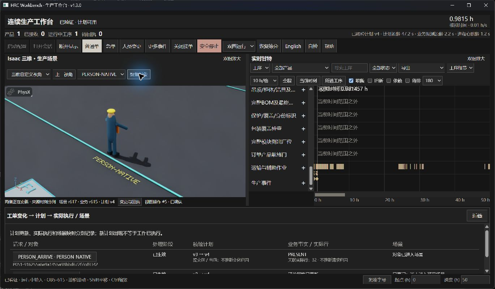
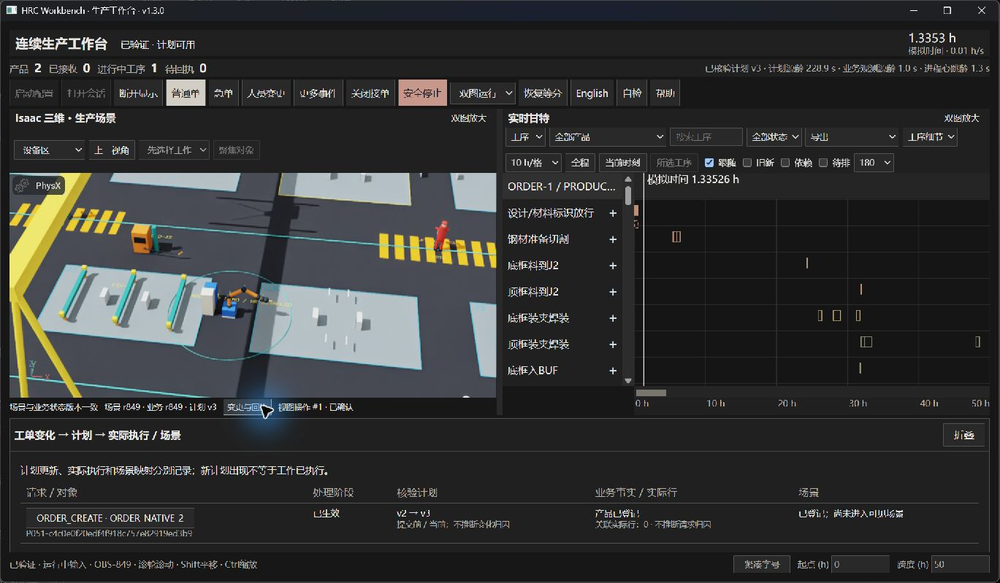
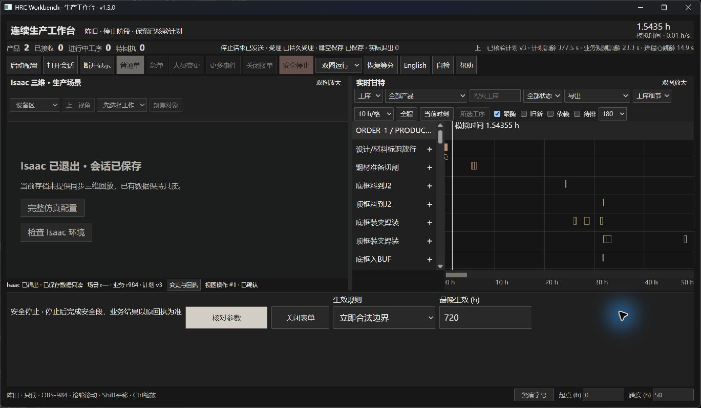

# v1.3.0 native-r2 原生验收与退出修复记录

状态：**LOCAL_REPAIR_VERIFIED / NATIVE_DIRECT_PICK_OPEN / NOT_PUBLISHED**。主要原生操作、退出修复和回归已有实际证据；三维直接点击/框选仍未通过，完整原生验收未关闭。版本为本地 v1.3.0 的 native-r2 修订，核心库仍为 0.1.0。

## 本次修复

1. **截图与关闭时序。** 旧路径只等待截图 future 和 PNG 写完，缺少渲染器异步捕获完成屏障。现在同时等待 `renderer_capture.wait_async_capture()`，超时取消未完成任务且不记成功；`SimulationApp.close()` 和实际进程退出仍被完整观测。已安装 Isaac 6.1 的 viewport utility 自身测试同样等待两级完成。未采用跳过清理或伪造退出成功的方法。
2. **重排错误拒绝。** 原生对照复现 `FULL_FROZEN_PREFIX_CHANGED`：已完成工序预计终点 0.5344861111111111 与实际回执 0.5344861111111108 相差约 3.33×10⁻¹⁶。已完成段按实际完成回执核对，运行段继续守住预测边界；已执行开始时间、操作、角色及实际事件前缀必须保持，篡改仍被拒绝。修复后工单与资源变更能够采用经独立核验的新计划。
3. **聚焦与选择。** 聚焦距离按实际视口比例与相机视锥计算，人员全身可见；关闭编辑操纵器，避免生产工作台暴露移动物体工具。显式声明选择扩展依赖，但原 Kit 已间接加载它，不能把这项配置称为直接点击的修复。
4. **表单与结束状态。** 变更目标按工单/人员/设备类别筛选，新建不要求已有目标；已观测的 EXITED/FAILED 不再被旧 STOPPED 控制记录覆盖，结束后显示已保存和只读状态。

## 实际原生操作

业务请求由原生 GUI 提交并确认，未以文件注入代替点击。完整请求、回执、运行身份和哈希见[机读证据](../delivery/v130_native_acceptance_r2.json)。两次修复运行分属早期修复包和最终 r6 运行时代码，不能误称所有操作都在同一次运行完成。

| 操作 | 实际结果与范围 |
| --- | --- |
| 双图布局、帮助、自检、分隔线、窗口缩放、全屏、中英文切换 | 原生截图留证；Isaac 与甘特保持共存。不是跨屏 DPI 或全部键盘路径验收。 |
| 甘特选择→场景对象、人员聚焦、返回视角 | 操作与视口结果留证；修复后聚焦不裁掉人员。 |
| 工单交期改为 600h、URGENT | GUI 请求 APPLIED；采用 v3 计划。 |
| PERSON-NATIVE 到岗 | APPLIED/PRESENT；人员进入可见场景，采用 v4。 |
| CUT1 故障 | APPLIED；新候选未获采用，保留 v4 并显示受阻状态，没有把失败候选当可执行计划。 |
| CUT1 维修，证据 ML-DEVICE | APPLIED；随后采用经核验的 v5。 |
| 新急单 ORDER-NATIVE-2 | 最终 r6 GUI APPLIED/REGISTERED，登记 PRODUCT-2，采用 v3。该产品当时尚未开工、不可见；不计作整单生产完成。 |
| 关闭接单 | 最终 r6 GUI APPLIED，intake_closed=true。 |
| 双图 PNG/PDF 导出 | 实际 GUI 导出，保留各自来源时刻；一页 A3 横向 PDF 经渲染检查，场景与甘特完整。 |
| 完整自检导出 | 0 FAIL、2 WARN：Isaac 前置检查不证明渲染、检查当时 worker 仍在运行。告警原样保留。 |
| 安全停止、保存、进程退出 | 两次修复原生运行均 STOPPED / save COMPLETE / audit PASS / closed=true / native exit 0。最终 r6 的界面正确显示已退出、已保存。 |
| 已保存会话只读重开 | 第一次修复原生会话已重开，计划 v5、1333 条当前区间；不新启动 Kit。 |
| 三维直接点击/双击/框选→甘特 | **OPEN**：未观察到选择变化。诊断订阅未收到左键事件，尚不能区分 Computer Use 输入投递和原生嵌入处理。隐藏编辑覆盖层无收益，试验代码已撤回。 |

## 退出结论与失败保留

旧无窗口运行 `P051-7febf2feb7884a9cb02e79b9daa36077` 已保存，却在 SDK `_app.shutdown()` 约 887 秒未返回，最后人工控制的终止导致 0xffffffff，closed=false。该失败保持。此次旧包原生对照正常退出，说明卡住并非每次必现。

修复后的两次原生运行分别为 `P051-fe9ee7c6dbd24bc7b5c10c64111c7668` 和最终 r6 `P051-cd5b424db17648e2bbc366c53d4b8d56`，均实际退出 0。两次无窗口退出检查也均正常；其中第一次操作驱动因试图聚焦未可见产品而 FAIL，只能计其停止/保存/退出通过，不能计完整流程通过。第二次改用可见人员后定位、聚焦、返回、截图和退出通过。另有已撤回的 r7 输入诊断运行正常退出，单独存证，不计最终候选验收。

遗漏的捕获完成屏障已有代码与 SDK 本地实现依据，修复后的关闭流程已有成功复验；旧 SDK 内部卡住的精确根因仍未单独证明。本次结果不保证所有硬件和驱动下永不出现退出卡住。

## 回归与交付身份

最终 r6 源码和隔离 wheel **各 1323 项通过**，分别耗时 1219.983 / 1222.967 秒；并行总验证阶段 1235.106 秒。锁文件、Ruff、格式、依赖一致性和历史字节契约通过。原测试身份与旧失败保留。交付候选只在受测 r6 基础上增加本记录、指南、截图、证据及相应旧版归档；运行代码和测试逐文件与受测 r6 比对，文档迁移后重跑字节契约。未把文档更新写回受测快照。

交付目录为 `交付/HRC-Workbench-v1.3.0-native-r2-20261113/`。`REVIEW.md` 提供入口，`ARTIFACTS.json` 与 `SHA256SUMS.txt` 记录最终包身份。Windows 包、完整源码、wheel/sdist、双图导出和验收证据分开。ZIP 全条目读取校验 CRC 与摘要；旧包保持。封包最终结果单独记录，本文不预写其成功。

## 尚未关闭

- **N01：直接三维鼠标选择。** 需要在原生场景内以实际鼠标点击可见人员，核对选择版本与右侧关联工作；若实际鼠标同样失败，再定位 Qt/GLFW 输入与 Kit 选择链路。本次自动化路径不足以给出结论。
- **N02：重排等待。** 最终急单一次候选计算约 455.922 秒，之后还需独立核验；属于可感知的体验问题。保留分阶段反馈与旧计划，不声称达到原性能目标。
- **N03：覆盖范围。** 未覆盖其他电脑、多屏 DPI、完整仅键盘流程以及每一种业务事件组合。停止时仍有未完生产义务；本次验证的是操作链和安全保存退出，不是 720h 全生产完成。

负责人 E12 仍为 OWNER_PENDING；组员电脑原报错仍需用同包自检在其机器核查。本次未连接真实工业设备，原研究结论、性能资格和其他既有未完成项保持。已关闭本轮全部原生窗口与自有 worker，无发布、推送、标签或远端 CI。
