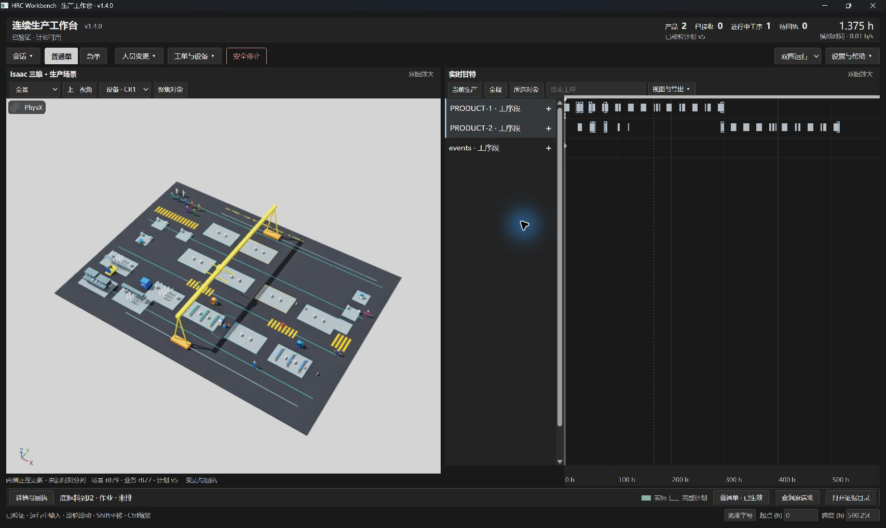

# v1.4.0 本地原生验收与修订记录

本机主要操作链路已通过，状态为 LOCAL_NATIVE_VALIDATION_COMPLETE_NOT_PUBLISHED。应用为 1.4.0，Python 核心库元数据仍为 0.1.0。最终候选保持 Isaac 与甘特并列，使用中性灰黑底色。未提交、打标签、推送、上传或启动远端 CI；旧包、失败记录及历史研究结果保留。

## 实际观察与修复

| 操作 | 观察结果与证据 |
| --- | --- |
| 三维点击 | 实际点击 CR1、OP1 与物料；共享选择关联到甘特。最终 CR1 对应 13 个工作区间。 |
| 框选与清空 | 实际正向/反向拖框、多对象选择、人员集合及空白清空；最终 r9 框选 32 个实体。 |
| 网页输入恢复 | 点击 Isaac 后可继续输入工单 ID；修复 Windows 原生子窗口与 Qt 网页焦点不一致。 |
| 改单 | r8 在已有实际开工前缀后修改 ORDER-1 为急单，交期保留 168 h，v2 核验通过。 |
| 设备故障及维修 | CUT1 故障生效，计划不可行时保留旧图且禁止执行；维修后 v3 通过核验。 |
| 缺勤及返回 | AF1 缺勤后隐藏；返回位置自动回填 CONTROL-AF1，返回生效并恢复可见，v2 核验通过。 |
| 新增与离岗 | V140-W1 到岗后在真实 USD 场景中出现，v3 核验；离岗后隐藏，v4 核验。 |
| 急单 | V140-FINAL-URGENT 实际提交并登记 PRODUCT-2，v5 完整核验通过。产品实际开工尚未在本次停止前发生。 |
| 双图导出 | 实际 GUI 导出 PNG 与 PDF；分别保留场景/甘特采样时刻、来源和摘要。 |
| 保存退出 | r9 安全停止、保存及 Isaac 退出 0；工作台随后实际退出 0。 |
| 只读重开 | 最终显示修正版读取最终存档并核验 v5，不启动 Kit，79 个原存档文件摘要保持；关闭工作台退出 0。 |

截图来自本地原生会话，未合成或改画。该图为 v5 采用后采样；新增产品已登记及排程，尚未物理开工。原图来源与 SHA256 见[图片来源](../assets/v1.4.0-native/provenance.json)。窗口使用 150% 系统 DPI，普通及最大化尺寸分别实际检查；不是多屏验收。

修复了嵌入窗口焦点、同帧按下/松开丢失、按钮事件坐标陈旧三类原生输入问题。现在按顺序保存鼠标移动，并以实际视口边界执行点击或矩形拾取。边界外起拖、跨尺寸变化和无效坐标拒绝。选择解析仍以已登记的实体关系为准。

时间边界修正针对 1e-8 h 既有容差内的浮点舍入：指令绑定实际观察时刻，冻结前缀精确保持实际开工/完工回执，角色和工序保持。实际前缀全等检查、执行回放及独立审计未取消。原 r6 多余重排与 r7 冻结前缀误拒绝保留，修复后 r8 改单、设备恢复及 r9 多次资源变更与急单均核验通过。

## 界面细节

主背景与表单恢复中性灰黑；网页、Qt 按钮/输入框和面板统一 3 px 圆角。滚动条端帽保留 8 px，其形状用途不同。少量灰蓝只表示选择与焦点，未作为大面积底色。Isaac 场景保留真实灰色环境。

改单读取现有交期和优先级；人员返回读取已核验位置，未知位置不可提交。核对页直接显示目标 ID。导出提示移至上方，避免遮住确认按钮。双图导出按场景缩放后的实际宽度分配空间。切换工序/概览或筛选后重置纵向位置，概览移除无效展开按钮，最终原生只读界面复验通过。

## 核验与性能

最终 Python 修订的源码与隔离安装 wheel 各完整运行 1,343 项，均无失败、无跳过，耗时分别 1,160.464 s 和 1,156.765 s；原 1,333 个测试身份全部保留。核心导入路径确认来自相应源码或 wheel，依赖、锁、Ruff、格式、字节契约检查通过。其后仅改 Timeline.jsx 的滚动定位/展开显示及构建产物，Python、原生脚本和测试文件字节保持；41 项前端检查和最终原生重开专项通过。不能把此前完整轮描述为后续显示改动后的新完整轮。

完整测试观察脚本曾因历史日志路径写错而退出，但两测试进程继续运行；独立进程句柄记录两个退出 0，完整日志和实际导入回执均保留。后续沙箱启动/解释器访问失败单列，获准的同一本地验证以正常进程重做，未改变断言或隐藏失败。

便携包 CPU 启动、计划、STOP、保存与实际退出在中文及空格路径通过。Isaac 前置自检无 FAIL，保留“自检不等于原生运行”的 scope 警告；原生实测另由本记录证明。组员电脑尚未复测。

| 测量 | 实际结果 | 解释 |
| --- | --- | --- |
| 固定输入五对交替对照 | 中位数 273.498 → 230.917 s，降低 15.57% | 绑定此前预检代码；一对慢约 37.2%；12 次含预热的计划/证明字节相同。 |
| r8 维修后重排 | 105.199 s | 单次原生功能验证，不是普遍性能基准。 |
| r9 人员返回/到岗/离岗 | 96.915 / 95.056 / 100.153 s | 同一连续会话内不同状态。 |
| r9 最后急单重排 | 391.935 s | 多次资源变化后的两产品完整重排；仍然较慢。 |

178,705,135 字节的最终存档逐包验证读取约需 7–8 分钟，期间界面保持可操作并显示进度；这项长存档读取性能仍需改进。60 s 和提速 50% 目标未达到。原性能图和研究数据未重画为新版成绩。

## 剩余范围与交付

Shift/Ctrl/Alt 持续按住再投递鼠标的组合，本轮工具不具备相应动作，只有事件映射检查；不记为实际鼠标通过。多屏、其他电脑及 E12 负责人本人连续操作仍待分别完成。新增急单产品的后续实物开工未推进到，人员显示/隐藏和设备状态已有实际场景证据。原手动 REST、在制品取消、J3 HOLD、K01、E20 四件全签收 NOT_MET 及工业性能资格范围保持。

完整英文与中文研究报告保留五章、原表图/公式/文献和贡献声明，更新封面并增加附录 D；旧 W5 报告不覆盖。发布候选包含便携包、完整源码/差异包、wheel/sdist、双语完整 PDF/DOCX 和闭合摘要。公开附件与本机验收日志分开，内部治理原件留本机。发布脚本按确切候选摘要、原 HEAD/索引、四轮实际远端 CI 和附件摘要设置门禁；本轮不执行这些发布动作。

机读事实：[v140_native_acceptance_r1.json](../delivery/v140_native_acceptance_r1.json)。使用方法：[中文指南](../releases/v1.4.0-user-guide.zh-CN.md)、[English guide](../releases/v1.4.0-user-guide.en.md)。
