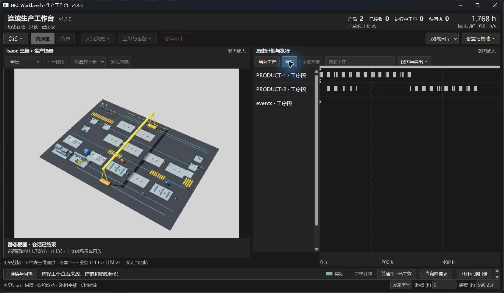
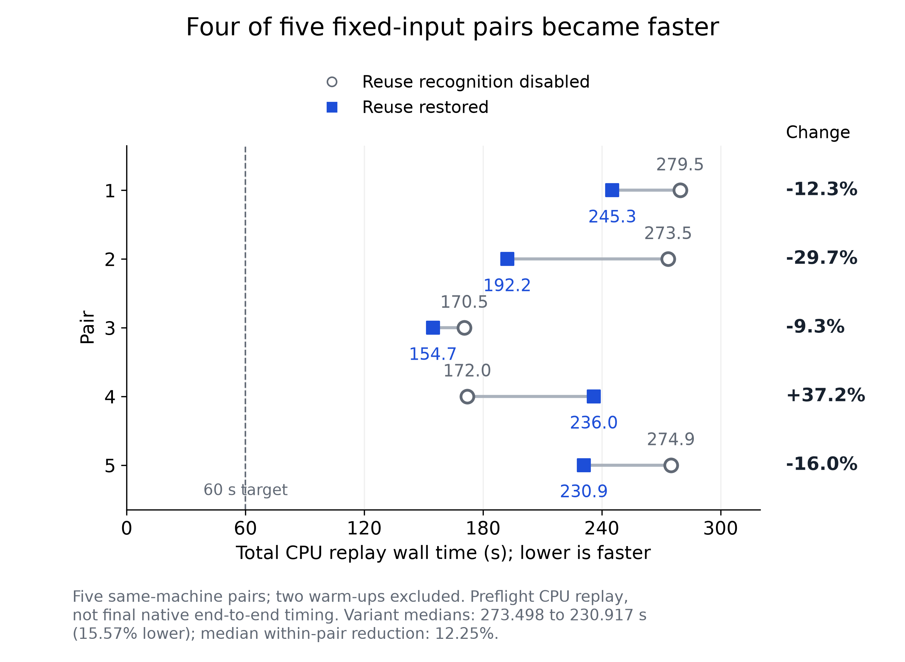

# v1.4.0 截图与数据图复核

本轮仅更新展示材料并核对既有数据，没有启动新的生产、Isaac、求解或性能测量。原 r3 审阅包完整保留，后续文档候选另封包，暂不发布。

## 截图更新

| 位置 | 发现 | 处理 |
| --- | --- | --- |
| 双语 README 主图 | 来自 r9 实时验收，早于最后的概览滚动和展开控件修正 | 换用最终显示版 r10 的原生只读重开截图；完整存档已载入，计划 v5 已核验。 |
| 实时生产证明 | 最新界面截图是只读状态，不能冒充正在运行的 Isaac | 原 r9 实时图原样保留并注明时序，作为另一条证据。 |
| 报告正文图 4-1 | 属于历史研究及原始工作台记录，图注已说明范围 | 保留原图及原图注；不以新会话图覆盖旧实验依据。 |
| 报告附录 D | 只有新版操作与测量文字，缺少最终界面图 | 增加图 D-1 展示最终界面，图注明确左侧是保存末帧。 |
| 点击、框选、故障、返回等过程图 | 分别绑定实际操作及观察状态 | 保留原始截图；不使用另一时刻的截图替换这些过程证据。 |

这张图的存档已完整载入，状态修订 1133、模拟时刻 1.768397222222222 h。场景末帧在界面中有明确标注，不是实时渲染或三维回放。核对的 202 个运行源码文件与最终 r3 相同。图片仅复制原始文件，没有重绘、修图、伪造状态或提高分辨率。

## 原科研数据与四幅主图

187 个分析、输入、结果和图文件与已发布源码逐字节保持。重新运行公开数据的离线再生入口，全部 12 个研究单元通过；9 张 CSV、数值 JSON 总表和四幅图的 12 个 PNG/SVG/PDF 输出逐字节相同。

再生清单中的输出目录、验证回执路径和相应摘要随新目录变化，未把这些元数据文件冒称逐字节相同。研究数值和图像内容则没有变化。本轮没有用 1.4.0 重新运行原生产实验，原研究图仍只支持其原受测版本的结论。

| 原图 | 本轮结论 |
| --- | --- |
| 机制分支人时与整模块结果 | 保留；原收益和无收益情况均未改变。 |
| E20 工单事件链 | 保留；不能用新急单的计划登记替换历史实际开工、接收和右截尾证据。 |
| 活动时间与模型暴露构成 | 保留；两个分母不变，无需重算配色或重画相同柱状图。 |
| 首日疲劳及新增暴露 | 保留；原恢复折点、积分和时间窗口均通过复算。 |

## 有必要增加的工程图

新增一幅五对固定输入回放耗时图，提供中英文 PNG/SVG/PDF、CSV、测量说明和重建脚本。它补充原单一百分数无法表达的波动：四对更快，一对更慢；全部样本可见。

| 统计口径 | 复核结果 |
| --- | --- |
| 两组总墙钟耗时中位数 | 273.498 → 230.917 s，中位数之比降低 15.57%。 |
| 五个逐对百分比降幅的中位数 | 12.25%；与中位数之比是不同估计量。 |
| 第四对 | 171.990 → 235.962 s，变慢 37.20%；保留，不排除。 |
| 进程峰值工作集中位数 | 2.473 → 2.023 GiB，降低 18.21%；仅限此预检进程，不是 Isaac 内存需求。 |
| 结果一致性 | 含两次预热的 12 次运行计划字节、解压证明字节和 513.2668305555555 h 完工时刻相同。 |

这组对照在同一插桩候选中切换复用识别，以复现原复用失效路径；不是直接比较两个已发布 EXE，也不是最终原生端到端性能。数据绑定此前预检源码身份，早于后续时钟边界修复。60 s 与提速 50% 目标仍未达到。

原生会话中的维修、返回、到岗、离岗和急单耗时分别为 105.199、96.915、95.056、100.153、391.935 s，经最终预算记录复核。它们的产品数量、人员与设备状态不同，继续用表格呈现；不画成“急单更慢/某功能更快”的提速对照。新增急单产品在停止前尚未物理开工，仍不能增加一张暗示完整产品已经执行完成的图。

依据与复现：[机读核查](../delivery/v140_visual_data_audit_r1.json)、[完整五对数据及绘图入口](../../figures/v140/README.md)、[原生验收记录](UX_v1.4.0_native_validation_r1.md)。

## 图示样式修正

按负责人要求，新增性能图改为与原 P07 科研系列一致的白底、DejaVu Sans 字体、灰色空心圆、蓝色方块、连接线、标题与图例层级。绘图脚本直接读取原 `presentation_figures.py` 中的样式和配色，原脚本不改。图内全部使用英文，中英文自述和报告共用同一张英文图；原 r4 的中文/灰黑图及审阅包留存，退出当前展示。全部测量、统计口径和慢样本保持不变。
