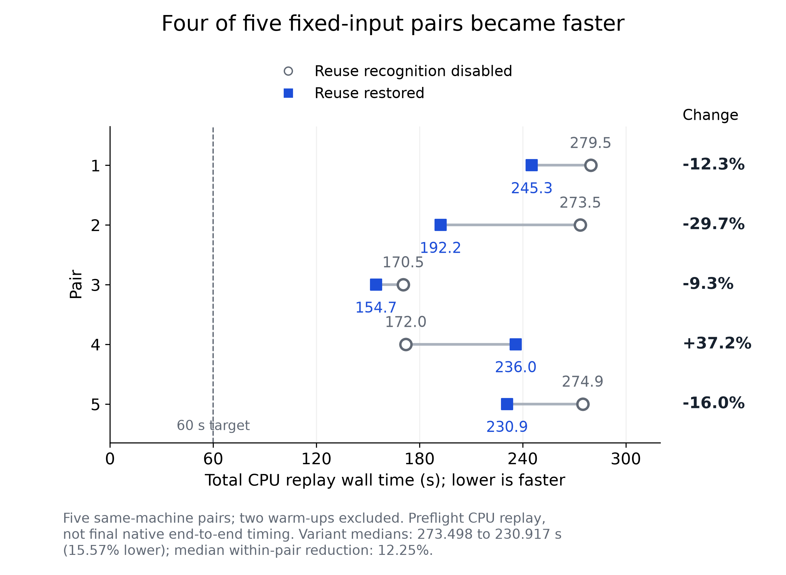

# Version 1.4.0 engineering figure

This English figure exposes all five previously measured fixed-input CPU replay pairs. It does not compare two released executables or establish final native end-to-end timing. Two warm-ups are excluded. One pair became slower and remains visible. All twelve runs retain identical plan and decompressed proof bytes and the same completion time.

[CSV](paired-replay.csv) · [Measurements and provenance](paired-replay-data.json) · [Export hashes](figure-manifest.json)

The 15.57% figure is the reduction calculated from the two variant medians. The median of the five paired reductions is 12.25%. Peak-working-set medians decreased from 2.473 to 2.023 GiB (18.21%) in this preflight setup; it is not an Isaac memory qualification.

Rebuild with the pinned packages in `../../analysis/p07/requirements.txt`, then run `python figures/v140/build_figure.py`. The builder reads the existing style and palette from `../../analysis/p07/presentation_figures.py`: DejaVu Sans, white background, gray open circles, blue squares, matching line weights, title, legend and footer hierarchy. PNG, SVG and PDF are English exports of the same figure, shared by both report languages. No new production or benchmark execution is performed by this builder.

中文：原四幅科研图的数据和导出内容保持一致。新增图继承原科研图样式，图内统一使用英文，中英文报告共用；全部五对观测、慢样本、预检范围和统计口径保持。
