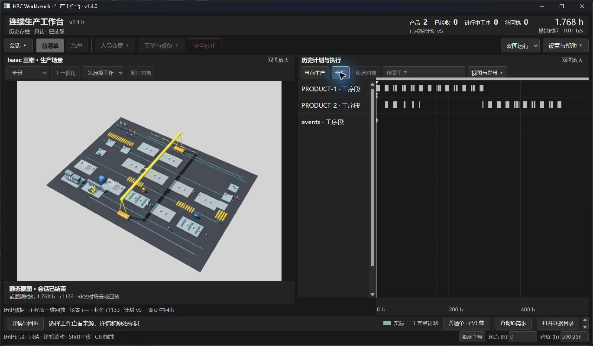
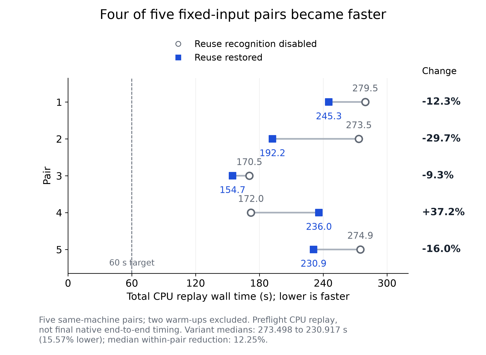

# Appendix D Version 1.4.0 workbench validation

## D.1 Full simulation and the workbench

Version 1.4.0 keeps the Isaac production scene and the Gantt chart visible together. The scene represents the executed physical state, including workers, equipment, materials and transport. The chart separates actual intervals from independently verified future plans. An accepted order changes the business catalog first; a new plan and subsequent physical execution follow through separate recorded stages. A new bar in a plan therefore does not imply that its product has already appeared in the scene.

This update concerns local engineering validation and release preparation. The research chapters, original figures, numerical results, equations and contribution statement are retained. Appendix C records the earlier W5 version and its own measurements. The application version is 1.4.0; the Python library metadata remains 0.1.0. The candidate has not been published.

The interface uses neutral charcoal surfaces, a consistent 3 px control radius, restrained selection outlines and distinct actual and planned bars. The split can favor the scene or the schedule without removing either view. Forms and change receipts occupy a separate lower area. Diagnostics identify missing dependencies and files before launch; their success does not substitute for a functioning native renderer. Chinese and English remain available, and native confirmation buttons follow the selected language where the installed Qt translation provides them.

## D.2 Selection and input across the native window

Actual mouse acceptance exposed three problems that offscreen layout checks could not reveal. Embedded-window focus was not reliably transferred to Isaac. Fast down and up events could be consumed in one frame without the default selection gesture observing a drag. In a batched input update, button-event coordinates could describe the final pointer position rather than the position at the press. These failures were retained as separate observations before repair.

The workbench now tracks ordered pointer-move events, binds a press to the actual viewport bounds and sends a completed click or rectangle to the viewport picking API. A drag that begins outside the scene or spans a resize is rejected. Selection resolves through registered scene entities and operation relationships. It does not infer business ownership from names. Clicking empty space clears the previous selection; selecting objects does not move the camera. Focus and previous-view controls provide explicit camera navigation.

The return path also needed repair: after clicking Isaac, Qt could report a focused web input while Windows still sent keystrokes to the child renderer. A mouse press in the workbench input area now restores focus to that application's web view. Native acceptance confirmed typing after scene interaction. Order edits populate the selected order's current due date and priority, preventing a fixed default from silently changing another field. Export feedback was moved above the work area so that it does not cover the confirmation buttons. Same-ID return now displays the person’s last verified location, avoiding rejection caused by the former fixed F1 default.

Actual local input selected the crane CR1, the person OP1 and registered material objects, performed forward and reverse rectangles, and cleared selection on empty space. The final r9 rectangle selected 32 entities; a direct CR1 click linked 13 work intervals. Window resizing and 150% system DPI were observed. The available input API cannot hold modifier keys while injecting mouse input, so Shift/Ctrl/Alt mouse combinations remain mapping-tested rather than natively accepted. A final display-only follow-up resets vertical scroll when changing view or filter and removes inactive overview expand controls; read-only native reopening verified that correction.

## D.3 Replanning time and numerical boundaries

The performance change restores safe reuse through the native timing wrapper and limits geometry preparation caching to one replay invocation. Configuration and immutable records can be shared only under the checked reuse contract; mutable execution and request state remain private. Full execution replay, causal audit, actual-prefix preservation and independent display verification remain required.

The earlier fixed-input preflight used one warm-up followed by five alternating pairs on the same machine. The comparison disabled recognition of the trusted timing wrapper in the same instrumented candidate to reproduce the lost-reuse path. It was not a direct comparison of two released executables. Median total wall time fell from 273.498 s to 230.917 s, a reduction of 15.57%. One pair became slower by about 37.2%; shared-machine variation was substantial. All twelve warm-up and measured runs retained identical plan bytes, decompressed proof bytes and completion time. The completion time was 513.2668305555555 simulated hours. The proposed 60 s and 50% improvement targets were not achieved. These measurements belong to that preflight source identity, before the subsequent clock-boundary corrections.

Native acceptance then revealed an avoidable additional solve. A planned boundary at 0.5344861111111111 h arrived as 0.5344861111111108 h. The policy already treated this difference as within its 1e-8 h boundary tolerance, but dispatch still received the predicted clock and rejected it against the exact observed clock. The resulting execution-deviation replan took 366.102 s in that particular native session. Commands within the existing tolerance now bind their issue time to the delivered observation; materially early or late commands retain the original wait or replan behavior.

A follow-up order edit exposed the same distinction in frozen-prefix comparison. Nine executed starts differed from the original predictions by only 2.22e-16 to 3.33e-16 h. The replacement plan retained those actual receipts, yet the comparison required the old predicted starts. The repaired check requires exact agreement with the actual start receipt, agreement with the prior prediction within the existing dispatch tolerance, unchanged operation and roles, and exact completed-end receipts. A running end may inherit the same bounded clock roundoff. The separate actual event-prefix equality check and independent audits remain unchanged. Regression cases reject altered receipts, material time shifts, changed operations and changed roles.

The repaired core passed an order change after executed work, CUT1 failure and repair, AF1 absence and same-ID return, V140-W1 arrival and departure, and a final urgent order. Repair replanning took 105.199 s in r8. Return, arrival and departure in r9 took 96.915, 95.056 and 100.153 s. The final urgent request registered PRODUCT-2 and produced independently verified plan v5 after 391.935 s. These are different states in continuous local sessions, not paired speed comparisons. The new product had not physically started before safe stop; registration, verified scheduling and visible execution remain distinct facts.

## D.4 Saving and reproducibility

Safe stop separates submission, durable acceptance, draining active work, saving and observed process exit. A disappearing window is not evidence of a successful save. An ended session displays a verified final screenshot with its sampling time and an explicit static-image label. Read-only reopening verifies saved plans and does not start Isaac or modify the archive.

The final native session saved at approximately 1.768 simulated hours. Both Isaac and the workbench returned exit code 0. Reopening its archive in the final display revision independently verified v5 without launching Kit; hashes of all 79 saved files were unchanged. The reopened application also exited 0. Dual PNG and PDF export was exercised through the native interface, with separate scene and schedule timestamps. The 178.7 MB timeline took about 7–8 minutes to validate incrementally while the interface remained usable; long-archive loading performance remains a limitation.

The final Python revision passed all 1,343 tests from source and all 1,343 from an isolated installed wheel, in 1,160.464 s and 1,156.765 s, respectively, with no failures or skips. All former 1,333 identities were retained and imports were checked against the intended installation. A subsequent change affected only timeline scrolling, overview controls and the frontend bundle; Python, native scripts and tests remained byte-identical. All 41 frontend checks and the final native reopening follow-up passed. The portable CPU flow also started, planned, stopped, saved and exited 0 from a Chinese path containing spaces. Release-gate simulations passed 29 cases without real Git writes.

The release preparation binds the portable runtime, wheel, source archive and report inputs to explicit hashes. Public checksums cover the proposed public payload only; private machine logs and internal governance files remain outside that payload. Publication, remote CI and anonymous download verification are future operations and are not counted as completed here.

## D.5 Interpretation and remaining scope

The useful result is a functioning local path from order input through independently checked scheduling to physical scene execution, with both views available for inspection. It does not establish a general planning-time guarantee. Native operation and fixed-input performance comparisons answer different questions, and neither establishes industrial real-time qualification.

The original research findings and unfavorable outcomes remain unchanged. Owner-operated E12 and another teammate's machine validation remain outstanding. The earlier 2 s source-age, sustained 4 Hz, 10/s and 50/s rate qualifications retain their original limits. E20 keeps its accepted split scope and original all-four-received NOT_MET result. In-process cancellation, J3 HOLD, manual REST, K01 diagnosis and other recorded limitations retain their established scope. The contribution and AI-assistance declaration in Appendix B applies to this update.

[PAGEBREAK]

## D.6 Current images and the data audit

Figure D-1 shows the final display revision actually reopened in the native application. The entire archive had loaded at state revision 1133 and simulation time 1.768397222222222 h. The saved scene frame is explicitly labelled; this is not live Isaac execution or a 3D replay. All 202 compared runtime source files match the final candidate. The earlier r9 live image remains a separately labelled acceptance record, before the scroll and overview-control correction. Figure 4-1 retains its historical source and claim.

Figure D-1. Final version 1.4.0 display, captured during actual read-only reopening. The saved Isaac frame and independently verified v5 Gantt plan remain together. The unaltered original PNG is supplied at its native resolution.

The audit found no changed historical research data: 187 analysis, input, result and figure files match the published source. Offline recomputation of all twelve research units reproduced nine CSV tables, the numerical JSON table and all twelve PNG/SVG/PDF outputs of the four research figures byte for byte. This is a recomputation of recorded experiments, not a new production run of version 1.4.0. The original research figures therefore remain unchanged.

[PAGEBREAK]

The new engineering figure shows every measured pair rather than only a single percentage. Five same-machine pairs alternate the order of restored and disabled reuse recognition; the two warm-up runs are excluded. Four pairs are faster and one is 37.2% slower. These are the previously recorded instrumented CPU replay observations described in Section D.3, before the later clock-boundary repairs.

Figure D-2. All five fixed-input preflight pairs. Gray open circles indicate disabled reuse recognition and blue squares indicate restored reuse. Change is (restored / disabled − 1) × 100%. Pair order is restored then disabled for pairs 1, 3 and 5, and reversed for pairs 2 and 4. No confidence interval or smoothing is inferred from these same-machine observations.

The two variant medians are 273.498 s and 230.917 s; their ratio gives a 15.57% reduction. The median of the five within-pair percentage reductions is 12.25%, a different estimator. The measured process peak-working-set medians are 2.473 GiB and 2.023 GiB, an 18.21% decrease under this preflight setup. These memory observations do not establish the final Isaac process memory requirement. All twelve runs including warm-ups retain identical plan bytes, decompressed proof bytes and the completion time of 513.2668305555555 h. Different native request scenarios remain separate table entries; they are not plotted as a speedup comparison.
