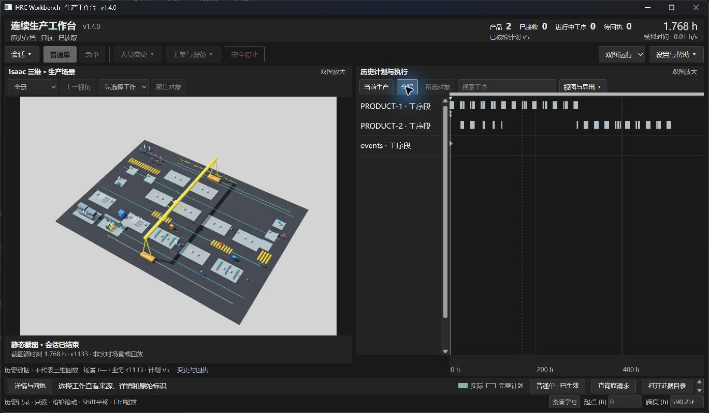
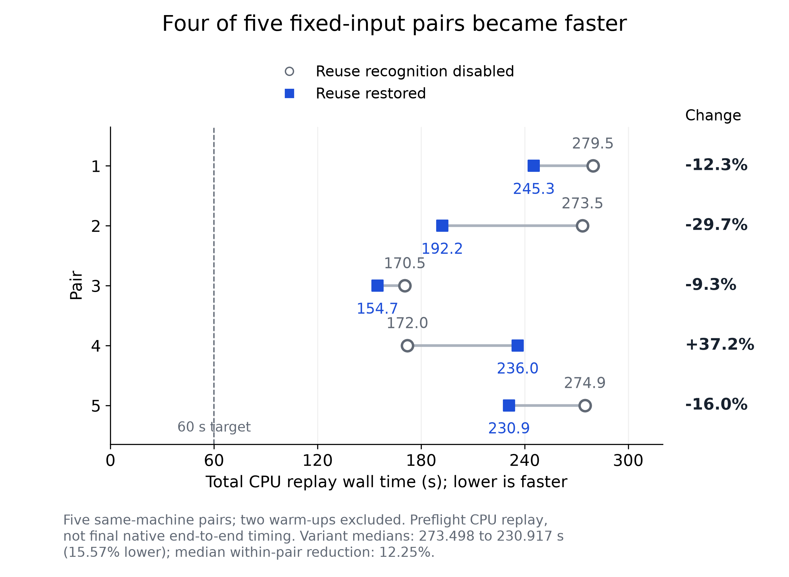

# 附录 D 1.4.0 版工作台验证

## D.1 全仿真与工作台

1.4.0 版持续并列展示 Isaac 生产场景与甘特图。场景反映人员、设备、物料和运输等已执行的物理状态；甘特图区分实际区间与经过独立核验的未来计划。工单被接纳后先更新业务目录，新计划及后续物理执行分别留下记录。因此，新计划出现一条工序，不等于相应产品已经进入场景。

本次更新记录本地工程验证与发布准备。原研究章节、图表、数值、公式和贡献声明保持；附录 C 继续记录此前 W5 版本及其自身的测量结果。应用版本为 1.4.0，Python 核心库元数据仍为 0.1.0。本候选尚未发布。

界面使用中性灰黑背景，控件圆角统一为 3 px，以少量轮廓色表示选择，并区分实际与计划甘特条。分栏可以侧重场景或排程，两图始终保留。表单和变更回执在底部独立区域展开。启动自检指出缺失依赖和文件，但自检通过不能代替原生渲染运行。界面保留中英文，原生确认按钮在所安装 Qt 译文覆盖的范围内随语言切换。

## D.2 原生窗口的选择与输入

真实鼠标验收发现了离屏布局检查无法揭示的三个问题：嵌入窗口未可靠获得焦点；快速按下和松开可能在同一帧内完成，默认选择手势未观察到拖动；一批输入事件中的按钮坐标可能指向最终位置，而非按下时的位置。修复前的失败均单独保留。

工作台现在按顺序记录鼠标移动，将按下位置绑定到实际视口边界，并把完整的点击或矩形交给视口拾取接口。视口外起拖、拖动期间视口尺寸改变等情况会被拒绝。选择通过已登记的场景实体和工序关系联动，不按名称猜测业务归属。空白点击清除旧选择；选择不移动相机，观察位置由聚焦和上一视角控件调整。

输入返回工作台时也存在焦点问题：点击 Isaac 后，Qt 可能认为网页输入框已获得焦点，而 Windows 仍把按键交给子渲染窗口。现在点击工作台输入区域会恢复本应用网页视图的焦点，原生验收已确认场景操作后可以输入。修改工单时，表单回填该工单的现有交期和优先级，避免固定默认值误改其他字段。导出提示移至工作区域上方，防止覆盖底部确认按钮。人员返回表单从已核验状态读取该人员离开时的位置，避免固定 F1 默认值导致返回请求被拒绝。

{{NATIVE_SELECTION}}

## D.3 重排耗时与数值边界

性能改动恢复原生计时封装下的安全复用，并把几何准备缓存限制在单次回放内。配置与不可变记录只能在复用契约检查通过时共享，可变执行状态和请求状态仍独立。完整执行回放、因果审计、实际前缀保持及独立展示核验继续执行。

此前固定输入预检在同一台机器上先预热，再交替执行五对对照。对照在同一插桩候选中禁用可信计时封装识别，以复现复用失效路径，并非直接比较两个已发布可执行文件。总墙钟中位数从 273.498 s 降至 230.917 s，降低 15.57%；其中一对反而慢约 37.2%，共享机器波动较大。含预热在内的十二次运行保持计划字节、解压证明字节与完工时刻完全相同，完工时刻为 513.2668305555555 模拟小时。60 s 与提速 50% 的拟定目标未达到。这组结果绑定预检源码身份，早于后续时间边界修正。

原生验收进一步发现一次可避免的额外求解。计划边界 0.5344861111111111 h 实际到达时为 0.5344861111111108 h。策略已按既有 1e-8 h 容差认定到达边界，但派发仍使用预测时刻，因无法精确匹配观察时刻而被拒绝。该会话因此触发执行偏差重排，耗时 366.102 s。现在，既有容差内的指令以实际观察时刻签发；实质性提前或滞后仍按原规则等待或重排。

后续改单又在冻结前缀比较中暴露了同一差别。九条实际开工与原预测仅相差 2.22e-16 至 3.33e-16 h，新计划保持了实际回执，比较却要求恢复旧预测时刻。修复后的检查要求新计划精确匹配实际开工回执、实际与旧预测之差不超过既有派发容差、工序及人员角色不变，并精确保持完工回执。尚在运行的结束预测允许继承同样受限的时间舍入差。独立的实际事件前缀全等检查和审计没有改变。回归反例继续拒绝回执篡改、实质性时间位移、工序变化和角色变化。

{{NATIVE_PLANNING}}

## D.4 保存与复现

安全停止分别记录提交、持久接纳、活动工作排空、保存和实际进程退出。窗口消失不能证明保存成功。结束会话展示经过摘要核对的末帧，明确标注采样时刻和静态截图。只读重开核验已保存计划，不启动 Isaac，也不改写存档。

{{NATIVE_EXIT}}

{{CHECKS}}

发布准备以明确摘要绑定便携运行时、wheel、源码包及报告输入。公开校验清单只覆盖拟公开载荷，本机日志和内部治理文件不进入该载荷。发布、远端 CI 与匿名下载核验属于后续操作，本报告不将它们记为已完成。

## D.5 结果解释与剩余范围

本轮的有效结果是本机工单输入、独立核验排程与物理场景执行之间的可检查链路，两图始终可见。这不构成普遍的重排耗时保证。原生操作和固定输入性能对照分别回答功能与耗时问题，两者均不足以建立工业实时资格。

原研究结论及不利结果保持。E12 负责人本人连续操作和其他组员电脑复测仍待完成。原 2 s 源龄、持续 4 Hz、10/s 与 50/s 速率资格保持原有限范围；E20 保留已接受的拆分范围及四件全签收 NOT_MET 结果。在制品取消、J3 HOLD、手动 REST、K01 根因及其他已登记限制保持。附录 B 的个人贡献与 AI 辅助声明同样适用于本次更新。

[PAGEBREAK]

## D.6 最新图示与数据复核

图 D-1 为最终显示修订在原生应用中实际只读重开的画面。存档已完整载入，状态修订为 1133，模拟时刻为 1.768397222222222 h；场景末帧有明确标注，不是实时 Isaac 执行或三维回放。核对的 202 个运行源码文件均与最终候选一致。较早的 r9 实时生产图另行标注保留，其后仅修正滚动与概览控件。正文图 4-1 继续保留原历史来源及结论范围。

图 D-1. 1.4.0 最终显示版的原生只读重开实测。已保存的 Isaac 场景末帧与独立核验的 v5 甘特计划同时显示。未经改动的原始 PNG 按其原生分辨率随包提供。

复核未发现历史研究数据改变：187 个分析、输入、结果及图文件与已发布源码一致。全部十二个研究单元离线重算后，九张 CSV、数值 JSON 总表及四幅研究图的十二个 PNG/SVG/PDF 导出文件均逐字节一致。这是既有实验记录的重算，不是使用 1.4.0 新跑的生产实验，因此原科研图保持原样。

[PAGEBREAK]

新增工程图展示每一对实测值。五对同机测量交替安排复用识别禁用和恢复复用的运行顺序，两次预热不纳入统计；其中四对更快，一对反而慢 37.2%。它们仍属于 D.3 所述的既有插桩 CPU 回放预检，早于后续时间边界修正。

图 D-2. 固定输入预检的全部五对测量。灰色空心圆表示复用识别禁用，蓝色方块表示恢复复用；变化为（恢复 / 禁用 − 1）× 100%。第 1、3、5 对先恢复后禁用，第 2、4 对顺序相反。没有从这些同机观察推断置信区间，也未平滑或排除慢样本。

两组耗时中位数为 273.498 s 和 230.917 s，中位数之比给出 15.57% 的降幅；五个逐对百分比降幅的中位数则为 12.25%，二者统计口径不同。该预检中进程峰值工作集的中位数为 2.473 GiB 和 2.023 GiB，下降 18.21%；这不代表最终 Isaac 进程的内存需求。含预热的十二次运行仍保持相同的计划字节、解压证明字节和 513.2668305555555 h 完工时刻。不同原生请求情景继续分别列于表中，不把它们画成提速对照。
